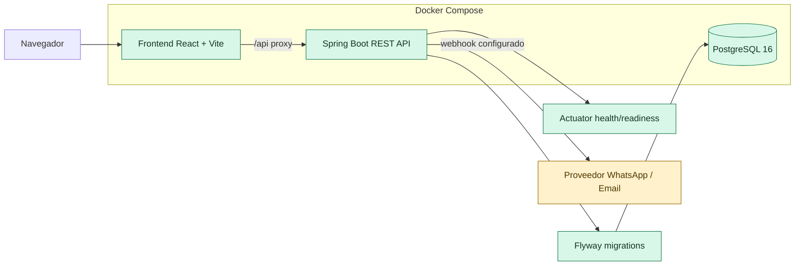
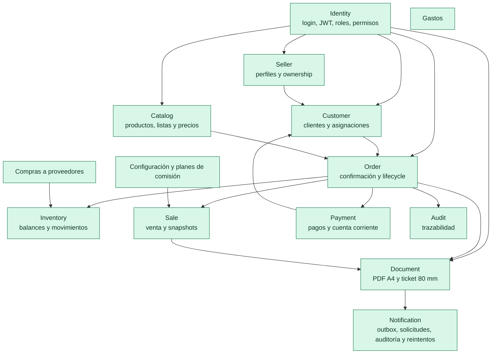
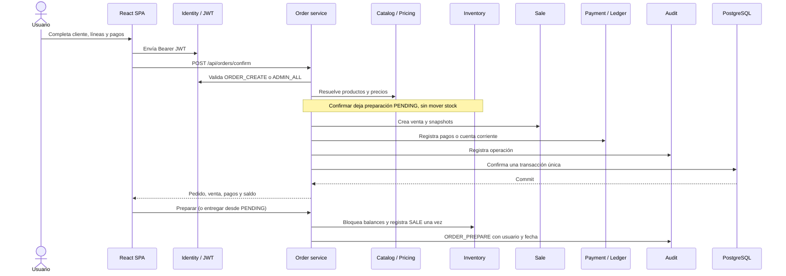
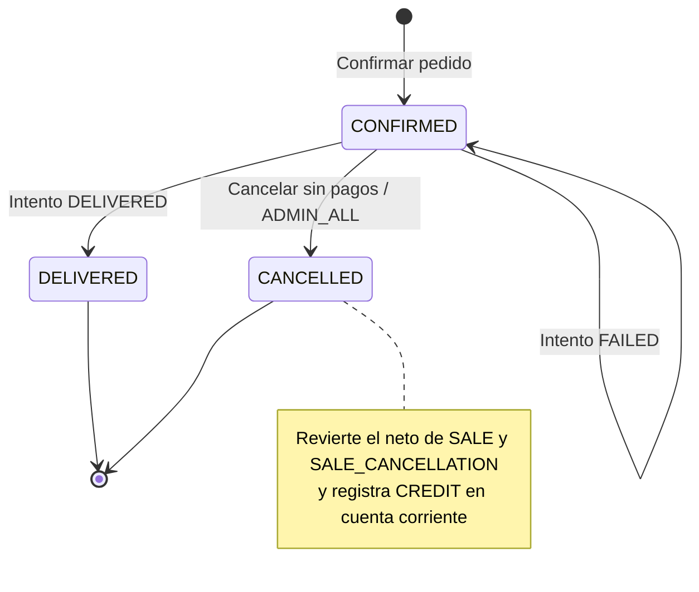
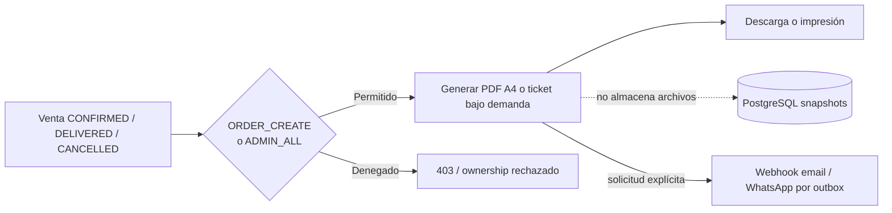
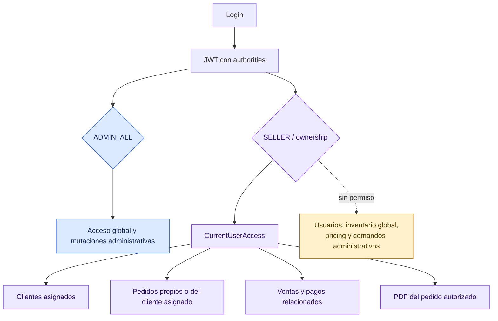

# Estado Actual Del Programa

Estado relevado: 2026-11-25. El esquema llega a Flyway V65.

Este documento usa Mermaid para mostrar cómo quedó el sistema después de los
bloques implementados. Las líneas punteadas representan capacidades previstas
pero todavía no implementadas.

## Despliegue

## Módulos Implementados

## Confirmación Y Venta

## Lifecycle Y Documentos

## Autorización Y Ownership

## Calidad Estática, Refactor Y Pendientes Post-Fases

- **Backend (`V65`, Java 21 / Spring Boot):** gates Maven en `verify` con
  Surefire (`*Test`), Failsafe (`*IT`), Checkstyle, SpotBugs, JaCoCo y
  ArchUnit (`ModuleBoundaryTest`). Zona horaria comercial centralizada en
  `BusinessTime`/`TimeConfig`, resolución de actor en `CurrentUserAccess` y
  servicios grandes descompuestos (`ReadQueryService` en servicios por
  dominio, `OrderEditService`, `OrderCancellationService`, `SellerQueryService`).
- **Frontend (React + TypeScript + Tailwind v4):** `Pagination` compartido,
  `shared/format.ts` y `shared/dates.ts`, `queryKeys` jerárquicas con
  invalidación por dominio, lazy loading de rutas, descomposición de
  `OrderForm`/`PriceListsPage`/`ProductsPage` y retiro de pantallas legadas
  (`PaymentsPage`, `InventoryPage`).
- **Pendientes diferidos fuera de código:** credenciales externas de
  webhooks WhatsApp/Email por entorno, definición funcional de `DOM-M1`
  (notas de crédito en devoluciones de ventas pagadas) y auditoría previa en
  producción antes de planificar una migración `V66`.

## Leyenda

- Verde: implementado y probado.
- Azul: acceso administrativo global.
- Violeta: ownership seller.
- Amarillo: pendiente o previsto.
- Flecha continua: dependencia o flujo implementado.
- Flecha punteada: integración o funcionalidad pendiente.
