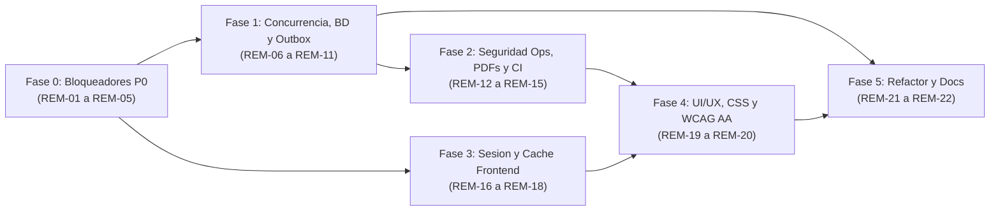

# Plan de Remediación y Hoja de Ruta — Distribuidora

**Fecha:** 2026-11-24  
**Documento base:** [`system-audit-2026-11-24.md`](system-audit-2026-11-24.md)  
**Cobertura:** **90/90 hallazgos** (`20` Críticos, `38` Altos, `28` Medios, `4` Bajos) organizados en **22 tareas ejecutables (`REM-01` a `REM-22`)** distribuidas en **6 fases (Fases 0 a 5)**.

## Seguimiento de ejecución

| Fase | Implementación verificada | Pendientes para el cierre |
|---|---|---|
| 0–1 | Se ejecutó la suite completa con PostgreSQL 16 después de aplicar las correcciones de autenticación, autorización, concurrencia, consultas, migraciones y outbox (`V61`–`V65` sin alterar `V1`–`V60`). | Medir planes de consulta (`EXPLAIN`) y concurrencia con un volumen representativo del entorno productivo. `DOM-M1` sigue diferido según la sección 5. |
| 2 | Imágenes y Compose, configuración de seguridad, exportaciones PDF incrementales, restauración cifrada, workflows de CI, gates estáticos de Java (`Checkstyle` 0 y `SpotBugs` 0 en `verify`), cobertura con `JaCoCo` (347 clases) y perfil `Failsafe` (`**/*IT.java`) configurado. Se verificó el aislamiento de sesiones y datos en A/B. | Confirmar la primera ejecución remota de GitHub Actions tras push (y optar, si se desea, por renombrar pruebas Postgres a `*IT.java` para separarlas de `Surefire`). |
| 3 | Renovación y expiración de sesión, limpieza de caché, almacenamiento por instancia, división del código por ruta, WhatsApp, actualización de datos comerciales, carga bajo demanda de formularios y migración unificada de `queryKeys`, `invalidateDomains`, `useDebouncedValue` y selectores compartidos (`CustomerSelect`/`SellerSelect`) del `REM-18`. | — |
| 4 | Contraste de tokens WCAG AA, foco de navegación, `<Pagination />`, formatos y fechas compartidos (`format.ts` / `dates.ts`), focus trap en diálogos, accesibilidad semántica (`Acciones`, `aria-label` contextual, teclado en `tablist`), filtros móviles plegables en `OrdersPage`, tablas compactas, retiro de `PaymentsPage.tsx` / `InventoryPage.tsx` y actualización de E2E del `REM-20`. | Validación manual con lector de pantalla sobre flujo real si se incorpora auditoría asistiva continua. |
| 5 | Descomposición de servicios backend (`ReadQueryService`, `OrderConfirmationService`, `DeliveryLifecycleService`, `SellerCommandService`), centralización de zona horaria (`BusinessTime`, `TimeConfig`) y actor (`CurrentUserAccess`), descomposición de componentes grandes en frontend (`PriceListsPage`, `ProductsPage`, `OrderForm`, `BusinessProfilePage`), `ArchUnit`, TypeScript estricto y sincronización integral documental (`REM-22`). | Limpieza de esquema (`V66` del `REM-21`), bloqueada hasta migrar escrituras residuales de `catalog.product_prices` y auditar consumidores y filas históricas en producción. |

La validación local más reciente usó PostgreSQL 16 efímero en Docker (`postgres:16-alpine` + Testcontainers). En backend (`mvn clean verify`) pasaron **689 pruebas** en `120` reportes XML sin fallos, errores ni omisiones (`0` violaciones de `Checkstyle`, `0` bugs y `0` errores de `SpotBugs`, `ArchUnit` en verde y `JaCoCo` sobre `347` clases). En frontend pasaron `npm run lint` (`0` errores), `npm run build` (`tsc -b && vite build`, `203` módulos), `npm run test:coverage` (**60/60 archivos, 445/445 pruebas**, cobertura `90.12%` statements / `83.68%` branches / `79.04%` functions / `90.12%` lines), `npm run test:navigation` (**23/23** pruebas) y `npm run test:mocked` (**164/164** pruebas sin fallos ni omisiones). Las pruebas previas con dos instancias A/B confirmaron además el aislamiento de cuentas, navegación y datos.

Se verificó la restauración cifrada con cliente y servidor PostgreSQL 17 y se confirmó que la base temporal se eliminó. Las tres imágenes se construyeron y arrancaron con usuarios sin privilegios. Los PDF se verificaron con un ticket de 450 movimientos y una lista de 415 productos.

La limpieza de esquema de `REM-21` requiere migrar primero las escrituras de `catalog.product_prices` que todavía mantienen `ProductCommandService`, `PriceListFollowService` y el seed local. Verificar los consumidores de informes e integraciones y los tipos históricos de movimientos sobre una restauración representativa antes de preparar una migración nueva.

---

## 1. Principios de Ejecución

1. **Preservación de migraciones Flyway ya aplicadas (`V1`–`V60`):** Toda corrección de esquema debe realizarse mediante nuevas migraciones **forward-only (`V61+`)**, nunca editando migraciones pasadas para no romper checksums de entornos existentes.
2. **PRs pequeños, convencionales y verificables:** Seguir commits convencionales (sin atribución IA según [`AGENTS.md`](../../AGENTS.md)). No mezclar refactors estructurales (Fase 5) con hotfixes críticos (Fases 0–1).
3. **Verificación continua en PostgreSQL real y frontend:** Ninguna tarea backend de BD/concurrencia se da por cerrada con solo H2; ninguna tarea UI se cierra sin probar `320px`/`390px`/`640px`/`760px`/`1050px`/`1280px` y ambos temas.
4. **Orden canónico de dependencias:** Limpiar seguridad/bloqueadores y tests rotos primero (Fase 0) para recuperar señal confiable de CI antes de aplicar migraciones de índices/concurrencia (Fase 1), endurecimiento operativo/PDF (Fase 2), estabilidad frontend (Fase 3), accesibilidad/CSS (Fase 4) y refactor/documentación (Fase 5).

### Flujo de Dependencias entre Fases



### Resumen de Fases

| Fase | Prioridad | Tareas | Objetivo Principal | Riesgo de Regresión |
|---|---|---|---|---|
| **Fase 0** | **P0 · Inmediata** | `REM-01`–`REM-05` | Frenar DoS de cuentas, bypasses de permisos/alcance, crash `VARCHAR(200)`, regresiones UI críticas y reparar tests/Git bloqueantes | Bajo (cambios acotados) |
| **Fase 1** | **P1 · Crítica** | `REM-06`–`REM-11` | Eliminar deadlocks Hikari y AB-BA, corregir fallback precios UUID, desbloquear productos inactivos, indexar BD y blindar Outbox | Medio (requiere suite PostgreSQL completa) |
| **Fase 2** | **P1/P2 · Operativa** | `REM-12`–`REM-15` | Endurecer Docker/Nginx/Swagger/Actuator, streaming PDF, corregir scripts backup/restore y habilitar CI full-stack | Bajo-Medio |
| **Fase 3** | **P1/P2 · Frontend** | `REM-16`–`REM-18` | Eliminar race conditions de refresh/tab-clone, `QueryClient`, SPA links, code splitting, invalidaciones y cascadas | Medio |
| **Fase 4** | **P2 · UX / A11y** | `REM-19`–`REM-20` | Contraste WCAG AA, `textarea`, `zoom`, focus trap, `<Pagination />`, `shared/format.ts` y pendientes de navegación | Bajo (verificar con `verify-style-parity.mjs`) |
| **Fase 5** | **P3 · Estructural** | `REM-21`–`REM-22` | Dividir god classes/componentes, ArchUnit estricto, limpieza de esquema legado y actualización integral de documentación | Bajo |

---

## 2. Matriz de Trazabilidad (100% Cobertura de Hallazgos)

| Tarea | Fase | Hallazgos Cubiertos |
|---|---|---|
| `REM-01` | Fase 0 | `SEC-C1` |
| `REM-02` | Fase 0 | `SEC-H1`, `SEC-H2`, `SEC-H3`, `SEC-H5`, `SEC-M5` |
| `REM-03` | Fase 0 | `FE-C3`, `UI-C1`, `UI-C2`, `UI-C3` |
| `REM-04` | Fase 0 | `DB-C1` |
| `REM-05` | Fase 0 | `OPS-C1`, `OPS-C2`, `OPS-C4` |
| `REM-06` | Fase 1 | `DOM-C1`, `SEC-M1`, `SEC-M2` |
| `REM-07` | Fase 1 | `DOM-C2`, `DOM-C4` |
| `REM-08` | Fase 1 | `DOM-C3`, `DOM-H1`, `DOM-H2`, `DOM-H3`, `DOM-H4` |
| `REM-09` | Fase 1 | `DB-C2`, `DB-C3`, `DB-H1`, `DB-H2`, `DB-H3` |
| `REM-10` | Fase 1 | `NOTIF-C1`, `NOTIF-C2`, `NOTIF-H1`, `NOTIF-H2`, `NOTIF-M1`, `SEC-H6` |
| `REM-11` | Fase 1 | `DB-H4`, `DB-H5`, `DB-M1`, `DB-M2`, `DOM-M1`, `DOM-M2`, `DOM-M3`, `DOM-M4`, `DOM-M5`, `DOM-M6`, `SEC-M3`, `SEC-M4` |
| `REM-12` | Fase 2 | `SEC-H4`, `SEC-M6`, `OPS-H1` |
| `REM-13` | Fase 2 | `PDF-H1`, `PDF-H2`, `PDF-M1`, `PDF-M2` |
| `REM-14` | Fase 2 | `OPS-H2`, `OPS-M1` |
| `REM-15` | Fase 2 | `OPS-C3`, `OPS-H3`, `OPS-H4` |
| `REM-16` | Fase 3 | `FE-C1`, `FE-C2`, `FE-M3` |
| `REM-17` | Fase 3 | `FE-H1`, `FE-H2`, `FE-M2`, `FE-M5` |
| `REM-18` | Fase 3 | `FE-H3`, `FE-H4`, `FE-H5`, `FE-M4`, `FE-M6` |
| `REM-19` | Fase 4 | `UI-H1`, `UI-H2`, `UI-H3`, `UI-M1` |
| `REM-20` | Fase 4 | `UI-H4`, `UI-H5`, `UI-H6`, `UI-H7`, `UI-M2`, `FE-M1` |
| `REM-21` | Fase 5 | `DOM-L1`, `FE-M7`, `FE-L1`, `SEC-M7`, `SEC-L1`, `DB-L1` |
| `REM-22` | Fase 5 | `DOC-H1`, `DOC-H2`, `DOC-H3` |

---

## 3. Detalle de Ejecución Paso a Paso

### Fase 0 — Estabilización Inmediata, Seguridad Crítica e Higiene de Bloqueadores (P0)

#### `REM-01` — Desacoplar bloqueo de login de `@Version` / `sessionVersion` y frenar DoS de cuentas
- **Hallazgos:** `SEC-C1`
- **Archivos objetivo:**
  - Nueva migración `backend/src/main/resources/db/migration/V61__decouple_user_session_version_and_lockout.sql`
  - [`UserAccount.java`](../../backend/src/main/java/com/distribuidora/identity/domain/UserAccount.java)
  - [`AuthService.java`](../../backend/src/main/java/com/distribuidora/identity/application/AuthService.java)
  - [`JwtService.java`](../../backend/src/main/java/com/distribuidora/identity/security/JwtService.java)
  - [`JwtAuthenticationFilter.java`](../../backend/src/main/java/com/distribuidora/identity/security/JwtAuthenticationFilter.java)
  - [`UserAdminService.java`](../../backend/src/main/java/com/distribuidora/identity/application/UserAdminService.java)
- **Pasos técnicos:**
  1. En `V61`, agregar `ALTER TABLE identity.users ADD COLUMN session_version BIGINT NOT NULL DEFAULT 1;` e inicializarla con `version` actual.
  2. En `UserAccount`, conservar `@Version private long version` exclusivamente para concurrencia JPA y agregar `private long sessionVersion = 1;` con método explícito `bumpSessionVersion()`.
  3. Actualizar `JwtService` y `JwtAuthenticationFilter` para emitir y validar el claim contra `user.getSessionVersion()`. Actualizar `UserAdminService` (bloqueo, desbloqueo, revocación, cambio de rol/permisos) para invocar `bumpSessionVersion()`.
  4. En `UserAccount.registerFailedLogin()`: no mutar `status` a `BLOCKED` ni mutar usuarios con `status != ACTIVE`; limitar `failedLoginAttempts` (p. ej. tope `Short.MAX_VALUE` o reset tras expirar `lockedUntil`) y fijar `lockedUntil = Instant.now().plusSeconds(900)`.
  5. En `AuthService.login()`: verificar `if (user.isLocked(now)) throw badCredentials();` y auto-limpiar `failedLoginAttempts`/`lockedUntil` si ya expiró, sin tocar `sessionVersion`.
  6. Incorporar rate limiting en memoria/filtro (p. ej. Bucket4j o token-bucket acotado por IP y email normalizado) sobre `/api/auth/login`, `/api/auth/refresh` y `/api/auth/activate`.
- **Verificación:** Ejecutar tests de `identity/` + nuevos casos que prueben: (a) 1 fallo de login no invalida el JWT activo del usuario ni de sus otras sesiones; (b) 3 fallos bloquean temporalmente por `lockedUntil` y permiten login al vencer los 15 min sin intervención DB; (c) intentos contra `INVITED`/`DISABLED` no mutan estado.
- **Criterio de aceptación:** Ningún intento de login no autenticado puede bloquear permanentemente a un `ADMIN` ni revocar sesiones activas.

#### `REM-02` — Cerrar bypasses de alcance, permisos de cobro, endpoints sin `@PreAuthorize` y timing/oráculos
- **Hallazgos:** `SEC-H1`, `SEC-H2`, `SEC-H3`, `SEC-H5`, `SEC-M5`
- **Archivos objetivo:**
  - [`OrderConfirmationService.java`](../../backend/src/main/java/com/distribuidora/order/application/OrderConfirmationService.java)
  - [`AccountPaymentService.java`](../../backend/src/main/java/com/distribuidora/payment/application/AccountPaymentService.java)
  - [`ReadQueryController.java`](../../backend/src/main/java/com/distribuidora/dashboard/api/ReadQueryController.java), [`BrandController.java`](../../backend/src/main/java/com/distribuidora/catalog/api/BrandController.java), [`CategoryController.java`](../../backend/src/main/java/com/distribuidora/catalog/api/CategoryController.java), [`PricingQueryController.java`](../../backend/src/main/java/com/distribuidora/pricing/api/PricingQueryController.java)
  - [`AuthController.java`](../../backend/src/main/java/com/distribuidora/identity/api/AuthController.java), [`AuthService.java`](../../backend/src/main/java/com/distribuidora/identity/application/AuthService.java)
  - [`AccountStatementDocumentService.java`](../../backend/src/main/java/com/distribuidora/document/application/AccountStatementDocumentService.java), [`PricingQueryService.java`](../../backend/src/main/java/com/distribuidora/pricing/application/PricingQueryService.java), [`PriceListDocumentService.java`](../../backend/src/main/java/com/distribuidora/document/application/PriceListDocumentService.java)
- **Pasos técnicos:**
  1. En `OrderConfirmationService.confirm()`: invocar `currentUser.requireCustomerAccess(request.customerId())` **antes** de `lockIdempotencyKey` y `findExisting`, y re-validar `currentUser.requireOrderAccess(existing.orderId())` en replays.
  2. Exigir `PermissionAccess.require("SALE_PAYMENT")` en `OrderConfirmationService.payPreviousDebts()` cuando `payments` no esté vacío, y dentro de `AccountPaymentService.apply()` (dejando un método privado compartido para que `settle()` siga autorizando vía `ACCOUNT_SETTLE`).
  3. Añadir `@PreAuthorize` explícito a todos los GET de `ReadQueryController`, `BrandController`, `CategoryController` y `PricingQueryController` (alineado con `CUSTOMER_VIEW`, `ORDER_CREATE`, `SALE_PAYMENT`, `ADMIN_ALL`, etc.).
  4. En `AuthController.LoginPayload`: añadir `@Size(max = 320)` en `email` y `@Size(max = 200)` en `password`. En `AuthService.login()`: ejecutar `passwordEncoder.matches(password, DUMMY_ARGON2_HASH)` cuando `user == null || status != ACTIVE` y truncar/hashear identificadores `> 120` chars antes de `auditService.record()`.
  5. En `AccountStatementDocumentService.load()`: ejecutar `currentUser.requireCustomerAccess(customerId)` antes de leer datos; en `PricingQueryService` y `PriceListDocumentService`: forzar `status = 'ACTIVE'` para usuarios sin `ADMIN_ALL`.
- **Verificación:** Ampliar [`SecurityChainAuthorizationTest.java`](../../backend/src/test/java/com/distribuidora/security/SecurityChainAuthorizationTest.java) con casos de rol con 0 permisos (`403` en todos los listados), rol `ORDER_CREATE` sin `SALE_PAYMENT` rechazado al enviar `previousDebtPayments`, vendedor bloqueado al reenviar `idempotencyKey` ajena, y login con email de 300 chars sin 500.
- **Criterio de aceptación:** Todos los endpoints de lectura y comandos respetan permisos granulares y aislamiento entre vendedores sin oráculos ni crashes.

#### `REM-03` — Hotfixes críticos de seguridad/datos en Frontend (`/admin/sellers`, comas decimales, modal `PriceListsPage` y `OrderForm`)
- **Hallazgos:** `FE-C3`, `UI-C1`, `UI-C2`, `UI-C3`
- **Archivos objetivo:**
  - [`App.tsx`](../../frontend/src/app/App.tsx#L153)
  - Nuevo helper decimal temporal/definitivo en `frontend/src/shared/` y usos en [`ProductsPage.tsx`](../../frontend/src/features/products/ProductsPage.tsx#L185), [`CreditLimitPage.tsx`](../../frontend/src/features/admin/CreditLimitPage.tsx#L36), [`SalesPage.tsx`](../../frontend/src/features/sales/SalesPage.tsx#L82), [`ExpensesPage.tsx`](../../frontend/src/features/expenses/ExpensesPage.tsx#L57)
  - [`PriceListsPage.tsx`](../../frontend/src/features/pricing/PriceListsPage.tsx#L643-L675) y [`styles.css`](../../frontend/src/styles.css#L865-L887)
  - [`OrderForm.tsx`](../../frontend/src/features/orders/OrderForm.tsx#L568-L576) y [`styles.css`](../../frontend/src/styles.css#L768-L771)
- **Pasos técnicos:**
  1. En `App.tsx:153`: envolver `<SellersPage />` con `<RequireAdmin>`.
  2. Crear función compartida `parseDecimalInput(raw)` (aceptando `"1250,50"`, `"1.250,50"` y `"1250.50"`, rechazando inválidos) y reemplazar `Number(...)` en costo de producto, límite de crédito, cantidades de devolución y gastos. En `SalesPage.tsx:192`, quitar atributos `min`/`max`/`step` del `<input type="text">`.
  3. En `PriceListsPage`: eliminar `.price-status-dialog-backdrop` y usar `<ConfirmationDialog>` compartido con `pending`, Escape, focus trap y `confirmVariant` contextual; borrar reglas `.price-status-dialog-*` de `styles.css`.
  4. En `styles.css:768-771,824` y `OrderForm.tsx:568-576`: convertir `.order-customer-grid.order-create-conditions` a grilla 2×2 en desktop (`>760px`) y 1 columna completa en móvil (`<=760px`), condicionando las utilidades `w-[calc(...)]` solo a desktop.
- **Verificación:** `npm run build`, `npx vitest run` (agregar tests con comas `"0,5"` / `"1.250,50"` y acceso vendedor a `/admin/sellers`) y revisión visual de `OrderForm` a `1280px` y `390px`.
- **Criterio de aceptación:** Vendedor redirige a `/orders` desde `/admin/sellers`, todas las entradas decimales aceptan formato argentino, `PriceListsPage` usa `<dialog>` nativo y `OrderForm` no trunca controles a `1280px`.

#### `REM-04` — Ampliar `product_name` a `VARCHAR(301)` en `order_items` y `sale_items`
- **Hallazgos:** `DB-C1`
- **Archivos objetivo:**
  - Nueva migración `backend/src/main/resources/db/migration/V62__widen_order_and_sale_item_product_name.sql`
- **Pasos técnicos:**
  1. Escribir migración forward-only:
     ```sql
     ALTER TABLE orders.order_items ALTER COLUMN product_name TYPE VARCHAR(301);
     ALTER TABLE sale.sale_items ALTER COLUMN product_name TYPE VARCHAR(301);
     ```
  2. Agregar caso de prueba de integración confirmando y editando un pedido con un producto cuya marca (100) + descripción (200) = 301 caracteres.
- **Verificación:** `mvn test` contra PostgreSQL con Flyway + `ddl-auto: validate`.
- **Criterio de aceptación:** Confirmar o editar pedidos con nombres de hasta 301 caracteres persiste sin error `22001`.

#### `REM-05` — Limpiar rastreo Git, reparar tests de migración rotos y corregir `order-confirmation-smoke.ps1`
- **Hallazgos:** `OPS-C1`, `OPS-C2`, `OPS-C4`
- **Archivos objetivo:**
  - [`.gitignore`](../../.gitignore)
  - [`SingleInventoryMigrationIntegrationTest.java`](../../backend/src/test/java/com/distribuidora/inventory/SingleInventoryMigrationIntegrationTest.java)
  - [`ProductSkuRemovalPostgresTest.java`](../../backend/src/test/java/com/distribuidora/catalog/ProductSkuRemovalPostgresTest.java), [`ProductDescriptionPostgresTest.java`](../../backend/src/test/java/com/distribuidora/catalog/ProductDescriptionPostgresTest.java)
  - [`scripts/order-confirmation-smoke.ps1`](../../scripts/order-confirmation-smoke.ps1)
- **Pasos técnicos:**
  1. Actualizar `.gitignore` con `/backend/target/`, `/backend/target-*/`, `/frontend/dist/`, `/frontend/dist-*/`, `/frontend/node_modules/`. Desindexar artefactos con `git rm -r --cached frontend/node_modules backend/target backend/target-customer-detail backend/target-pending-verification frontend/dist`.
  2. En `SingleInventoryMigrationIntegrationTest`: migrar segunda etapa hasta `.target("24")` (`MigrationVersion.fromVersion("24")`) para validar `V24` antes de que `V36`/`V57` renumeren `order_number`/`sale_number` (o actualizar las aserciones post-V57 en un test separado).
  3. En `ProductSkuRemovalPostgresTest` y `ProductDescriptionPostgresTest`: aislar cada ejecución creando y destruyendo una base temporal (`CREATE DATABASE ...` / `DROP DATABASE ... WITH (FORCE)` en `finally`) usando el mismo patrón de [`SaleAccountHolderMigrationPostgresTest.java#L115-L125`](../../backend/src/test/java/com/distribuidora/sale/SaleAccountHolderMigrationPostgresTest.java#L115-L125).
  4. En `scripts/order-confirmation-smoke.ps1`: envolver cualquier trigger temporal en `try { ... } finally { DROP TRIGGER ... }`, actualizar el flujo al comportamiento `V42` (stock se descuenta en `/prepare` o entrega), corregir `Headers["Content-Type"]` para PS 7 (`-join ','`), añadir `-v ON_ERROR_STOP=1 -X` en `psql` y apuntar a BD efímera/descartable.
- **Verificación:** `mvn --batch-mode clean test -Disolated.build.dir=...` (0 fallos); ejecución con `POSTGRES_TEST_URL` completo; verificar `git status` limpio tras `npm run build` y `mvn test`.
- **Criterio de aceptación:** 100% de los tests backend pasan en local y en CI PostgreSQL; 0 archivos de build/dependencias rastreados en Git.

---

### Fase 1 — Integridad Transaccional, Concurrencia, Base de Datos y Outbox (P1)

#### `REM-06` — Eliminar deadlocks `REQUIRES_NEW` de auditoría, habilitar logging de 500 y ordenar `RequestIdFilter`
- **Hallazgos:** `DOM-C1`, `SEC-M1`, `SEC-M2`
- **Archivos objetivo:**
  - [`AuditService.java`](../../backend/src/main/java/com/distribuidora/audit/application/AuditService.java) y los 17+ call sites en `PricingCommandService`, `SellerCommandService`, `ZoneService`, `SupplierService`, `SupplierOrderService`, `BrandService`, `CategoryService`, `ProductCommandService`, `AuthService`, `UserAdminService`
  - [`ApiExceptionHandler.java`](../../backend/src/main/java/com/distribuidora/shared/error/ApiExceptionHandler.java), [`JwtAuthenticationFilter.java`](../../backend/src/main/java/com/distribuidora/identity/security/JwtAuthenticationFilter.java), [`RequestIdFilter.java`](../../backend/src/main/java/com/distribuidora/shared/web/RequestIdFilter.java), [`SecurityConfig.java`](../../backend/src/main/java/com/distribuidora/config/SecurityConfig.java)
- **Pasos técnicos:**
  1. Sustituir toda llamada `audit.record(...)` de eventos `"SUCCESS"` dentro de `@Transactional` por `audit.recordWithinTransaction(...)` (`Propagation.MANDATORY`). Mantener `REQUIRES_NEW` exclusivamente para eventos `"FAILURE"` que deban persistir ante rollback (p. ej. `LOGIN FAILURE`).
  2. Agregar logger SLF4J en `ApiExceptionHandler.handleUnexpected` (`log.error`) y `JwtAuthenticationFilter` (`log.debug`/`warn`), sin registrar credenciales ni cuerpos HTTP.
  3. Anotar `RequestIdFilter` con `@Order(Ordered.HIGHEST_PRECEDENCE)` y registrar `FilterRegistrationBean<JwtAuthenticationFilter>` con `setEnabled(false)` (o quitar `@Component` de `JwtAuthenticationFilter`).
- **Verificación:** Test de concurrencia con 15 hilos simultáneos sobre `PricingCommandService`/`ZoneService` contra pool Hikari de tamaño 10 (0 timeouts); test MockMvc verificando `X-Request-Id` presente en respuesta `401`.
- **Criterio de aceptación:** Cero deadlocks del pool bajo concurrencia de escrituras; cero registros `"SUCCESS"` tras rollbacks; toda respuesta 401/500 trazable por `requestId`.

#### `REM-07` — Corregir fallback de precios (quitar `id < ?`) y desbloquear pedidos/compras ante productos desactivados
- **Hallazgos:** `DOM-C2`, `DOM-C4`
- **Archivos objetivo:**
  - [`PricingQueryService.java`](../../backend/src/main/java/com/distribuidora/pricing/application/PricingQueryService.java#L132-L197)
  - [`OrderConfirmationService.java`](../../backend/src/main/java/com/distribuidora/order/application/OrderConfirmationService.java#L472-L499)
  - [`InventoryMovementService.java`](../../backend/src/main/java/com/distribuidora/inventory/application/InventoryMovementService.java#L140-L154)
  - [`OrderFulfillmentService.java`](../../backend/src/main/java/com/distribuidora/order/application/OrderFulfillmentService.java#L61-L64)
  - [`SupplierOrderService.java`](../../backend/src/main/java/com/distribuidora/purchasing/application/SupplierOrderService.java#L113-L199)
- **Pasos técnicos:**
  1. En `PricingQueryService.resolveAsOf()` y `resolveBatch()`: eliminar el filtro `id < ? order by id desc` y resolver únicamente en el orden `explicitList/customerList -> lista con is_default = true AND status = 'ACTIVE'` (sin loop N+1). Unificar la resolución por defecto mediante `is_default = true` en `OrderConfirmationService` también.
  2. En `InventoryMovementService`: permitir movimientos `SALE` emitidos desde la preparación/entrega de pedidos ya confirmados y permitir deltas negativos `PURCHASE_ADJUSTMENT` sobre productos inactivos.
  3. En `SupplierOrderService.update()`: validar `product.status = 'ACTIVE'` únicamente cuando se agrega un producto o se incrementa su cantidad (`after > before`), igual que `OrderConfirmationService.editConfirmed`.
- **Verificación:** Test PostgreSQL creando 3 listas con UUID aleatorio (`GENERAL` + 2 nuevas) comprobando que la ausencia de precio cae siempre a `GENERAL`; test de flujo completo confirmando pedido → desactivando producto → preparando y entregando pedido exitosamente; test quitando producto inactivo de compra `CONFIRMED`.
- **Criterio de aceptación:** Fallback determinista hacia lista default y cero bloqueos operativos al desactivar productos con órdenes en curso.

#### `REM-08` — Orden canónico global de locks, límite de crédito atómico, deuda al editar y devoluciones de revendedor
- **Hallazgos:** `DOM-C3`, `DOM-H1`, `DOM-H2`, `DOM-H3`, `DOM-H4`
- **Archivos objetivo:**
  - [`OrderConfirmationService.java`](../../backend/src/main/java/com/distribuidora/order/application/OrderConfirmationService.java)
  - [`DeliveryLifecycleService.java`](../../backend/src/main/java/com/distribuidora/order/application/DeliveryLifecycleService.java)
  - [`DeliveryDebtQuery.java`](../../backend/src/main/java/com/distribuidora/payment/application/DeliveryDebtQuery.java)
  - [`SaleReturnService.java`](../../backend/src/main/java/com/distribuidora/sale/application/SaleReturnService.java)
  - [`SellerCommandService.java`](../../backend/src/main/java/com/distribuidora/seller/application/SellerCommandService.java)
  - [`CustomerCommandService.java`](../../backend/src/main/java/com/distribuidora/customer/application/CustomerCommandService.java)
  - Nueva migración opcional `V63__add_sale_account_kind.sql` (para inmutabilidad de cuenta revendedor en `sale.sales`).
- **Pasos técnicos:**
  1. **Orden canónico de bloqueo en toda operación transaccional:** (1) `orders.orders` (por `id` o `created_at, id`), (2) `sale.sales`, (3) `customer.customers` en orden ascendente de UUID si intervienen `customerId` y `resellerId`, (4) `inventory.inventory_balances` ordenado por `productId.toString()` ascendente.
     - Cambiar `DeliveryDebtQuery.lockSales` a `for update of o, s` (o bloquear `orders` antes de `sales`).
     - Ordenar `resolved` por `productId.toString()` antes del loop `inventory.apply` en `SaleReturnService.create()`.
     - En `SellerCommandService.reassignCustomers()`: bloquear/actualizar `orders.orders` antes que `customer.customers`, bloqueando `targetSellerId` `FOR SHARE`.
  2. En `OrderConfirmationService.confirm()`: bloquear `customerId` y `resellerId` (ordenados por UUID) `FOR UPDATE` **antes** de verificar `status = 'ACTIVE'`, resolver saldo y evaluar `creditLimitWarning` (ajustando el orden si hay `previousDebtPayments` para no invertir `R → C` vs `C → R`).
  3. En `OrderConfirmationService.editConfirmed()`: restar `ledger.saleBalance(saleId)` del saldo elegible para `previousBalanceAmount` y utilizar `CustomerAccountBalanceQuery` descontando la venta actual para usuarios con alcance vendedor.
  4. En `DeliveryLifecycleService.collectDeliveryPayments()`, `editConfirmed()`, `cancel()`: validar cotas contra `account.balance.max(ZERO)` y `ledger.saleBalance(saleId).max(ZERO)` antes de acreditar/reducir saldo; en `reactivate()`, verificar que cliente y cuenta sigan `ACTIVE`.
  5. En `SaleReturnService.create()`: impedir devoluciones cuando `account_kind = 'RESELLER'`, `account_customer_id <> customer_id` o existan `commission_entries` con `reseller_id IS NOT NULL`.
- **Verificación:** Tests de concurrencia multi-hilo en PostgreSQL para los 4 pares AB-BA, pruebas de límite de crédito bajo confirmación simultánea y prueba de bloqueo de devolución tras desmarcar un revendedor.
- **Criterio de aceptación:** Cero deadlocks bajo carga concurrente mixta; saldos siempre `>= 0`; devoluciones de revendedor históricamente protegidas.

#### `REM-09` — Migración de índices críticos, eliminación de scans `O(N×M)` y optimización de consultas/analytics
- **Hallazgos:** `DB-C2`, `DB-C3`, `DB-H1`, `DB-H2`, `DB-H3`
- **Archivos objetivo:**
  - Nueva migración `backend/src/main/resources/db/migration/V64__add_performance_indexes_and_pg_trgm.sql`
  - [`ReadQueryService.java`](../../backend/src/main/java/com/distribuidora/dashboard/application/ReadQueryService.java)
  - [`DashboardAnalyticsService.java`](../../backend/src/main/java/com/distribuidora/dashboard/application/DashboardAnalyticsService.java)
  - [`SoldProductsReportService.java`](../../backend/src/main/java/com/distribuidora/dashboard/application/SoldProductsReportService.java)
  - [`AccountPaymentService.java`](../../backend/src/main/java/com/distribuidora/payment/application/AccountPaymentService.java), [`CustomerAccountBalanceQuery.java`](../../backend/src/main/java/com/distribuidora/payment/application/CustomerAccountBalanceQuery.java), [`DeliveryDebtQuery.java`](../../backend/src/main/java/com/distribuidora/payment/application/DeliveryDebtQuery.java)
  - [`PricingQueryService.java`](../../backend/src/main/java/com/distribuidora/pricing/application/PricingQueryService.java), [`PriceListFollowService.java`](../../backend/src/main/java/com/distribuidora/pricing/application/PriceListFollowService.java)
  - [`ProductCommandService.java`](../../backend/src/main/java/com/distribuidora/catalog/application/ProductCommandService.java), [`BrandService.java`](../../backend/src/main/java/com/distribuidora/catalog/application/BrandService.java), [`CategoryService.java`](../../backend/src/main/java/com/distribuidora/catalog/application/CategoryService.java), [`SupplierService.java`](../../backend/src/main/java/com/distribuidora/supplier/application/SupplierService.java)
- **Pasos técnicos:**
  1. Crear `V64` con `CREATE EXTENSION IF NOT EXISTS pg_trgm;` e índices en:
     - `payment.payments`: `(sale_id, created_at, id)`, `(created_at DESC, id DESC)`, `(customer_id, created_at DESC)`
     - `customer.account_ledger`: `(sale_id)`
     - `orders.order_items`: `(order_id)`, `(product_id)`
     - `inventory.stock_movements`: `(reference_id) WHERE reference_id IS NOT NULL`
     - `orders.orders`: `(customer_id, created_at DESC, id DESC)`, `(seller_id, created_at DESC)`, `(status, created_at, id)`
     - `sale.sales`: parcial `(account_customer_id, created_at, id) WHERE status IN ('CONFIRMED', 'DELIVERED') AND total > paid`
     - `sale.sale_items(product_id)`, `sale.return_items(sale_id)`, `sale.return_items(product_id)`, `purchasing.supplier_order_items(product_id)`
     - `customer.customers(seller_id)`, `(balance DESC, id) WHERE balance > 0`
     - `catalog.products(status)` y `catalog.product_price_history(price_list_id, product_id, effective_on DESC, created_at DESC, id DESC) INCLUDE (price)`
     - `notification.outbox_events(created_at)`, `notification.delivery_requests(created_at)`, `notification.delivery_requests(order_id)`
     - `audit.audit_events(operation, resource_id)`
     - `sale.commission_entries`: parcial `WHERE seller_id IS NOT NULL`, `(settlement_id)` y `commission_settlements(seller_id)` / `(reseller_id)`
     - Índices GIN `gin_trgm_ops` sobre `lower(business_name)`, `lower(products.name)`, `lower(order_number)`, `lower(sale_number)`.
  2. Añadir `AND s.paid < s.total` en `DashboardAnalyticsService.debtAging`, `CustomerAccountBalanceQuery`, `DeliveryDebtQuery`, `AccountPaymentService.lockCandidateSales` y `AccountStatementDocumentService`. Refactorizar `AccountPaymentService.settle()` en una sola pasada de locks y cálculo agrupado de saldos por venta.
  3. En `ReadQueryService`: restringir la agregación `payment.payments` en `dashboard()` a las ventas del período; omitir `scoped_balance` de `SELECT count(*)` en `customers()` cuando `hasBalance = false`; paginar productos antes de hacer `LATERAL stock_movements` en `inventory()`; envolver lecturas compuestas en `@Transactional(readOnly = true)` eliminando doble `requireOrderAccess`; corregir `(long) safePage * safeSize` (también en `PricingQueryService:240`).
  4. En `DashboardAnalyticsService`: consolidar queries de ventas/cobros (con `FILTER`), deuda (1 sola lectura de clientes con `balance > 0`) y stock (1 lectura) reduciendo de 16 a ~6 consultas. En `SoldProductsReportService`: omitir `allocated_lines` si `count == 0` y calcular totales sin duplicar el CTE.
  5. En `ReadQueryService`, `BrandService`, `CategoryService`, `SupplierService`: omitir `LIKE` cuando la búsqueda esté vacía, usar `=` en estados y escapar `%`, `_`, `!` con `ESCAPE '!'`.
  6. En `PriceListFollowService.copyDefaultPricesIntoList`: cambiar `FOR UPDATE` a `FOR SHARE`; en `ProductCommandService` y `OrderConfirmationService.resolveLines`: reemplazar loops N+1 con `= ANY(?)` / `resolveBatch` / `batchUpdate`.
- **Verificación:** `EXPLAIN (ANALYZE, BUFFERS)` en PostgreSQL sobre queries críticos confirmando Index Scans; test de paginación con `page=30000000&size=100` devolviendo vacío (`200`) sin `OFFSET` negativo (`500`).
- **Criterio de aceptación:** Cero sequential scans sobre tablas transaccionales en rutas calientes; cero `int` overflows en paginación.

#### `REM-10` — Endurecer Outbox Transaccional, Retención y Canal de Notificaciones
- **Hallazgos:** `NOTIF-C1`, `NOTIF-C2`, `NOTIF-H1`, `NOTIF-H2`, `NOTIF-M1`, `SEC-H6`
- **Archivos objetivo:**
  - [`OutboxRepository.java`](../../backend/src/main/java/com/distribuidora/notification/application/OutboxRepository.java)
  - [`OutboxWorker.java`](../../backend/src/main/java/com/distribuidora/notification/application/OutboxWorker.java)
  - [`OutboxPollingJob.java`](../../backend/src/main/java/com/distribuidora/notification/application/OutboxPollingJob.java)
  - [`NotificationRequestService.java`](../../backend/src/main/java/com/distribuidora/notification/application/NotificationRequestService.java)
  - [`NotificationRequestStateService.java`](../../backend/src/main/java/com/distribuidora/notification/application/NotificationRequestStateService.java)
  - [`NotificationRetentionJob.java`](../../backend/src/main/java/com/distribuidora/notification/application/NotificationRetentionJob.java)
  - [`WebhookNotificationSender.java`](../../backend/src/main/java/com/distribuidora/notification/infrastructure/WebhookNotificationSender.java)
  - [`UserInvitationEmailService.java`](../../backend/src/main/java/com/distribuidora/identity/application/UserInvitationEmailService.java)
  - [`application.yml`](../../backend/src/main/resources/application.yml) y nuevo `NotificationExceptionHandler.java`
- **Pasos técnicos:**
  1. En `OutboxRepository.claimBatch()`: separar en CTEs con `FOR UPDATE SKIP LOCKED` y devolver mediante `RETURNING` los eventos expirados que alcanzan `maxAttempts`, para que `OutboxWorker` publique `OutboxRetryExhaustedEvent`, incremente métricas y transicione `delivery_requests` fuera de `'SENDING'`. Separar `PENDING` vs `PROCESSING` expirado con `UNION ALL`.
  2. Ajustar `batchSize` a `5–10` (o ampliar lease dinámicamente por encima de `batchSize * maxTimeout`) y exigir `AND attempt_count = ?` como fencing token en `markProcessed`/`markFailed` (verificando `updated == 1`).
  3. Distinguir errores no reintentables (`NonRetryableOutboxException`: 4xx excepto 408/429, invitaciones expiradas) para pasar de inmediato a `RETRY_EXHAUSTED` purgando `payload`; añadir cifrado AES-GCM en reposo para payloads de invitación si es viable (o regenerar token al despachar).
  4. En `NotificationRequestStateService.purgeTerminalBefore`: eliminar `'FAILED'` de la cláusula `IN (...)` (solo `'SENT'`, `'RETRY_EXHAUSTED'`); borrar en lotes de 5.000 filas bajo `pg_try_advisory_xact_lock`; configurar `spring.task.scheduling.pool.size: 4` y `zone = "America/Argentina/Buenos_Aires"` en `@Scheduled`.
  5. En `NotificationRequestService.request()`: eliminar la consulta `SELECT count(*) FROM audit.audit_events` usando el resultado `inserted == 1` del `INSERT ... ON CONFLICT DO NOTHING`; validar `recipient.length() <= 320`; crear `NotificationExceptionHandler` mapeando `NotificationChannelNotConfiguredException` a HTTP `503`.
  6. En `WebhookNotificationSender`: validar `"[::1]"` y `uri.getUserInfo() != null`, serializar JSON directamente a `byte[]`, agregar ±20% jitter al backoff de `OutboxWorker`, y cachear `pendingCount` en `AtomicLong`.
- **Verificación:** Tests de expiración en último intento en PostgreSQL (`delivery_requests` pasa a `RETRY_EXHAUSTED`), fencing token ante worker rezagado, purga manteniendo filas `'FAILED'` en reintento, y MockMvc verificando 503 cuando falta webhook.
- **Criterio de aceptación:** Sin envíos duplicados por vencimiento de lease, sin filas atrapadas en `'SENDING'` y sin escaneos a `audit_events`.

#### `REM-11` — Constraints de BD, FKs, validaciones de borde, invariantes de dominio y correcciones de reportes
- **Hallazgos:** `DB-H4`, `DB-H5`, `DB-M1`, `DB-M2`, `DOM-M1`, `DOM-M2`, `DOM-M3`, `DOM-M4`, `DOM-M5`, `DOM-M6`, `SEC-M3`, `SEC-M4`
- **Archivos objetivo:**
  - Nueva migración `V65__integrity_constraints_fks_and_zone_uniqueness.sql`
  - Entidades/repos: [`RefreshToken.java`](../../backend/src/main/java/com/distribuidora/identity/domain/RefreshToken.java), [`UserActivationToken.java`](../../backend/src/main/java/com/distribuidora/identity/domain/UserActivationToken.java), [`UserActivationTokenRepository.java`](../../backend/src/main/java/com/distribuidora/identity/infrastructure/UserActivationTokenRepository.java)
  - Servicios/DTOs: `InventoryMovementService`, `OrderCalculationService`, `OrderConfirmationService`, `DeliveryLifecycleService`, `CustomerCommandController`/`Service`, `ZoneService`, `SellerDtos`/`CommandService`, `CommissionPlansController`/`Service`, `CommissionSettlementService`, `ExpenseService`, `BusinessSettingsService`, `SupplierOrderService`, `PricingCommandService`, `PricingQueryService`, `DashboardAnalyticsService`, `ReadQueryService`, `ProductCommandService`, `CategoryService`, `CatalogAdminDtos`, `RoleAdminService`, `UserAdminService`, `OrderFulfillmentService`.
- **Pasos técnicos:**
  1. En `V65`: añadir constraints `CHECK` (`NOT VALID` + `VALIDATE`) sobre montos `>= 0`, `payments.amount > 0`, `payments.method IN ('CASH', 'BANK_TRANSFER')`, descuentos `0..100`, cantidades `> 0` y múltiplo de `0.5`; tipar montos de `commission_entries`/`commission_settlements` a `NUMERIC(19,4)`; añadir FKs faltantes (`orders.created_by_user_id`, `order_items.price_list_id`, `sale_items.price_list_id`, `price_list_follows.reviewed_by`) y `CREATE UNIQUE INDEX ux_zones_name_lower ON customer.zones (LOWER(name))` + índice/FK de zonas.
  2. Implementar `Persistable<UUID>` en `RefreshToken` y `UserActivationToken`; añadir `@Lock(PESSIMISTIC_WRITE)` en `UserActivationTokenRepository.findByTokenHash`.
  3. Añadir `@Valid`, `@Size`/`@Digits`/`@Email`/`@Pattern` faltantes y cotas de `NUMERIC(19,4)` y listas (`<= 500`/`1000`); rechazar `customerIds: []` vacío en `SellerCommandService.reassignCustomers`; capturar `DuplicateKeyException` → `409` en clientes/zonas/vendedores y bloquear fila de zona `FOR UPDATE`.
  4. Alinear `USER_MANAGE`/`ORDER_REVIEW`, prohibir perfil vendedor en `ADMIN`, rotar `session_version` en cambios de vendedor, exigir `status == 'BLOCKED'` en `unblockUser()`, restringir desactivación de `RESELLER` a `ADMIN_ALL` + `RESELLER_MANAGE`, validar `seller.status = 'ACTIVE'` en `OrderConfirmationService` y usar `FOR SHARE` / `FOR NO KEY UPDATE`.
  5. Mover `BusinessLogoImage.normalize` fuera de `@Transactional`; añadir `REPEATABLE_READ` a listados faltantes; corregir `SupplierOrderService` self-invocation y secuencia tras idempotencia; corregir `validateEditOverrides`, `ensureBalance` en reversiones históricas, `previousDebtAmount` con pago `$0`, y reemplazar `string_agg` en `CommissionSettlementService.pending()`.
  6. Corregir `DashboardAnalyticsService.topProducts` (descontar devoluciones y usar nombre vigente de producto), compartir proyección de `orderDetail` en `orderDetailByNumber`, limitar rango de fechas en `dashboard`/`dashboardSellerOrders` y `saleFilterOptions`, validar listas `ACTIVE` en `ProductCommandService.update`, y diferir el soporte de notas de crédito para devoluciones (`DOM-M1`) a la [Sección 5 (Pendientes de Definición Post-Fases)](#5-pendientes-de-definición-post-fases).
- **Verificación:** Suite completa Maven + tests específicos de concurrencia/límites/validación DTOs.
- **Criterio de aceptación:** Integridad referencial y numérica garantizada en Java y PostgreSQL sin 500 por desbordamiento ni colisiones.

---

### Fase 2 — Seguridad de Plataforma, Operación, PDFs y CI/CD Completo (P1/P2)

#### `REM-12` — Hardening de Nginx, Swagger/Actuator, Dockerfiles, Compose, CORS y BouncyCastle
- **Hallazgos:** `SEC-H4`, `SEC-M6`, `OPS-H1`
- **Archivos objetivo:**
  - [`application.yml`](../../backend/src/main/resources/application.yml), [`application-local.yml`](../../backend/src/main/resources/application-local.yml), [`SecurityConfig.java`](../../backend/src/main/java/com/distribuidora/config/SecurityConfig.java), [`DemoDataSeeder.java`](../../backend/src/main/java/com/distribuidora/demo/DemoDataSeeder.java), [`pom.xml`](../../backend/pom.xml)
  - [`frontend/nginx.conf`](../../frontend/nginx.conf), [`frontend/nginx.instance.conf.template`](../../frontend/nginx.instance.conf.template), [`tools/development-gateway/nginx.conf`](../../tools/development-gateway/nginx.conf)
  - [`backend/Dockerfile`](../../backend/Dockerfile), [`frontend/Dockerfile`](../../frontend/Dockerfile), [`tools/development-gateway/Dockerfile`](../../tools/development-gateway/Dockerfile)
  - [`compose.yaml`](../../compose.yaml), [`compose.development.yaml`](../../compose.development.yaml)
- **Pasos técnicos:**
  1. Desactivar `springdoc.api-docs.enabled` y `springdoc.swagger-ui.enabled` en `application.yml`, habilitándolos únicamente en `application-local.yml`; restringir `/actuator/{info,metrics/**}` y detalles de `/actuator/health` a `ADMIN_ALL` dejando públicos solo probes liveness/readiness; devolver `404` en `location /actuator/` dentro de `frontend/nginx.conf`.
  2. Añadir `server_tokens off`, `gzip on`, `client_max_body_size 2m`, headers de seguridad (`X-Content-Type-Options`, `X-Frame-Options`, `Referrer-Policy`, `CSP`) y `Cache-Control: public, max-age=31536000, immutable` para `/assets/` (dejando `no-store` solo en `/index.html`) en las configs Nginx.
  3. Mover credenciales dev fuera de `application.yml` hacia `application-local.yml`; limitar `DemoDataSeeder` a `@Profile("local")` validando contraseña `>= 8` chars y sin pisar roles en cada arranque; configurar `.cors(...)` por entorno y `server.forward-headers-strategy: framework`; mover `bcprov-jdk18on` al bloque runtime y subir a `>= 1.80.2` (última `1.8x`).
  4. Convertir los 3 Dockerfiles a usuarios non-root (`app` y `nginxinc/nginx-unprivileged:1.27-alpine`), añadir `HEALTHCHECK` en frontend y gateway, extraer capas Spring Boot, fijar `-Duser.timezone=UTC` y `-XX:MaxRAMPercentage=75.0`. En `compose.yaml`: enlazar puertos a `127.0.0.1` (y crear perfil/archivo prod seguro sin defaults débiles) y usar `condition: service_healthy`; en `compose.development.yaml`: exigir `JWT_SECRET` y `DEV_ADMIN_PASSWORD` desde `.env.development-tunnel.local` al activar ngrok.
- **Verificación:** `docker compose config`, build de las 3 imágenes Docker, verificación de UID no-root (`id`), y `curl` comprobando `404` en `/actuator/` y `/swagger-ui.html` fuera de `local`.
- **Criterio de aceptación:** Ningún servicio público expone docs internas ni métricas; contenedores sin root ni secretos hardcodeados en túneles.

#### `REM-13` — Streaming PDF, corrección de renderers/excepciones y caché de logo
- **Hallazgos:** `PDF-H1`, `PDF-H2`, `PDF-M1`, `PDF-M2`
- **Archivos objetivo:**
  - [`SaleDocumentService.java`](../../backend/src/main/java/com/distribuidora/document/application/SaleDocumentService.java), [`PriceListDocumentService.java`](../../backend/src/main/java/com/distribuidora/document/application/PriceListDocumentService.java), [`CustomerPurchasesReportService.java`](../../backend/src/main/java/com/distribuidora/dashboard/application/CustomerPurchasesReportService.java), [`AccountStatementDocumentService.java`](../../backend/src/main/java/com/distribuidora/document/application/AccountStatementDocumentService.java)
  - Controladores en `document/api/` y [`DocumentExceptionHandler.java`](../../backend/src/main/java/com/distribuidora/document/api/DocumentExceptionHandler.java)
  - [`AccountStatementPdfRenderer.java`](../../backend/src/main/java/com/distribuidora/document/rendering/AccountStatementPdfRenderer.java), [`PdfFormat.java`](../../backend/src/main/java/com/distribuidora/document/rendering/PdfFormat.java), [`PriceListPdfRenderer.java`](../../backend/src/main/java/com/distribuidora/document/rendering/PriceListPdfRenderer.java)
  - [`BusinessLogoImage.java`](../../backend/src/main/java/com/distribuidora/settings/application/BusinessLogoImage.java), [`BusinessSettingsController.java`](../../backend/src/main/java/com/distribuidora/settings/api/BusinessSettingsController.java), [`BusinessSettingsService.java`](../../backend/src/main/java/com/distribuidora/settings/application/BusinessSettingsService.java)
- **Pasos técnicos:**
  1. Eliminar la query inútil de `payment.payments` en `SaleDocumentService`; consolidar `PriceListDocumentService.loadActiveLists` en 1 query ordenada con `COLLATE`; limitar líneas en `OrderConfirmationDtos`/`OrderEditDtos` (`<= 500`) y tope razonable en exportación de compras/cuentas.
  2. Migrar los controladores PDF de `ResponseEntity<byte[]>` a `StreamingResponseBody` y activar flush incremental en tablas OpenPDF (`setComplete(false)`).
  3. En `AccountStatementPdfRenderer.renderTicket`: medir altura real con `calculateHeights(true)` y tope `14400f`; en `PdfFormat.render`: replicar manejo `addSuppressed` en `finally` y reutilizar `DecimalFormatSymbols` estáticos con guards contra `null`.
  4. Crear `DocumentRenderingException` mapeada a HTTP `500` y cubrir los 4 controladores documentales en `DocumentExceptionHandler`.
  5. En `BusinessLogoImage`: capturar `RuntimeException` de `ImageIO` como error 400 legible; cachear perfil/logo en memoria (invalidando en `BusinessSettingsService`) y servir `GET /api/settings/business-logo` con `ETag` / `Cache-Control`; actualizar `updated_at`/`updated_by` al guardar perfil o logo.
- **Verificación:** Tests de exportación masiva y tickets extensos (400+ líneas), test de imagen corrupta retornando `400` y fallo OpenPDF retornando `500`.
- **Criterio de aceptación:** Sin picos 2× en heap al descargar PDFs, errores PDF correctamente reportados como 500 y caché efectiva de logo.

#### `REM-14` — Corregir scripts de backup/restore, aislamiento en `dev-instances` y scripts auxiliares
- **Hallazgos:** `OPS-H2`, `OPS-M1`
- **Archivos objetivo:**
  - [`scripts/test-postgres-restore.ps1`](../../scripts/test-postgres-restore.ps1), [`scripts/backup-postgres.ps1`](../../scripts/backup-postgres.ps1), [`scripts/BackupCrypto.psm1`](../../scripts/BackupCrypto.psm1), [`scripts/restore-postgres.ps1`](../../scripts/restore-postgres.ps1)
  - [`scripts/register-postgres-backup-task.ps1`](../../scripts/register-postgres-backup-task.ps1), [`scripts/run-postgres-backup-task.ps1`](../../scripts/run-postgres-backup-task.ps1)
  - [`scripts/dev-instances.ps1`](../../scripts/dev-instances.ps1), [`scripts/seed.ps1`](../../scripts/seed.ps1), [`scripts/seed-extensive.ps1`](../../scripts/seed-extensive.ps1), [`scripts/dev.ps1`](../../scripts/dev.ps1), [`scripts/README.md`](../../scripts/README.md)
  - [`.dockerignore`](../../.dockerignore), [`backend/.dockerignore`](../../backend/.dockerignore), [`compose.development.yaml`](../../compose.development.yaml)
- **Pasos técnicos:**
  1. En `test-postgres-restore.ps1`: ejecutar `& $dropdb ...` **antes** de restaurar `$env:PGPASSWORD`, quitar `2>$null`, filtrar migraciones numéricas (`~ '^[0-9]+$'`) y quitar variable sin uso `$plain`.
  2. En `backup-postgres.ps1` y `BackupCrypto.psm1`: agregar `#Requires -Version 7.0`, filtrar retención por `"$Database-*.dcbak"`, escribir en `"$OutputPath.tmp"` y renombrar atómicamente tras append de HMAC, disponer `$process`, elevar retención diaria sugerida de 2 a 7–14 días.
  3. En `restore-postgres.ps1` y `BackupCrypto.psm1`: añadir `--single-transaction` en `pg_restore`, usar carpeta temporal con ACL exclusiva del usuario y hacer streaming acotado en `Unprotect-BackupArchive` eliminando `.cipher.tmp`.
  4. En `run-postgres-backup-task.ps1`: rotar logs >90 días; documentar alternativa no interactiva en `register-postgres-backup-task.ps1`.
  5. Limpiar `.main-instances/` en `dev-instances.ps1` (borrar `.tar` tras extraer, agregar subcomando `prune` conservando últimas 2 releases y validar valores no vacíos de `.env.development-tunnel.local`), fijar tag de `ngrok` en `compose.development.yaml`, mover `-Disolated.build.dir` de `seed.ps1` a `backend/target-seed`, parametrizar contenedor en `seed-extensive.ps1` (o retirarlo si es descartable), respetar env vars en `dev.ps1`, ampliar `.dockerignore` y corregir typo en `scripts/README.md`.
- **Verificación:** Ejecutar `scripts/test-postgres-restore.ps1` verificando en PostgreSQL que no quedan bases `distribuidora_restore_test_*` huérfanas; probar backup/restore cifrado completo y `dev-instances.ps1`.
- **Criterio de aceptación:** Cero fugas de bases en test de restore, backups atómicos con retención aislada por base de datos y scripts compatibles con PowerShell 7.

#### `REM-15` — Pipeline CI/CD integral, consolidación de pruebas, calidad estática e higiene del repositorio
- **Hallazgos:** `OPS-C3`, `OPS-H3`, `OPS-H4`
- **Archivos objetivo:**
  - [`.github/workflows/backend-postgres.yml`](../../.github/workflows/backend-postgres.yml) + nuevos `frontend-ci.yml`, `docker-build.yml`, `.github/dependabot.yml`
  - Backend tests: singleton Testcontainers compartido, desglose de [`PostgresBackendFixesIntegrationTest.java`](../../backend/src/test/java/com/distribuidora/integration/PostgresBackendFixesIntegrationTest.java) (`@MockBean` → `@MockitoBean`), nuevos tests para `expense/`, `audit/`, `payment/`, [`SecurityChainAuthorizationTest.java`](../../backend/src/test/java/com/distribuidora/security/SecurityChainAuthorizationTest.java), JaCoCo + Checkstyle/SpotBugs en [`pom.xml`](../../backend/pom.xml)
  - Frontend tests/lint: consolidación de los 20 `playwright.*.config.ts` en 3 configs (`mocked`, `e2e`, `instances`), actualización de [`package.json`](../../frontend/package.json) (`lint`, `@vitest/coverage-v8`), tests faltantes (`expenses/`, `SettingsPage`, `BusinessProfilePage`, `CommissionPlansPage`, `CommissionSettlementsPage`, `ShrinkagesPage`, etc.)
  - Limpieza de herramientas personales (`.omo/`, `.opencode/`, `.superpowers/`, `openspec/`, `.archify/`, `tmp/`, `.github/modernize/`).
- **Pasos técnicos:**
  1. Endurecer `backend-postgres.yml` (`permissions: read`, `concurrency`, `timeout-minutes: 20`, ramas `[main, support, feature/**]`, subida de `surefire-reports` siempre) y crear workflows `frontend-ci.yml` (`build` + `vitest` + Playwright mockeado), `docker-build.yml` y `dependabot.yml`.
  2. Unificar las 8 clases `@Testcontainers` bajo un singleton compartido y eliminar skips silenciosos cuando corra la suite Postgres; migrar paulatinamente tests H2 con DDL manual (`SalesFiltersTest`, etc.).
  3. Reemplazar los 20 configs Playwright (resolviendo colisión de puerto `5182`) por 3 configs limpios (o proyectos Playwright) y arreglar `npm run test:e2e`.
  4. Agregar tests unitarios/MockMvc/RTL donde hoy hay 0% (`expense`, `audit`, `payment`, 12 páginas frontend) y activar ESLint + Prettier + JaCoCo + `@vitest/coverage-v8` + `.editorconfig`.
  5. Purgar carpetas de agentes/temporales del árbol Git e incluirlas en `.gitignore`.
- **Verificación:** Green run completo en GitHub Actions (backend Postgres, frontend build + Vitest + Playwright mockeado, Docker builds) y reporte de cobertura generado.
- **Criterio de aceptación:** Cada PR hacia `support` o `main` valida automáticamente backend+Postgres, frontend+Playwright, linters, Docker y cobertura.

---

### Fase 3 — Arquitectura Frontend, Sesión, Caché y Rendimiento (P1/P2)

#### `REM-16` — Blindar ciclo de vida de sesión (`client.ts`), `QueryClient` y aislamiento de almacenamiento multi-instancia
- **Hallazgos:** `FE-C1`, `FE-C2`, `FE-M3`
- **Archivos objetivo:**
  - [`client.ts`](../../frontend/src/shared/api/client.ts), [`main.tsx`](../../frontend/src/main.tsx), [`App.tsx`](../../frontend/src/app/App.tsx)
  - [`OrderForm.tsx`](../../frontend/src/features/orders/OrderForm.tsx#L131), [`orderNavigation.tsx`](../../frontend/src/features/orders/orderNavigation.tsx#L5), [`PriceListsPage.tsx`](../../frontend/src/features/pricing/PriceListsPage.tsx#L53-L65)
- **Pasos técnicos:**
  1. En `client.ts`: (a) incrementar un contador `authGeneration` en `clearAccessToken()` / `logout()` y descartar el resultado de `refreshAccessToken()` (revocando el token recién recibido) si cambió la generación; (b) dentro de `fetchAuthenticated` tras `401`, comprobar si `getAccessToken()` ya cambió respecto al token enviado antes de invocar `refreshAccessToken()`; (c) mitigar colisión por pestaña duplicada mediante coordinación entre pestañas (`navigator.locks` + `BroadcastChannel` para propagar tokens rotados en la misma sesión de navegador) — y evaluar como evolución definitiva mover el refresh token a cookie `HttpOnly; SameSite=Strict`.
  2. Emitir suscripción reactiva de cambio de sesión (`subscribeAuthChange`) en `client.ts` para que `RequireAuth` limpie la caché de TanStack Query y redirija a `/login` al expirar la sesión.
  3. Configurar `defaultOptions` en `new QueryClient(...)` en `main.tsx`: `retry` únicamente hasta 1–2 veces en errores de red o `>= 500` (nunca `401`/`403`/`404`/`409`), `refetchOnWindowFocus: false`, `staleTime: 30_000`.
  4. Envolver las claves de `OrderForm` (borrador), `orderNavigation` y `PriceListsPage` con `instanceStorageKey(...)` y reemplazar decodificación JWT manual por `getCurrentUserId()`.
- **Verificación:** Tests en [`client.test.ts`](../../frontend/src/shared/api/client.test.ts) cubriendo: (a) 2 requests paralelos con `401` ejecutan 1 solo refresh; (b) `logout()` en medio de `refreshAccessToken()` no re-guarda tokens; (c) redirección automática a `/login` al vencer refresh; (d) aislamiento `/a/` vs `/b/`.
- **Criterio de aceptación:** Cero revocaciones accidentales por doble petición o pestaña duplicada; redirección instantánea al vencer sesión; cero reintentos sobre 4xx.

#### `REM-17` — Navegación SPA en `Button`, code splitting por rutas, `ErrorBoundary`, WhatsApp y PDFs confiables
- **Hallazgos:** `FE-H1`, `FE-H2`, `FE-M2`, `FE-M5`
- **Archivos objetivo:**
  - [`Button.tsx`](../../frontend/src/shared/components/Button.tsx), [`App.tsx`](../../frontend/src/app/App.tsx)
  - [`OrderForm.tsx`](../../frontend/src/features/orders/OrderForm.tsx#L540-L547), [`client.ts`](../../frontend/src/shared/api/client.ts#L152-L216)
  - [`TextSizeToggle.tsx`](../../frontend/src/shared/components/TextSizeToggle.tsx), [`ThemeToggle.tsx`](../../frontend/src/shared/components/ThemeToggle.tsx)
- **Pasos técnicos:**
  1. En `Button.tsx`: renderizar `<Link to={props.href}>` de React Router para rutas internas de la app (manteniendo `<a>` solo si `external` o rutas fuera del `basename`, como `InstanceLauncher`), y concatenar `className` entrante sin sobrescribir `button button-${variant}`.
  2. En `App.tsx`: convertir las rutas de features a `React.lazy(...)` con `<Suspense>` y añadir un `<ErrorBoundary>` con botón `"Reintentar"` / `"Volver al inicio"`.
  3. En `OrderForm.tsx:540-547`: conectar el botón `"Enviar por WhatsApp"` tras confirmar con `<OrderNotificationDialog channel="WHATSAPP" ... />`.
  4. En `client.ts`: en `apiPrintPdf`, cerrar ventana móvil en `catch` y agregar `onerror` + timeout de seguridad en el `<iframe>`; en `apiGetBlob`, diferir `URL.revokeObjectURL(objectUrl)` con `setTimeout`; en `apiMutate`, verificar respuesta vacía antes de `response.json()`.
- **Verificación:** `npm run build` comprobando múltiples chunks JS por ruta y bundle inicial reducido; Vitest sobre `Button`, `ErrorBoundary`, `client` PDF timeouts y flujo WhatsApp de `OrderForm`.
- **Criterio de aceptación:** Navegación 100% SPA sin recarga de documento, chunk inicial reducido y errores de impresión recuperables.

#### `REM-18` — Query-key factories, invalidaciones completas, paralelización de páginas y fixes interactivos
- **Hallazgos:** `FE-H3`, `FE-H4`, `FE-H5`, `FE-M4`, `FE-M6`
- **Archivos objetivo:**
  - Nuevo `frontend/src/shared/api/queryKeys.ts` (y helpers de invalidación por dominio)
  - [`pagination.ts`](../../frontend/src/shared/api/pagination.ts), [`orderPrice.ts`](../../frontend/src/features/orders/orderPrice.ts)
  - Nuevo `createIdempotencyKey` en `frontend/src/shared/api/` + usos en [`ExpensesPage.tsx`](../../frontend/src/features/expenses/ExpensesPage.tsx), [`SupplierOrderForm.tsx`](../../frontend/src/features/purchasing/SupplierOrderForm.tsx), [`ShrinkageDialog.tsx`](../../frontend/src/features/inventory/ShrinkageDialog.tsx)
  - [`CustomersPage.tsx`](../../frontend/src/features/customers/CustomersPage.tsx), [`ProductsPage.tsx`](../../frontend/src/features/products/ProductsPage.tsx), [`SellersPage.tsx`](../../frontend/src/features/admin/SellersPage.tsx), [`SalesPage.tsx`](../../frontend/src/features/sales/SalesPage.tsx), [`PriceListsPage.tsx`](../../frontend/src/features/pricing/PriceListsPage.tsx), [`CatalogAdminPage.tsx`](../../frontend/src/features/catalog/CatalogAdminPage.tsx), [`AuditPage.tsx`](../../frontend/src/features/admin/AuditPage.tsx), [`DeliveryAttemptDialog.tsx`](../../frontend/src/features/orders/DeliveryAttemptDialog.tsx), [`BusinessLogoPanel.tsx`](../../frontend/src/features/admin/BusinessLogoPanel.tsx), [`lockBodyScroll.ts`](../../frontend/src/shared/lockBodyScroll.ts), [`useUrlListState.ts`](../../frontend/src/shared/useUrlListState.ts), [`OrderForm.tsx`](../../frontend/src/features/orders/OrderForm.tsx)
- **Pasos técnicos:**
  1. Migrar claves de query desde URLs planas a claves jerárquicas (`queryKeys.orders.list(params)`, `queryKeys.sales.all`, etc.) y completar todas las invalidaciones cruzadas tras confirmar/editar/entregar/cancelar/devolver/ajustar stock/cobrar/reasignar/modificar catálogo.
  2. Actualizar `apiGetAllPages(path, signal)` para obtener página 0 y luego cargar `1..totalPages-1` en paralelo con concurrencia acotada (p. ej. 4) y `AbortSignal`; subir los 4 call sites restantes (`OrderForm`, `ProductsPage`, `SellersPage`) de `size=20` a `size=100` (eliminando `loadPriceLists` duplicado en `OrderForm`); habilitar queries de modales en `CustomersPage`, `ProductsPage` y `SellersPage` solo con `enabled: modalOpen`.
  3. Pasar `{ signal }` en las 59 `useQuery` restantes; agregar hook `useDebouncedValue` (250–300 ms) en búsquedas de listados; usar `{ replace: true }` en `AuditPage`/`PriceListsPage` y `Number.isInteger` para `page` en `AuditPage`.
  4. Extraer `createIdempotencyKey()` (con fallback `crypto.getRandomValues`) para `ExpensesPage` y `SupplierOrderForm`; limpiar `attempt.current` en `ShrinkageDialog` ante cambios de inputs.
  5. Limpiar borrador de devolución al cambiar venta en `SalesPage`; agregar guardas `saving` en `PriceListsPage.submitRename`/`changeStatus` y `CatalogAdminPage.reactivate`; hacer `lockBodyScroll` idempotente; asignar IDs estables en filas de pago de `DeliveryAttemptDialog`; abortar `FileReader` previo en `BusinessLogoPanel`; usar updater funcional en `useUrlListState`; ofrecer reintento para cualquier query fallida en `OrderForm:679`.
- **Verificación:** `npx vitest run` cubriendo invalidación cruzada de ventas/stock/clientes, `apiGetAllPages` paralelo con abort, fallback de UUID sin `randomUUID`, y no-regresión en `ShrinkageDialog`/`DeliveryAttemptDialog`.
- **Criterio de aceptación:** Ninguna pantalla muestra datos obsoletos tras mutar en otro flujo, sin waterfalls de 25 requests secuenciales ni errores en entornos HTTP LAN.

---

### Fase 4 — UI/UX, Arquitectura CSS, Accesibilidad WCAG 2.1 AA y Guía de Estilos (P2)

#### `REM-19` — Reestructuración CSS por capas, contraste WCAG AA, `textarea`, `zoom` y purga de CSS muerto
- **Hallazgos:** `UI-H1`, `UI-H2`, `UI-H3`, `UI-M1`
- **Archivos objetivo:**
  - [`styles.css`](../../frontend/src/styles.css) (opcionalmente dividido en `styles/tokens.css`, `styles/base.css`, `styles/components.css`, `styles/features/*.css` manteniendo compilación Tailwind v4)
  - [`index.html`](../../frontend/index.html), [`instance-launcher.html`](../../frontend/instance-launcher.html), [`PreviousOrderDiscountDialog.tsx`](../../frontend/src/features/orders/PreviousOrderDiscountDialog.tsx), [`SuppliersPage.tsx`](../../frontend/src/features/suppliers/SuppliersPage.tsx#L100), [`ExpensesPage.tsx`](../../frontend/src/features/expenses/ExpensesPage.tsx#L99), [`AnalyticsDashboardPage.tsx`](../../frontend/src/features/dashboard/AnalyticsDashboardPage.tsx#L84), [`BusinessLogoPanel.tsx`](../../frontend/src/features/admin/BusinessLogoPanel.tsx#L71), [`CustomerPurchasesPage.tsx`](../../frontend/src/features/customers/CustomerPurchasesPage.tsx#L41)
- **Pasos técnicos:**
  1. Mover utilidades globales de `:root` y resets (`*`, `body`, `button, input, select, textarea`, `a`, `h1..p`, `:focus-visible`) a `@layer base`; incluir `textarea` en tipografía heredada y contorno `:focus-visible`, retirando workarounds locales.
  2. Corregir tokens WCAG AA: oscurecer `--muted` claro (ratio `>= 4.5:1`), oscurecer `--focus-ring` claro (`>= 3:1` sobre `--canvas`), elevar contraste de bordes de inputs (`>= 3:1` claro/oscuro), corregir contraste de `.brand-mark` en modo oscuro (`>= 4.5:1`), unificar `.button-primary` oscuro, declarar `--detail-*`, `--shadow-*`, `--scrim` y `--z-*` explícitos por tema, y reemplazar `#438566` en `L715`.
  3. En `L551`: excluir `.navigation-drawer` (`dialog:not(.navigation-drawer) > *`); portalar `PreviousOrderDiscountDialog` a `document.body`; añadir restauración pre-paint de `distribuidora.text-size` en `index.html` y tema en `instance-launcher.html`.
  4. Envolver reglas desktop de `.price-products-table-*` en `@media (min-width: 641px)` eliminando regla muerta `L659` y los `!important` innecesarios; cambiar `max-[640px]:` a `[@media(max-width:640px)]:` en `SuppliersPage`; eliminar las 8 familias CSS huérfanas.
- **Verificación:** Ejecutar `npm run build`, verificar contraste calculado de los 4 pares corregidos y correr [`verify-style-parity.mjs`](../../frontend/scripts/verify-style-parity.mjs) + `npm run test:navigation` en anchos `320`–`1920px` y tema oscuro.
- **Criterio de aceptación:** 0 violaciones de contraste AA medidas, foco visible consistente en `textarea`, menú móvil intacto en texto grande y 0 selectores muertos.

#### `REM-20` — Componentes compartidos (`Pagination`, `format`), focus trap, accesibilidad semántica y navegación UX
- **Hallazgos:** `UI-H4`, `UI-H5`, `UI-H6`, `UI-H7`, `UI-M2`, `FE-M1`
- **Archivos objetivo:**
  - Nuevos [`Pagination.tsx`](../../frontend/src/shared/components/), `frontend/src/shared/format.ts`, `frontend/src/shared/dates.ts`, hook compartido `useDialogFocusTrap`
  - [`FormModal.tsx`](../../frontend/src/shared/components/FormModal.tsx), [`StockAdjustmentDialog.tsx`](../../frontend/src/shared/components/StockAdjustmentDialog.tsx), [`DeliveryAttemptDialog.tsx`](../../frontend/src/features/orders/DeliveryAttemptDialog.tsx), [`SellerOrdersDialog.tsx`](../../frontend/src/features/dashboard/SellerOrdersDialog.tsx), [`PreviousOrderDiscountDialog.tsx`](../../frontend/src/features/orders/PreviousOrderDiscountDialog.tsx)
  - [`DataTable.tsx`](../../frontend/src/shared/components/DataTable.tsx), [`EmptyState.tsx`](../../frontend/src/shared/components/EmptyState.tsx), [`OrderDateFilter.tsx`](../../frontend/src/features/orders/OrderDateFilter.tsx), [`AppShell.tsx`](../../frontend/src/app/AppShell.tsx), [`App.tsx`](../../frontend/src/app/App.tsx)
  - Pantallas afectadas de `features/*` y retiro de `frontend/src/features/payments/PaymentsPage.tsx` / `frontend/src/features/inventory/InventoryPage.tsx`
- **Pasos técnicos:**
  1. Extraer `<Pagination />` (con `<nav aria-label>`, `type="button"` y copy unificado) y reemplazar las 23 implementaciones inline; crear `src/shared/format.ts` / `dates.ts` fijando `timeZone: 'America/Argentina/Buenos_Aires'` en todas las vistas y reemplazar `<input type="date">` en `PriceListsPage:622` por `OrderDateFilter`.
  2. Centralizar focus trap + `lockBodyScroll` usando `:not(:disabled)` (excluyendo radios no marcados e incluyendo `summary`), aplicándolo a todos los `<dialog>` con foco inicial en encabezado/cerrar en modales de solo lectura.
  3. Cerrar los 4 ítems prioritarios de [`navigation-ux-audit.md`](navigation-ux-audit.md): contexto de fechas/regreso Ventas ↔ Artículos vendidos, tablas compactas a `1280px` (`SalesPage`, `SoldProductsPage`, `DashboardPage`, `OrderDetailPage`), filtros secundarios plegables en móvil en `OrdersPage`, `document.title` dinámico por ruta y foco en `<main>` al navegar desde `NavigationDrawer`.
  4. Poner `label: 'Acciones'` en las 13 tablas con `<th>` vacíos; añadir `aria-label` con nombre de entidad en acciones repetidas; sacar `<Button>` de `<label>` en `CustomersPage`; quitar `aria-expanded` de `<input>` en `OrderDateFilter`; agregar soporte teclado en `tablist` (`PriceListsPage`, `CatalogAdminPage`); estandarizar `<EmptyState state="loading|error" />` y asegurar `<h1>` en `SupplierOrderDetailPage`; deprecar `onRowClick` en `DataTable`; corregir `preserveAspectRatio` del gráfico SVG en `AnalyticsDashboardPage`.
  5. Corregir violaciones puntuales de guía/copy: deuda en rojo en `CustomerDetailPage:70`, `confirmVariant="primary"` al activar en `ProductsPage:557`, sacar botones fuera de `.form-grid`, agrupar paneles con `.content-grid`, traducir `referenceType`, corregir typo `"el última"`, unificar voseo y guion `'—'`, usar `PasswordField` en `UsersPage:154`, añadir `useDiscardChanges` a los 4 modales faltantes y `invalid={Boolean(dateError)}` en `SupplierOrdersPage`, y eliminar `PaymentsPage.tsx` / `InventoryPage.tsx`.
- **Verificación:** `npm run build`, `npm test`, `npm run test:navigation` + Playwright desktop/mobile sobre las pantallas actualizadas.
- **Criterio de aceptación:** Cumplimiento total de `ui-style-guide.md`, WCAG 2.1 AA en foco/etiquetas/encabezados y navegación contextual intacta.

---

### Fase 5 — Refactorización Estructural, Limpieza de Esquema y Sincronización Documental (P3)

#### `REM-21` — Descomposición de god classes/componentes, ArchUnit estricto, `actorId` unificado y limpieza de esquema
- **Hallazgos:** `DOM-L1`, `FE-M7`, `FE-L1`, `SEC-M7`, `SEC-L1`, `DB-L1`
- **Archivos objetivo:**
  - Backend: [`OrderConfirmationService.java`](../../backend/src/main/java/com/distribuidora/order/application/OrderConfirmationService.java), [`ReadQueryService.java`](../../backend/src/main/java/com/distribuidora/dashboard/application/ReadQueryService.java), [`DeliveryLifecycleService.java`](../../backend/src/main/java/com/distribuidora/order/application/DeliveryLifecycleService.java), [`ModuleBoundaryTest.java`](../../backend/src/test/java/com/distribuidora/architecture/ModuleBoundaryTest.java), [`CurrentUserAccess.java`](../../backend/src/main/java/com/distribuidora/shared/security/CurrentUserAccess.java), [`JwtService.java`](../../backend/src/main/java/com/distribuidora/identity/security/JwtService.java), [`BootstrapAdminRunner.java`](../../backend/src/main/java/com/distribuidora/identity/application/BootstrapAdminRunner.java), `SellerProfile.java` / `SellerProfileRepository.java`, y nueva migración `V66__cleanup_legacy_schema_objects.sql`
  - Frontend: [`OrderForm.tsx`](../../frontend/src/features/orders/OrderForm.tsx), [`PriceListsPage.tsx`](../../frontend/src/features/pricing/PriceListsPage.tsx), [`ProductsPage.tsx`](../../frontend/src/features/products/ProductsPage.tsx), [`DataTable.tsx`](../../frontend/src/shared/components/DataTable.tsx), [`SearchableSelect.tsx`](../../frontend/src/shared/components/SearchableSelect.tsx), [`tsconfig.app.json`](../../frontend/tsconfig.app.json)
- **Pasos técnicos:**
  1. Dividir `OrderConfirmationService` (`OrderConfirmationService`, `OrderEditService`, `OrderIdempotencySupport`), `ReadQueryService` (por dominio: pedidos/ventas, clientes/productos, admin) y separar query vs command en `SupplierOrderService`/`SellerCommandService`.
  2. Reemplazar los 9 helpers `actorId()` por `currentUser.userId()`, inyectar un `Clock`/`ZoneId` comercial único, eliminar constructores con `currentUser = null`, extraer fragmentos compartidos de deuda abierta y alcance seller, y retirar `SellerProfile` JPA muerto.
  3. Ampliar `ModuleBoundaryTest`: aislar `shared` de los 18 módulos de negocio, prohibir `..infrastructure..` entre módulos y exigir `@PreAuthorize` en endpoints protegidos.
  4. En `V66` (solo tras confirmar ausencia de consumidores): retirar `catalog.product_prices`, `sale.next_sale_number()`/`sale_number_seq`, schema `document` vacío, `TRANSFER_OUT`/`TRANSFER_IN` (tras validar filas históricas) y completar backfill `products.category_id`.
  5. Dividir `OrderForm`, `PriceListsPage` y `ProductsPage` en subcomponentes/hooks; evolucionar `DataTable<T>` a genérico; memoizar búsqueda en `SearchableSelect`; activar `noUnusedLocals` / `noUnusedParameters` en `tsconfig.app.json` y corregir detalles UX menores (`FE-L1`).
- **Verificación:** Suite ArchUnit + Maven completo (PostgreSQL) + `tsc` estricto + Vitest + Playwright.
- **Criterio de aceptación:** Servicios y páginas dentro de tamaños manejables, límites modulares reforzados por ArchUnit y esquema limpio.

#### `REM-22` — Sincronización integral de documentación técnica y operativa a `V60+`
- **Hallazgos:** `DOC-H1`, `DOC-H2`, `DOC-H3`
- **Archivos objetivo:**
  - [`docs/api/api-guidelines.md`](../api/api-guidelines.md), [`docs/development/git-workflow.md`](git-workflow.md)
  - [`docs/architecture/current-state.md`](../architecture/current-state.md), [`docs/architecture/overview.md`](../architecture/overview.md), [`docs/architecture/frontend-architecture.md`](../architecture/frontend-architecture.md), [`docs/adr/ADR-005-event-communication.md`](../adr/ADR-005-event-communication.md), [`docs/domain/domain-overview.md`](../domain/domain-overview.md)
  - [`docs/development/backend-checklist.md`](backend-checklist.md), [`docs/development/backend-functionality-status.md`](backend-functionality-status.md), [`docs/development/frontend-checklist.md`](frontend-checklist.md), [`docs/development/frontend-backend-gaps.md`](frontend-backend-gaps.md), [`docs/development/implementation-checklist.md`](implementation-checklist.md), [`docs/development/ui-style-guide.md`](ui-style-guide.md)
  - [`backend/README.md`](../../backend/README.md) y nuevo `README.md` raíz
- **Pasos técnicos:**
  1. Reescribir `api-guidelines.md` reflejando `/api/...`, idempotencia en payload JSON y política real de Actuator/OpenAPI.
  2. Actualizar `current-state.md`, `overview.md`, `domain-overview.md`, `ADR-005` y `backend/README.md` al estado real `V60+` (flujo de preparación `PENDING -> PREPARED`, compras, comisiones, gastos, revendedores, roles custom y permisos granulares).
  3. Actualizar `frontend-architecture.md` (estado real sin React Hook Form/Zod/shadcn, o reflejar decisión explícita), retirar afirmaciones falsas de funcionalidades *"aplazadas"* en `frontend-checklist.md`/`frontend-backend-gaps.md` y sincronizar `ui-style-guide.md` con `<Pagination />`, `shared/format.ts` y la purga de selectores muertos.
  4. Consolidar los 4 checklists superpuestos en una única referencia viva y crear `README.md` en la raíz con guía rápida de arranque, pruebas y operaciones.
- **Verificación:** Revisión cruzada de enlaces rotos y consistencia contra rutas reales de controladores, `package.json` y migraciones.
- **Criterio de aceptación:** Cero contradicciones entre documentación activa y código en producción.

---

## 4. Checklist Global de Verificación Final

Al completar todas las fases (o al cierre de cada lote de PRs), ejecutar y confirmar en verde:

1. **Backend + PostgreSQL real:**
   ```powershell
   cd backend
   mvn --batch-mode --no-transfer-progress clean test
   ```
   *(Con `POSTGRES_TEST_URL`, `POSTGRES_TEST_USERNAME` y `POSTGRES_TEST_PASSWORD` apuntando a una base PostgreSQL 16 descartable: 0 fallos, 0 errores, 0 omitidos, validación ArchUnit y Flyway + `ddl-auto: validate` en verde.)*
2. **Frontend (Tipos, Build, Unit, Navegación y Paridad CSS):**
   ```powershell
   cd frontend
   npm run build
   npm run lint
   npm run test:coverage
   npm run test:navigation
   ```
3. **E2E Flujo Completo + Mocks:**
   - Suite Playwright mockeada completa y suite comercial contra backend + PostgreSQL reales en desktop (`1280×800`) y móvil (`390×844`).
4. **Infraestructura y Operaciones:**
   - `docker compose config` y build de `backend/Dockerfile`, `frontend/Dockerfile`, `tools/development-gateway/Dockerfile`.
   - `scripts/test-postgres-restore.ps1` sobre archivo `.dcbak` reciente verificando limpieza automática de la base temporal.
5. **Integridad del Repositorio:**
   - `git status` limpio después de construir backend/frontend y correr todas las suites (0 archivos generados rastreados).

---

## 5. Pendientes de Definición (Post-Fases)

| Hallazgo | Origen | Tema | Estado / Criterio |
|---|---|---|---|
| `DOM-M1` | `REM-11` (Fase 1) | Soporte de notas de crédito / saldo a favor en devoluciones sobre ventas ya pagadas (y criterio para devoluciones en cuentas de revendedores) | Diferido al cierre de todas las fases de remediación para definir las reglas de negocio con el usuario antes de diseñar esquema e implementación |
