# Auditoría Técnica Integral del Sistema — Distribuidora

**Fecha de relevamiento:** 2026-11-24  
**Rama evaluada:** `support` (incluyendo estado vigente del working tree y migraciones `V1`–`V60`)  
**Alcance:** Arquitectura full-stack (`backend/` con 20 paquetes de dominio, 164 clases `main`, 113 clases `test` y 60 migraciones Flyway; `frontend/` con 13 features, `app/`, `shared/` y [`styles.css`](../../frontend/src/styles.css); despliegue Docker/Nginx, scripts operativos en [`scripts/`](../../scripts/), CI/CD en [`.github/workflows/`](../../.github/workflows/) y documentación en [`docs/`](../)).

---

## 1. Resumen Ejecutivo y Matriz de Severidades

El sistema posee una base funcional sólida y bien encaminada para un monolito modular en **Java 21 / Spring Boot 3.5 + PostgreSQL 16** y una SPA en **React 19 / TypeScript 5.8 / Vite 7 / Tailwind CSS 4 / TanStack Query 5**. Existen controles maduros en áreas clave (hashing Argon2id, rotación de refresh tokens con detección de reuso, ausente SQL injection en SQL dinámico, validación runtime en respuestas analíticas, encriptación AES-256-CBC + HMAC-SHA256 en backups).

Sin embargo, el crecimiento acelerado hasta la migración `V60` introdujo **90 hallazgos verificados** que comprometen la disponibilidad en producción, la integridad financiera/de stock, la seguridad multi-rol, la escalabilidad de base de datos, la estabilidad de la sesión frontend, la accesibilidad WCAG 2.1 AA y la confiabilidad del pipeline CI/CD.

### Matriz Consolidada por Dominio y Severidad

| Dominio | Código | Crítico | Alto | Medio | Bajo | Total |
|---|---|---:|---:|---:|---:|---:|
| Seguridad, Autorización y Config Backend | `SEC` | 1 | 6 | 7 | 1 | **15** |
| Dominio Comercial, Concurrencia y Transacciones | `DOM` | 4 | 4 | 6 | 1 | **15** |
| Base de Datos, Migraciones, Índices y Analytics | `DB` | 3 | 5 | 2 | 1 | **11** |
| Generación de Documentos PDF y Logo | `PDF` | 0 | 2 | 2 | 0 | **4** |
| Notificaciones y Outbox Transaccional | `NOTIF` | 2 | 2 | 1 | 0 | **5** |
| Arquitectura Frontend, Sesión, Caché y Contratos | `FE` | 3 | 5 | 7 | 1 | **16** |
| UI/UX, CSS, Accesibilidad y Guía de Estilos | `UI` | 3 | 7 | 2 | 0 | **12** |
| DevOps, Docker, Scripts, CI/CD, Higiene y Pruebas | `OPS` | 4 | 4 | 1 | 0 | **9** |
| Desfase Documental | `DOC` | 0 | 3 | 0 | 0 | **3** |
| **Total General** | — | **20** | **38** | **28** | **4** | **90** |

### Línea Base de Verificación Ejecutada (2026-11-24)

| Verificación | Comando / Fuente | Resultado Observado |
|---|---|---|
| TypeScript (`app` + `node`) | `npx tsc -p tsconfig.app.json --noEmit --incremental false` y `tsconfig.node.json` | **Exit 0** (0 errores de compilación; `tsc -b` falla al escribir `.tmp/tsconfig.app.tsbuildinfo` por carpeta `node_modules` rastreada en Git) |
| Pruebas unitarias frontend | `npx vitest run` | **49/49 archivos, 409/409 pruebas aprobadas** (40,41 s) |
| Suite backend (aislada, sin `POSTGRES_TEST_URL`) | `mvn --batch-mode --no-transfer-progress test -Disolated.build.dir=...` | **608 ejecutadas, 1 fallo real, 0 errores, 93 omitidas**. Fallo verificado en [`SingleInventoryMigrationIntegrationTest.java#L70`](../../backend/src/test/java/com/distribuidora/inventory/SingleInventoryMigrationIntegrationTest.java#L70): esperaba `"ORD-MIG"` pero obtuvo `"000100001"` porque migra hasta `V60` sin aislar contra `V36`/`V57` |
| Higiene Git y artefactos | `git ls-files`, `git count-objects -vH` | **8.285 archivos de build/dependencias rastreados** (`frontend/node_modules`: 6.396; `backend/target`: 902 incluido JAR de 72,92 MB; `target-customer-detail`: 400; `target-pending-verification`: 584; `frontend/dist`: 3), pack de **107,20 MiB** |

### Mapa de Riesgos Críticos Interconectados

```mermaid
flowchart TD
    AuthDoS["SEC-C1: @Version acoplado a sessionVersion y lockedUntil ignorado"] --> Lockout["Bloqueo permanente de ADMIN y caida de sesiones"]
    PoolDeadlock["DOM-C1: Audit REQUIRES_NEW dentro de @Transactional"] --> Hikari["Agotamiento pool Hikari (10 conexiones)"]
    MissingIdx["DB-C2 + DB-C3: 0 indices en payments y scans O(NxM)"] --> Hikari
    V301["DB-C1: product_name VARCHAR(200) vs 301"] --> OrderCrash["HTTP 500 al confirmar/editar pedidos"]
    UUIDFallback["DOM-C2: Fallback precios por UUID aleatorio (id < ?)"] --> WrongPrice["Cobro con lista de precios equivocada"]
    ABBA["DOM-C3: 4 deadlocks AB-BA orders/sales/customers/inventory"] --> TxFail["Rollbacks y contencion en horas pico"]
    DeactDeadlock["DOM-C4: Producto inactivo traba pedidos PENDING y compras"] --> StuckOrders["Pedidos impagables/inpreparables"]
    OutboxBugs["NOTIF-C1 + NOTIF-C2: Lease 2m vs lote 50 y silent dead-letter"] --> NotifFail["Envios duplicados y SENDING eterno"]
    FERefresh["FE-C1 + FE-C2: Double-refresh, tab-clone reuse y sin redirect"] --> SessionLoss["Revocacion cruzada de sesiones"]
    CIBroken["OPS-C1 + OPS-C2 + OPS-C3: Artefactos en Git, tests rotos, sin CI FE"] --> BlindDeploy["Regresiones sin deteccion"]
```

---

## 2. Fortalezas Verificadas (Línea Base Positiva)

Antes de detallar las deficiencias, se verificaron explícitamente las siguientes fortalezas en el código actual:

- **Hashing y rotación de refresh tokens:** Uso de `Argon2PasswordEncoder.defaultsForSpringSecurity_v5_8()` ([`SecurityConfig.java#L54-L56`](../../backend/src/main/java/com/distribuidora/config/SecurityConfig.java#L54-L56)), tokens de refresco opacos de 256 bits almacenados como hash SHA-256 con `@Lock(PESSIMISTIC_WRITE)` ([`RefreshTokenRepository.java#L16-L18`](../../backend/src/main/java/com/distribuidora/identity/infrastructure/RefreshTokenRepository.java#L16-L18)) y detección de reuso por `replaced_by`.
- **Resistencia a inyección SQL:** Todo SQL dinámico en `JdbcTemplate` concatena únicamente constantes en tiempo de compilación, enums cerrados o placeholders `?` con parámetros enlazados. **No se encontraron vulnerabilidades de SQL injection** en los 20 módulos.
- **Protección contra cabecera/log injection y fugas de stacktrace:** [`RequestIdFilter.java#L20`](../../backend/src/main/java/com/distribuidora/shared/web/RequestIdFilter.java#L20) valida `X-Request-Id` contra regex estricto y [`application.yml#L25-L26`](../../backend/src/main/resources/application.yml#L25-L26) deshabilita `include-message` e `include-stacktrace`.
- **Higiene JPA base:** `open-in-view: false`, `ddl-auto: validate` con Flyway ([`application.yml#L11-L20`](../../backend/src/main/resources/application.yml#L11-L20)) y ausencia de trampas `FetchType.EAGER` o relaciones bidireccionales en las entidades JPA.
- **Procesamiento seguro de imágenes de logo:** [`BusinessLogoImage.java#L12-L76`](../../backend/src/main/java/com/distribuidora/settings/application/BusinessLogoImage.java#L12-L76) valida firma PNG/JPEG vía `ImageIO`, tamaño máximo (512 KB), dimensiones (`<= 2048x2048`) y re-codifica a PNG (`<= 384px`) eliminando metadatos.
- **Criptografía de backups:** [`BackupCrypto.psm1`](../../scripts/BackupCrypto.psm1) implementa correctamente Encrypt-then-MAC (AES-256-CBC con IV aleatorio por archivo + HMAC-SHA256 con claves separadas de 32 bytes y comparación en tiempo constante `FixedTimeEquals`).
- **Disciplina TypeScript y selectores de entidad:** `strict: true` sin supresiones `as any` ni `@ts-ignore`; cumplimiento del **100%** de la regla de [`AGENTS.md`](../../AGENTS.md) sobre uso exclusivo de `CustomerSelect` y `SellerSelect` ([`EntitySelect.tsx`](../../frontend/src/shared/components/EntitySelect.tsx)) sin `<select>` nativos para clientes ni vendedores.
- **Caché estática de fuentes OpenPDF y validación runtime en Dashboard:** Las fuentes Type-1 se instancian como constantes estáticas ([`PdfFormat.java#L22-L25`](../../backend/src/main/java/com/distribuidora/document/rendering/PdfFormat.java#L22-L25)) y [`dashboardResponses.ts`](../../frontend/src/features/dashboard/dashboardResponses.ts) valida en runtime los contratos analíticos.

---

## 3. Seguridad, Autenticación, Autorización y Configuración Backend (`SEC-*`)

### `SEC-C1` [Crítico] Bloqueo permanente de cuentas por ataque no autenticado y revocación inmediata de sesiones por acoplamiento `@Version`
- **Evidencia:** [`UserAccount.java#L45-L47`](../../backend/src/main/java/com/distribuidora/identity/domain/UserAccount.java#L45-L47), [`UserAccount.java#L81-L92`](../../backend/src/main/java/com/distribuidora/identity/domain/UserAccount.java#L81-L92), [`AuthService.java#L72-L90`](../../backend/src/main/java/com/distribuidora/identity/application/AuthService.java#L72-L90), [`JwtAuthenticationFilter.java#L43-L48`](../../backend/src/main/java/com/distribuidora/identity/security/JwtAuthenticationFilter.java#L43-L48), [`V2__create_identity_and_audit_tables.sql#L6-L12`](../../backend/src/main/resources/db/migration/V2__create_identity_and_audit_tables.sql#L6-L12).
- **Causa raíz:**
  1. `registerFailedLogin()` cambia `status = UserStatus.BLOCKED` y fija `lockedUntil = now + 15m` al llegar a 3 intentos fallidos, pero **`getLockedUntil()` / `locked_until` jamás se consulta ni auto-desbloquea en todo `src/main`**.
  2. `@Version` (`version`) cumple dos funciones incompatibles: bloqueo optimista JPA y `sessionVersion` del JWT. Como `login()` está anotado con `@Transactional(noRollbackFor = BadCredentialsException.class)`, incrementar `failedLoginAttempts` en un fallo dispara el incremento de `version` en commit.
  3. Se llama `registerFailedLogin()` incluso cuando `status != ACTIVE`, mutando cuentas `INVITED` o `DISABLED` a `BLOCKED` e impidiendo su activación (`AuthService.activate()` exige `INVITED`). Tras >32.767 fallos, `short failedLoginAttempts` desborda a negativo violando `ck_users_failed_login_attempts`.
- **Impacto:** Cualquier atacante sin autenticación (no existe rate limiting) puede bloquear **de forma permanente** incluso al último `ADMIN` en 3 peticiones, y con **1 solo intento fallido** revocar todos los access JWT activos de cualquier usuario en producción.
- **Corrección:** Separar `session_version BIGINT` de `@Version`; usar `locked_until` como bloqueo temporal sin mutar `status` a `BLOCKED`; no mutar cuentas `INVITED`/`DISABLED`; agregar rate limiting por IP y cuenta en `/api/auth/{login,refresh,activate}`.

### `SEC-H1` [Alto] Replay de idempotencia entre vendedores y bypass de alcance por cliente en confirmación de pedidos
- **Evidencia:** [`OrderConfirmationService.java#L136-L148`](../../backend/src/main/java/com/distribuidora/order/application/OrderConfirmationService.java#L136-L148), [`OrderConfirmationService.java#L443-L464`](../../backend/src/main/java/com/distribuidora/order/application/OrderConfirmationService.java#L443-L464).
- **Causa raíz e impacto:** `lockIdempotencyKey` y `findExisting()` se ejecutan **antes** de `currentUser.requireCustomerAccess(customerId)` y consultan `orders.orders` globalmente por `idempotency_key` sin validar propietario. Un vendedor puede enviar una clave ajena para recibir `409` (oráculo de existencia) o la respuesta `ConfirmationResult` completa de un pedido de otro vendedor si acierta el payload.
- **Corrección:** Ejecutar `currentUser.requireCustomerAccess(request.customerId())` antes de `lockIdempotencyKey`/`findExisting`, validar `currentUser.requireOrderAccess(existing.orderId())` en el replay y/o acotar la unicidad de `idempotency_key` al actor creador.

### `SEC-H2` [Alto] Bypass de permisos `SALE_PAYMENT` / `ACCOUNT_SETTLE` mediante `previousDebtPayments`
- **Evidencia:** [`OrderConfirmationController.java#L23-L28`](../../backend/src/main/java/com/distribuidora/order/api/OrderConfirmationController.java#L23-L28), [`OrderConfirmationService.java#L171`](../../backend/src/main/java/com/distribuidora/order/application/OrderConfirmationService.java#L171), [`OrderConfirmationService.java#L697-L707`](../../backend/src/main/java/com/distribuidora/order/application/OrderConfirmationService.java#L697-L707), [`AccountPaymentService.java#L99-L105`](../../backend/src/main/java/com/distribuidora/payment/application/AccountPaymentService.java#L99-L105).
- **Causa raíz e impacto:** `OrderConfirmationController.confirm` solo exige `ORDER_CREATE`, pero delega `previousDebtPayments` directamente en `AccountPaymentService.apply()`, que carece de chequeo `PermissionAccess.require("SALE_PAYMENT")` (a diferencia de `AccountPaymentController.apply` y `AccountPaymentService.settle`). Un rol con `ORDER_CREATE` pero sin permiso de cobro puede saldar deudas anteriores de clientes.
- **Corrección:** Exigir `PermissionAccess.require("SALE_PAYMENT")` en `OrderConfirmationService.payPreviousDebts()` cuando haya pagos previos y en `AccountPaymentService.apply()`.

### `SEC-H3` [Alto] Más de 15 endpoints de lectura sin `@PreAuthorize` permiten evadir `CUSTOMER_VIEW` y operar con roles sin permisos
- **Evidencia:** [`ReadQueryController.java#L46-L57`](../../backend/src/main/java/com/distribuidora/dashboard/api/ReadQueryController.java#L46-L57), [`ReadQueryController.java#L71-L78`](../../backend/src/main/java/com/distribuidora/dashboard/api/ReadQueryController.java#L71-L78), [`ReadQueryController.java#L88-L128`](../../backend/src/main/java/com/distribuidora/dashboard/api/ReadQueryController.java#L88-L128), [`BrandController.java#L21-L31`](../../backend/src/main/java/com/distribuidora/catalog/api/BrandController.java#L21-L31), [`CategoryController.java#L21-L31`](../../backend/src/main/java/com/distribuidora/catalog/api/CategoryController.java#L21-L31), [`PricingQueryController.java#L32-L38`](../../backend/src/main/java/com/distribuidora/pricing/api/PricingQueryController.java#L32-L38), frente a [`CustomerDetailController.java#L24-L28`](../../backend/src/main/java/com/distribuidora/dashboard/api/CustomerDetailController.java#L24-L28).
- **Causa raíz e impacto:** Aunque `ReadQueryService` aplica alcance por vendedor y oculta costos/proveedores a no-admins, los endpoints listados solo exigen estar autenticado. Un usuario sin `CUSTOMER_VIEW` recibe `403` en `GET /api/customers/{id}`, pero lee toda la PII y saldos vía `GET /api/customers`; un rol personalizado creado con `[]` permisos sigue accediendo a clientes, pedidos, ventas, pagos, productos, marcas, categorías y listas de precios.
- **Corrección:** Anotar cada endpoint de lectura con `@PreAuthorize` explícito acorde a su dominio y añadir regla ArchUnit deny-by-default.

### `SEC-H4` [Alto] Swagger/OpenAPI público en todos los perfiles y exposición de métricas/detalles de Actuator en proxy público
- **Evidencia:** [`SecurityConfig.java#L35-L46`](../../backend/src/main/java/com/distribuidora/config/SecurityConfig.java#L35-L46), [`application.yml#L28-L43`](../../backend/src/main/resources/application.yml#L28-L43), [`frontend/nginx.conf#L17-L22`](../../frontend/nginx.conf#L17-L22).
- **Causa raíz e impacto:** `/v3/api-docs/**` y `/swagger-ui/**` tienen `.permitAll()` y Springdoc está habilitado en base `application.yml`. Además `/actuator/metrics/**` e `/actuator/info` permiten acceso a cualquier usuario autenticado, `show-details: when_authorized` sin `roles` expone detalles de DB/disco a cualquier autenticado, y `nginx.conf` publica `/actuator/` al exterior (en contradicción con [`nginx.instance.conf.template#L20-L22`](../../frontend/nginx.instance.conf.template#L20-L22) y [`api-guidelines.md#L162`](../api/api-guidelines.md#L162)).
- **Corrección:** Deshabilitar Springdoc por defecto en `application.yml` (habilitar solo en [`application-local.yml`](../../backend/src/main/resources/application-local.yml)); restringir `/actuator/info`, `/actuator/metrics/**` y `/actuator/health` (fuera de probes) a `ADMIN_ALL`; devolver `404` en `location /actuator/` dentro de `frontend/nginx.conf`.

### `SEC-H5` [Alto] Enumeración de cuentas por timing Argon2, DoS por contraseña ilimitada y overflow en `audit_events.resource_id`
- **Evidencia:** [`AuthController.java#L52`](../../backend/src/main/java/com/distribuidora/identity/api/AuthController.java#L52), [`AuthService.java#L74-L86`](../../backend/src/main/java/com/distribuidora/identity/application/AuthService.java#L74-L86), [`V2__create_identity_and_audit_tables.sql#L57`](../../backend/src/main/resources/db/migration/V2__create_identity_and_audit_tables.sql#L57).
- **Causa raíz e impacto:** `LoginPayload` omite `@Size(max)` en `email` y `password` (permite DoS de CPU/memoria enviando contraseñas gigantes a Argon2id). `AuthService.login()` retorna inmediato si `user == null` o `status != ACTIVE`, revelando cuentas activas por diferencia de latencia (~2 ms vs decenas/cientos de ms). Además inserta `email` crudo (hasta 320+ chars) en `audit.audit_events.resource_id VARCHAR(120)` provocando HTTP 500 por truncado y guardando PII en `resource_id`.
- **Corrección:** Añadir `@Size(max = 320)` y `@Size(max = 200)` en `LoginPayload`; verificar contra hash Argon2 dummy cuando `user == null || status != ACTIVE`; truncar/hashear identificadores desconocidos antes de auditar.

### `SEC-H6` [Alto] Token de activación en texto plano en `outbox_events` reintentado 8 veces tras expirar
- **Evidencia:** [`UserInvitationEmailService.java#L38-L58`](../../backend/src/main/java/com/distribuidora/identity/application/UserInvitationEmailService.java#L38-L58), [`OutboxRepository.java#L52-L58`](../../backend/src/main/java/com/distribuidora/notification/application/OutboxRepository.java#L52-L58).
- **Causa raíz e impacto:** El enlace con token crudo de activación se guarda sin cifrar en `notification.outbox_events.payload` (JSONB). Si la invitación expira (30 min) antes de enviarse, el servicio lanza `IllegalStateException` (transitoria), forzando 7 reintentos inútiles (~7,5 h) con el token crudo sin purgar hasta el último fallo.
- **Corrección:** Marcar invitaciones vencidas con una excepción no reintentable (`NonRetryableOutboxException`) que pase directo a `RETRY_EXHAUSTED` purgando `payload`, y cifrar payloads sensibles en reposo (o emitir token al despachar).

### `SEC-M1` [Medio] HTTP 500 silenciosos en `ApiExceptionHandler` y fallos JWT sin logging
- **Evidencia:** [`ApiExceptionHandler.java#L85-L98`](../../backend/src/main/java/com/distribuidora/shared/error/ApiExceptionHandler.java#L85-L98), [`JwtAuthenticationFilter.java#L55-L57`](../../backend/src/main/java/com/distribuidora/identity/security/JwtAuthenticationFilter.java#L55-L57).
- **Impacto:** Salvo `DemoDataSeeder` y `OutboxWorker`, ninguna clase declara logger SLF4J. Toda excepción 500 no controlada y todo rechazo JWT desaparecen sin traza en los logs ECS JSON.
- **Corrección:** Registrar `log.error(...)` (sin secretos ni bodies) en `ApiExceptionHandler.handleUnexpected()` y `log.debug`/`warn` en `JwtAuthenticationFilter`.

### `SEC-M2` [Medio] `RequestIdFilter` corre después de `SecurityFilterChain` y doble registro servlet de `JwtAuthenticationFilter`
- **Evidencia:** [`RequestIdFilter.java#L16-L17`](../../backend/src/main/java/com/distribuidora/shared/web/RequestIdFilter.java#L16-L17), [`JwtAuthenticationFilter.java#L25-L26`](../../backend/src/main/java/com/distribuidora/identity/security/JwtAuthenticationFilter.java#L25-L26), [`SecurityConfig.java#L48`](../../backend/src/main/java/com/distribuidora/config/SecurityConfig.java#L48).
- **Impacto:** Las respuestas `401` rechazadas por Spring Security salen sin cabecera `X-Request-Id` ni MDC `requestId`; además `JwtAuthenticationFilter` se registra simultáneamente como filtro Servlet global y dentro de `SecurityFilterChain`.
- **Corrección:** Anotar `RequestIdFilter` con `@Order(Ordered.HIGHEST_PRECEDENCE)` y desactivar el registro servlet duplicado de `JwtAuthenticationFilter` (`FilterRegistrationBean.setEnabled(false)` o quitar `@Component`).

### `SEC-M3` [Medio] Enforcement inconsistente de permisos reservados de administrador (`USER_MANAGE`, `ORDER_REVIEW`)
- **Evidencia:** [`RoleAdminService.java#L25-L26`](../../backend/src/main/java/com/distribuidora/identity/application/RoleAdminService.java#L25-L26), [`UserAdminController.java#L18`](../../backend/src/main/java/com/distribuidora/identity/api/UserAdminController.java#L18), [`OrderFulfillmentController.java#L27-L29`](../../backend/src/main/java/com/distribuidora/order/api/OrderFulfillmentController.java#L27-L29), [`OrderFulfillmentService.java#L89-L94`](../../backend/src/main/java/com/distribuidora/order/application/OrderFulfillmentService.java#L89-L94).
- **Impacto:** `USER_MANAGE` no se verifica en ningún punto del código y `ORDER_REVIEW` es bypasseado por `|| ADMIN_ALL`, en contraste con `STOCK_ADJUST`, `STOCK_SHRINKAGE` y `RESELLER_MANAGE` que exigen `ADMIN_ALL AND <PERMISO>`.
- **Corrección:** Unificar el criterio exigiendo `hasAuthority('ADMIN_ALL') and hasAuthority('USER_MANAGE')` / `ORDER_REVIEW` (o remover permisos redundantes).

### `SEC-M4` [Medio] Invariantes rotas en `SellerCommandService` y transición insegura en `UserAdminService.unblockUser()`
- **Evidencia:** [`SellerCommandService.java#L77-L87`](../../backend/src/main/java/com/distribuidora/seller/application/SellerCommandService.java#L77-L87), [`SellerCommandService.java#L136-L154`](../../backend/src/main/java/com/distribuidora/seller/application/SellerCommandService.java#L136-L154), [`UserAdminService.java#L180-L187`](../../backend/src/main/java/com/distribuidora/identity/application/UserAdminService.java#L180-L187), [`UserAdminService.java#L205-L213`](../../backend/src/main/java/com/distribuidora/identity/application/UserAdminService.java#L205-L213).
- **Impacto:** `SellerCommandService.create` puede crear un perfil vendedor activo sobre un usuario `ADMIN` (violando `UserAdminService.changeRole`), y ni `create` ni `setStatus(INACTIVE)` incrementan `identity.users.version` ni revocan refresh tokens. Además `unblockUser()` pasa a `ACTIVE` cualquier usuario sin verificar que su estado previo fuese `BLOCKED` (corrompiendo cuentas `INVITED` o reactivando `DISABLED`).
- **Corrección:** Bloquear creación de perfil vendedor para usuarios `ADMIN`; rotar `session_version` y revocar refresh tokens vía servicio de identidad al cambiar rol/estado de vendedor; exigir `status == 'BLOCKED'` bajo lock `FOR UPDATE` en `unblockUser()`.

### `SEC-M5` [Medio] Oráculo de existencia de clientes en PDF de cuenta y acceso vendedor a listas de precios inactivas
- **Evidencia:** [`AccountStatementDocumentService.java#L36-L50`](../../backend/src/main/java/com/distribuidora/document/application/AccountStatementDocumentService.java#L36-L50), [`PricingQueryService.java#L81-L114`](../../backend/src/main/java/com/distribuidora/pricing/application/PricingQueryService.java#L81-L114), [`PriceListDocumentService.java#L33-L40`](../../backend/src/main/java/com/distribuidora/document/application/PriceListDocumentService.java#L33-L40).
- **Impacto:** Un vendedor consultando `GET /api/documents/customers/{uuid}/statement` distingue `"Cliente inexistente"` (no existe) de `"El recurso no existe"` (pertenece a otro vendedor). Además, vendedores autenticados pueden leer y exportar listas de precios `INACTIVE`.
- **Corrección:** Invocar `currentUser.requireCustomerAccess(customerId)` al inicio de `AccountStatementDocumentService.load()`; filtrar `status = 'ACTIVE'` para `!currentUser.isAdmin()` en `PricingQueryService` y `PriceListDocumentService`.

### `SEC-M6` [Medio] Hardening de configuración, bug de contraseña vacía en `DemoDataSeeder` y `bcprov-jdk18on:1.80` (CVE-2026-5598)
- **Evidencia:** [`application.yml#L5-L7`](../../backend/src/main/resources/application.yml#L5-L7), [`application.yml#L64-L65`](../../backend/src/main/resources/application.yml#L64-L65), [`DemoDataSeeder.java#L70`](../../backend/src/main/java/com/distribuidora/demo/DemoDataSeeder.java#L70), [`DemoDataSeeder.java#L325-L340`](../../backend/src/main/java/com/distribuidora/demo/DemoDataSeeder.java#L325-L340), [`pom.xml#L116-L120`](../../backend/pom.xml#L116-L120), [`SecurityConfig.java#L28-L51`](../../backend/src/main/java/com/distribuidora/config/SecurityConfig.java#L28-L51).
- **Causa raíz e impacto:**
  1. `application.yml:65` define `app.demo-password: ${DEMO_PASSWORD:}` (cadena vacía), anulando el default `:ChangeMe123!` del `@Value` en `DemoDataSeeder` y creando cuentas admin demo con **contraseña vacía** si se activa `SEED_DEMO=true` sin `DEMO_PASSWORD`; además `repairSeedRoles()` re-otorga `ADMIN` en cada arranque sin incrementar `version`.
  2. Credenciales DB por defecto (`distribuidora/distribuidora`) viven en base `application.yml` en lugar de [`application-local.yml`](../../backend/src/main/resources/application-local.yml); falta configuración `.cors(...)` y `server.forward-headers-strategy: framework`.
  3. `org.bouncycastle:bcprov-jdk18on:1.80` (sí es necesaria en runtime para `Argon2PasswordEncoder`, pero está declarada dentro del bloque de dependencias `test` en `pom.xml`) está afectada por **CVE-2026-5598** (Alta, timing side-channel en FrodoKEM; corregida en `1.80.2+`/`1.84+`).
- **Corrección:** Mover credenciales dev a `application-local.yml`, restringir `DemoDataSeeder` a `@Profile("local")` y exigir `demo-password.length() >= 8`; configurar CORS + `forward-headers-strategy: framework`; mover `bcprov-jdk18on` al bloque runtime y actualizarla a `>= 1.80.2` (última `1.8x`).

### `SEC-M7` [Medio] Cobertura parcial en ArchUnit (`ModuleBoundaryTest`) y bypass intermodular vía SQL
- **Evidencia:** [`ModuleBoundaryTest.java#L14-L66`](../../backend/src/test/java/com/distribuidora/architecture/ModuleBoundaryTest.java#L14-L66), [`SellerCommandService.java#L77-L87`](../../backend/src/main/java/com/distribuidora/seller/application/SellerCommandService.java#L77-L87), [`UserAdminService.java`](../../backend/src/main/java/com/distribuidora/identity/application/UserAdminService.java).
- **Impacto:** `sharedDoesNotDependOnCatalog` bloquea únicamente `shared -> catalog`, ignorando los otros 18 módulos; tampoco existen reglas que prohíban acceder a `..infrastructure..` ajeno ni que exijan `@PreAuthorize` en endpoints protegidos. Además múltiples servicios mutan tablas de otros schemas directamente por SQL (`UserAdminService` → `seller`, `SellerCommandService` → `identity`/`customer`/`orders`), originando inconsistencias como `SEC-M4`.
- **Corrección:** Ampliar `ModuleBoundaryTest` para aislar `shared` de todos los módulos de negocio, bloquear dependencias hacia `..infrastructure..` ajenos y exigir `@PreAuthorize` en todos los `@RestController` fuera de la lista pública explícita.

### `SEC-L1` [Bajo] Endurecimientos menores de identidad, constructores fail-open y límites defensivos
- **Evidencia:** [`AuthService.java#L171-L185`](../../backend/src/main/java/com/distribuidora/identity/application/AuthService.java#L171-L185), [`JwtService.java#L22-L44`](../../backend/src/main/java/com/distribuidora/identity/security/JwtService.java#L22-L44), [`ReadQueryService.java#L27-L29`](../../backend/src/main/java/com/distribuidora/dashboard/application/ReadQueryService.java#L27-L29), [`OrderConfirmationService.java#L129-L133`](../../backend/src/main/java/com/distribuidora/order/application/OrderConfirmationService.java#L129-L133), [`BootstrapAdminRunner.java#L37-L45`](../../backend/src/main/java/com/distribuidora/identity/application/BootstrapAdminRunner.java#L37-L45), [`UserAdminService.java#L156-L187`](../../backend/src/main/java/com/distribuidora/identity/application/UserAdminService.java#L156-L187), [`WebhookNotificationSender.java#L87-L99`](../../backend/src/main/java/com/distribuidora/notification/infrastructure/WebhookNotificationSender.java#L87-L99).
- **Detalle:** (1) `logout()` no invalida el access JWT actual (hasta 15 min) y `JwtService` incluye el claim `email` sin leerlo ni validar `accessTokenMinutes`; (2) constructores legacy aceptan `CurrentUserAccess = null` fallando abierto; (3) `BootstrapAdminRunner` no hace `trim()` al email ni valida longitud de contraseña ni incrementa `version` al promover; (4) `UserAdminService` mezcla 400 (`IllegalArgumentException`) y 404 (`EmptyResultDataAccessException`) para usuario inexistente; (5) `WebhookNotificationSender` omite validar `uri.getUserInfo() != null` y `application.yml` omite timeouts explícitos de Hikari/Tomcat.

---

## 4. Dominio Comercial, Concurrencia, Transacciones y Contabilidad (`DOM-*`)

### `DOM-C1` [Crítico] Deadlock sistémico de HikariCP y registros de auditoría fantasma por `AuditService.record` (`REQUIRES_NEW`) dentro de `@Transactional`
- **Evidencia:** [`AuditService.java#L21-L33`](../../backend/src/main/java/com/distribuidora/audit/application/AuditService.java#L21-L33), [`application.yml#L8-L9`](../../backend/src/main/resources/application.yml#L8-L9) (`maximum-pool-size: 10`), y 25+ invocaciones dentro de métodos `@Transactional` en [`PricingCommandService.java`](../../backend/src/main/java/com/distribuidora/pricing/application/PricingCommandService.java), [`SellerCommandService.java`](../../backend/src/main/java/com/distribuidora/seller/application/SellerCommandService.java), [`ZoneService.java`](../../backend/src/main/java/com/distribuidora/customer/application/ZoneService.java), [`SupplierService.java`](../../backend/src/main/java/com/distribuidora/supplier/application/SupplierService.java), [`SupplierOrderService.java#L83`](../../backend/src/main/java/com/distribuidora/purchasing/application/SupplierOrderService.java#L83), [`BrandService.java`](../../backend/src/main/java/com/distribuidora/catalog/application/BrandService.java), [`CategoryService.java`](../../backend/src/main/java/com/distribuidora/catalog/application/CategoryService.java), [`ProductCommandService.java`](../../backend/src/main/java/com/distribuidora/catalog/application/ProductCommandService.java), [`AuthService.java`](../../backend/src/main/java/com/distribuidora/identity/application/AuthService.java) y [`UserAdminService.java`](../../backend/src/main/java/com/distribuidora/identity/application/UserAdminService.java).
- **Causa raíz e impacto:** Cada transacción externa retiene 1 conexión de PostgreSQL y suspende su uso para pedir una 2.ª conexión donde ejecutar `REQUIRES_NEW`. Con apenas 10 escrituras concurrentes, el pool Hikari (tamaño 10) entra en **auto-deadlock total** hasta vencer `connectionTimeout` (30 s). Además, si la transacción principal hace rollback tras la llamada a `audit.record(..., "SUCCESS", ...)`, queda persistido un evento de auditoría falso.
- **Corrección:** Reemplazar todas las llamadas de éxito dentro de `@Transactional` por `audit.recordWithinTransaction(...)` (`Propagation.MANDATORY`), reservando `REQUIRES_NEW` exclusivamente para auditorías `"FAILURE"` fuera de rollback.

### `DOM-C2` [Crítico] Fallback de listas de precios ordenado por UUID aleatorio (`id < ?`), aplicando listas equivocadas
- **Evidencia:** [`PricingQueryService.java#L132-L154`](../../backend/src/main/java/com/distribuidora/pricing/application/PricingQueryService.java#L132-L154), [`PricingQueryService.java#L156-L188`](../../backend/src/main/java/com/distribuidora/pricing/application/PricingQueryService.java#L156-L188), [`PricingCommandService.java#L42`](../../backend/src/main/java/com/distribuidora/pricing/application/PricingCommandService.java#L42), [`V5__create_pricing_tables.sql#L37-L39`](../../backend/src/main/resources/db/migration/V5__create_pricing_tables.sql#L37-L39).
- **Causa raíz e impacto:** `resolveAsOf()` y `resolveBatch()` buscan respaldo usando `where status = 'ACTIVE' and id < ? order by id desc` asumiendo los UUIDs secuenciales iniciales (`...0001`..`...0003`), pero toda lista nueva creada por un administrador recibe `UUID.randomUUID()`. Si falta el precio de un artículo en una lista asignada, el sistema **no cae a `GENERAL` (`00000000-...-0001`)**, sino a cualquier otra lista activa cuyo UUID aleatorio resulte mayor entre los menores a la lista actual (p. ej., cobrando a un cliente común con una lista mayorista/VIP por lotería de UUID), además de ejecutar un loop N+1 en `resolveAsOf`.
- **Corrección:** Reemplazar `id < ?` por fallback explícito hacia la lista predeterminada (`is_default = true AND status = 'ACTIVE'`), unificando también la búsqueda en [`OrderConfirmationService.java#L472`](../../backend/src/main/java/com/distribuidora/order/application/OrderConfirmationService.java#L472) que hardcodea `code = 'GENERAL'`.

### `DOM-C3` [Crítico] Cuatro escenarios verificados de deadlock AB-BA en PostgreSQL
- **Evidencia y secuencias verificadas:**
  1. **Revendedor con `previousDebtPayments` vs confirmación normal / `assignReseller` (`customer.customers`):** [`OrderConfirmationService.java#L171`](../../backend/src/main/java/com/distribuidora/order/application/OrderConfirmationService.java#L171) + [`AccountPaymentService.java#L108`](../../backend/src/main/java/com/distribuidora/payment/application/AccountPaymentService.java#L108) bloquean primero al revendedor `R` y en línea `213` al cliente `C` (`R → C`), mientras confirmación sin pagos previos o [`CustomerCommandService.java#L181-L193`](../../backend/src/main/java/com/distribuidora/customer/application/CustomerCommandService.java#L181-L193) bloquean `C → R`.
  2. **Entrega con deuda previa vs edición/preparación (`sale.sales` ↔ `orders.orders`):** [`DeliveryDebtQuery.java#L46-L50`](../../backend/src/main/java/com/distribuidora/payment/application/DeliveryDebtQuery.java#L46-L50) bloquea `sale.sales` primero y luego [`DeliveryLifecycleService.java#L279-L285`](../../backend/src/main/java/com/distribuidora/order/application/DeliveryLifecycleService.java#L279-L285) bloquea `orders.orders` (`s → o`), opuesto a [`OrderConfirmationService.java#L285-L287`](../../backend/src/main/java/com/distribuidora/order/application/OrderConfirmationService.java#L285-L287) y [`OrderFulfillmentService.java#L37-L41`](../../backend/src/main/java/com/distribuidora/order/application/OrderFulfillmentService.java#L37-L41) (`o → s`).
  3. **Devoluciones en orden de payload JSON (`inventory.inventory_balances`):** [`SaleReturnService.java#L94-L126`](../../backend/src/main/java/com/distribuidora/sale/application/SaleReturnService.java#L94-L126) aplica stock sin ordenar líneas por `productId`, al revés que el resto de servicios que ordenan por `product_id`.
  4. **Reasignación masiva de vendedor (`customers` ↔ `orders`):** [`SellerCommandService.java#L228-L262`](../../backend/src/main/java/com/distribuidora/seller/application/SellerCommandService.java#L228-L262) actualiza `customer.customers` antes que `orders.orders` sin orden por ID, invirtiendo el orden global de pagos y entregas.
- **Corrección:** Imponer orden canónico único de bloqueo en todo el sistema: `orders.orders` → `sale.sales` → `customer.customers` (por UUID ascendente entre `customerId` y `resellerId`) → `inventory.inventory_balances` (por `productId` ascendente).

### `DOM-C4` [Crítico] Bloqueo permanente de pedidos confirmados `PENDING` y compras `CONFIRMED` al desactivar un producto
- **Evidencia:** [`InventoryMovementService.java#L140-L154`](../../backend/src/main/java/com/distribuidora/inventory/application/InventoryMovementService.java#L140-L154), [`OrderFulfillmentService.java#L61-L64`](../../backend/src/main/java/com/distribuidora/order/application/OrderFulfillmentService.java#L61-L64), [`SupplierOrderService.java#L113`](../../backend/src/main/java/com/distribuidora/purchasing/application/SupplierOrderService.java#L113), [`SupplierOrderService.java#L133`](../../backend/src/main/java/com/distribuidora/purchasing/application/SupplierOrderService.java#L133), [`SupplierOrderService.java#L198-L199`](../../backend/src/main/java/com/distribuidora/purchasing/application/SupplierOrderService.java#L198-L199).
- **Causa raíz e impacto:** Desde `V42`, confirmar un pedido lo deja en preparación `PENDING` sin mover stock. Si luego se desactiva un producto incluido en ese pedido, `prepare` y `DELIVERED` fallan con `409` porque `InventoryMovementService.requireActiveProductForNewMovement` rechaza `SALE` sobre productos inactivos. Si el pedido además tiene pagos (`paid > 0`), tampoco puede cancelarse ni rebajar su total debajo de lo pagado, quedando **irremediablemente atascado**. Análogamente, en una compra `CONFIRMED`, desactivar un producto impide editar otras líneas o eliminar el producto inactivo (`PURCHASE_ADJUSTMENT` rechazado).
- **Corrección:** Permitir `SALE` en la preparación de un pedido ya confirmado (cuya vigencia fue validada en `confirm`), permitir deltas negativos `PURCHASE_ADJUSTMENT` para quitar productos inactivos de compras y exigir `ACTIVE` en `SupplierOrderService.update` solo cuando una línea se agrega o aumenta su cantidad.

### `DOM-H1` [Alto] Lectura sin lock de saldo y límite de crédito en `OrderConfirmationService.confirm`
- **Evidencia:** [`OrderConfirmationService.java#L148-L161`](../../backend/src/main/java/com/distribuidora/order/application/OrderConfirmationService.java#L148-L161), [`OrderConfirmationService.java#L173-L185`](../../backend/src/main/java/com/distribuidora/order/application/OrderConfirmationService.java#L173-L185), [`OrderConfirmationService.java#L203-L228`](../../backend/src/main/java/com/distribuidora/order/application/OrderConfirmationService.java#L203-L228).
- **Causa raíz e impacto:** `status`, `reseller_id` y `balance` se leen sin `FOR UPDATE` (solo se bloquea si `previousBalanceAmount > 0`), calculando `projectedBalance` y `creditLimitWarning` antes de bloquear la fila. Confirmaciones concurrentes pierden alertas `CREDIT_LIMIT_WARNING`, persisten snapshots obsoletos y pueden confirmar contra clientes/revendedores desactivados en paralelo.
- **Corrección:** Bloquear cliente y revendedor (`FOR UPDATE`, orden canónico) antes de validar `status = 'ACTIVE'`, leer `balance` y evaluar el límite de crédito.

### `DOM-H2` [Alto] Doble conteo de la deuda del propio pedido al editar y fuga de saldo entre vendedores
- **Evidencia:** [`OrderConfirmationService.java#L178-L181`](../../backend/src/main/java/com/distribuidora/order/application/OrderConfirmationService.java#L178-L181), [`OrderConfirmationService.java#L307-L310`](../../backend/src/main/java/com/distribuidora/order/application/OrderConfirmationService.java#L307-L310).
- **Causa raíz e impacto:** En `editConfirmed()`, `account.get("balance")` ya incluye la deuda impaga de la venta editada (`ledger.saleBalance(saleId)`). Permitir `previousBalance <= account.balance` hace que un cliente sin deuda previa y con un pedido de $10.000 pueda fijar `previousBalanceAmount = 10.000`, duplicando el `collectionTotal` mostrado a $20.000. Además, para vendedores con alcance restringido, `confirm` y `editConfirmed` validan contra el saldo global del cliente en lugar de [`CustomerAccountBalanceQuery`](../../backend/src/main/java/com/distribuidora/payment/application/CustomerAccountBalanceQuery.java), exponiendo deuda de otros vendedores.
- **Corrección:** En `editConfirmed()`, restar `ledger.saleBalance(saleId)` del tope permitido para `previousBalanceAmount`; para usuarios no-admin, calcular el tope con `CustomerAccountBalanceQuery` descontando la propia venta.

### `DOM-H3` [Alto] Ruptura de invariantes no negativos en saldos de cuenta corriente y re-débito a cuentas inactivas
- **Evidencia:** [`DeliveryLifecycleService.java#L120-L138`](../../backend/src/main/java/com/distribuidora/order/application/DeliveryLifecycleService.java#L120-L138), [`DeliveryLifecycleService.java#L215-L263`](../../backend/src/main/java/com/distribuidora/order/application/DeliveryLifecycleService.java#L215-L263), [`OrderConfirmationService.java#L347-L358`](../../backend/src/main/java/com/distribuidora/order/application/OrderConfirmationService.java#L347-L358).
- **Causa raíz e impacto:** `collectDeliveryPayments()` descarta el balance devuelto por `ledger.lockAccount(accountId)` y nunca valida `received <= account.balance`; `editConfirmed()` y `cancel()` acreditan sin acotar a `ledger.saleBalance(saleId)` / `account.balance`, pudiendo dejar `customer.customers.balance < 0` (violando ADR-007); `reactivate()` re-debita cuentas sin comprobar que cliente y titular de cuenta sigan `ACTIVE`.
- **Corrección:** Validar límites contra `account.balance.max(ZERO)` y `saleBalance`, y verificar `status = 'ACTIVE'` para cliente y revendedor al reactivar.

### `DOM-H4` [Alto] Desmarcar un revendedor habilita devoluciones sobre ventas históricas de revendedor con comisiones negativas huérfanas
- **Evidencia:** [`SaleReturnService.java#L76-L82`](../../backend/src/main/java/com/distribuidora/sale/application/SaleReturnService.java#L76-L82), [`CustomerCommandService.java#L158-L165`](../../backend/src/main/java/com/distribuidora/customer/application/CustomerCommandService.java#L158-L165), [`CommissionAccrualService.java#L80-L101`](../../backend/src/main/java/com/distribuidora/sale/application/CommissionAccrualService.java#L80-L101).
- **Causa raíz e impacto:** `SaleReturnService` consulta el `c.kind` **actual** del titular en lugar de si la venta se originó bajo un revendedor. Si un revendedor liquida comisiones y luego pasa a `REGULAR`, se habilita devolver esa venta y [`CommissionAccrualService.returned()`](../../backend/src/main/java/com/distribuidora/sale/application/CommissionAccrualService.java#L80-L101) genera asientos negativos huérfanos con `reseller_id`, violando [`commission-plans.md#L83`](../api/commission-plans.md#L83).
- **Corrección:** Bloquear devoluciones si `c.kind = 'RESELLER'`, `account_customer_id <> customer_id` o existen asientos previos en `sale.commission_entries` con `reseller_id IS NOT NULL` (idealmente guardando `account_kind` inmutable en `sale.sales`).

### `DOM-M1` [Medio] Contradicción contable en devoluciones: repone stock y revierte comisiones pero mantiene 100% de la deuda
- **Evidencia:** [`SaleReturnService.java#L117-L131`](../../backend/src/main/java/com/distribuidora/sale/application/SaleReturnService.java#L117-L131), [`CommissionAccrualService.java#L80-L101`](../../backend/src/main/java/com/distribuidora/sale/application/CommissionAccrualService.java#L80-L101), [`sale-returns.md#L43`](../api/sale-returns.md#L43).
- **Impacto:** Al devolver el 100% de una venta en cuenta corriente, el stock regresa y la comisión del vendedor cae a `$0`, pero la deuda del cliente permanece intacta al 100% en `sale.sales`, `account_ledger` y métricas de morosidad sin que exista ningún comando de nota de crédito para conciliarla.
- **Corrección:** Definir e implementar nota de crédito automática/auditada vinculada a `sale.returns` (o comando administrativo de ajuste de crédito).

### `DOM-M2` [Medio] Vacíos de validación numérica (`NUMERIC(19,4)`), `@Valid`, listas sin cota y trampa `customerIds: []`
- **Evidencia:** [`InventoryMovementService.java#L88-L124`](../../backend/src/main/java/com/distribuidora/inventory/application/InventoryMovementService.java#L88-L124), [`OrderCalculationService.java#L29-L44`](../../backend/src/main/java/com/distribuidora/order/application/OrderCalculationService.java#L29-L44), [`CustomerCommandController.java#L79`](../../backend/src/main/java/com/distribuidora/customer/api/CustomerCommandController.java#L79), [`SellerDtos.java#L17-L63`](../../backend/src/main/java/com/distribuidora/seller/api/SellerDtos.java#L17-L63), [`SellerCommandService.java#L227`](../../backend/src/main/java/com/distribuidora/seller/application/SellerCommandService.java#L227), [`CommissionPlansController.java`](../../backend/src/main/java/com/distribuidora/settings/api/CommissionPlansController.java), [`ExpenseService.java#L51`](../../backend/src/main/java/com/distribuidora/expense/application/ExpenseService.java#L51), [`BusinessSettingsService.java#L43-L98`](../../backend/src/main/java/com/distribuidora/settings/application/BusinessSettingsService.java#L43-L98), [`SaleReturnDtos.java#L26`](../../backend/src/main/java/com/distribuidora/sale/api/SaleReturnDtos.java#L26).
- **Impacto:** Desbordamientos de `NUMERIC(19,4)` o `VARCHAR` producen HTTP 500; faltan `@Valid` en 6 controladores; listas ilimitadas en `IN (?,...)` pueden superar 65.535 parámetros; enviar `customerIds: []` vacío en `SellerCommandService.reassignCustomers` reasigna **todos los clientes y pedidos** por tratar lista vacía igual que `null`.
- **Corrección:** Validar cotas máximas de importes/listas, añadir `@Valid` y `@Size` faltantes, comprobar NPEs en servicio y rechazar `customerIds: []` vacío salvo bandera explícita `reassignAll`.

### `DOM-M3` [Medio] Condiciones de carrera de unicidad (HTTP 500) y validación case-sensitive en zonas
- **Evidencia:** [`CustomerCommandService.java#L54-L89`](../../backend/src/main/java/com/distribuidora/customer/application/CustomerCommandService.java#L54-L89), [`ZoneService.java#L36-L69`](../../backend/src/main/java/com/distribuidora/customer/application/ZoneService.java#L36-L69), [`V27__create_customer_zones.sql#L3`](../../backend/src/main/resources/db/migration/V27__create_customer_zones.sql#L3), [`SellerCommandService.java#L70-L95`](../../backend/src/main/java/com/distribuidora/seller/application/SellerCommandService.java#L70-L95).
- **Impacto:** Los patrones `SELECT EXISTS` + `INSERT` sin capturar `DuplicateKeyException` devuelven HTTP 500 bajo concurrencia en vez de `409`; además `customer.zones.name` solo tiene `UNIQUE(name)` sensible a mayúsculas, permitiendo insertar `"Norte"` y `"norte"` en paralelo.
- **Corrección:** Crear índice único sobre `LOWER(name)` en `customer.zones`, capturar `DuplicateKeyException` → `409` y bloquear la zona `FOR UPDATE` al renombrar o eliminar.

### `DOM-M4` [Medio] Controles faltantes de estado activo, protección de revendedores y locks `FOR SHARE` / `FOR NO KEY UPDATE`
- **Evidencia:** [`CustomerCommandService.java#L112-L122`](../../backend/src/main/java/com/distribuidora/customer/application/CustomerCommandService.java#L112-L122), [`OrderConfirmationService.java#L187-L191`](../../backend/src/main/java/com/distribuidora/order/application/OrderConfirmationService.java#L187-L191), [`SellerCommandService.java#L221-L224`](../../backend/src/main/java/com/distribuidora/seller/application/SellerCommandService.java#L221-L224), [`PricingCommandService.java#L170-L174`](../../backend/src/main/java/com/distribuidora/pricing/application/PricingCommandService.java#L170-L174), [`CommissionPlansService.java#L134`](../../backend/src/main/java/com/distribuidora/settings/application/CommissionPlansService.java#L134).
- **Impacto:** Un vendedor con `CUSTOMER_STATUS_CHANGE` puede desactivar un revendedor asignado paralizando clientes de otros vendedores; `OrderConfirmationService` admite un `sellerId` inactivo; faltan `FOR SHARE` sobre `targetSellerId` y `price_list`; `CommissionPlansService.assign` usa `FOR UPDATE` bloqueando FKs innecesariamente.
- **Corrección:** Proteger desactivación de `RESELLER` con `ADMIN_ALL` + `RESELLER_MANAGE`; validar `seller.status = 'ACTIVE'`; aplicar `FOR SHARE` y `FOR NO KEY UPDATE`.

### `DOM-M5` [Medio] Transacción larga en procesamiento de logo, aislamientos de lectura y validación de overrides al editar
- **Evidencia:** [`BusinessSettingsService.java#L60-L66`](../../backend/src/main/java/com/distribuidora/settings/application/BusinessSettingsService.java#L60-L66), [`PricingQueryService.java#L48-L126`](../../backend/src/main/java/com/distribuidora/pricing/application/PricingQueryService.java#L48-L126), [`SupplierOrderService.java#L98`](../../backend/src/main/java/com/distribuidora/purchasing/application/SupplierOrderService.java#L98), [`SupplierService.java#L55-L68`](../../backend/src/main/java/com/distribuidora/supplier/application/SupplierService.java#L55-L68), [`OrderConfirmationService.java#L495-L519`](../../backend/src/main/java/com/distribuidora/order/application/OrderConfirmationService.java#L495-L519).
- **Impacto:** `updateBusinessLogo` retiene conexión Hikari durante todo el decodificado/reescalado ImageIO; lecturas paginadas sin `REPEATABLE_READ` pueden desalinear filas vs `count(*)`; `SupplierOrderService` autoinvoca `@Transactional` perdiendo proxy; `validateEditOverrides` rechaza con 403 líneas con precio fallback y permite copiar overrides entre líneas repetidas del mismo producto.
- **Corrección:** Mover `BusinessLogoImage.normalize` fuera de `@Transactional`; añadir `@Transactional(readOnly = true, isolation = REPEATABLE_READ)` a servicios de listado; extraer helper privado de lectura en `SupplierOrderService`; corregir comparación multiset y lista fallback en `validateEditOverrides`.

### `DOM-M6` [Medio] Casos borde de inventario, entregas, secuencias de compra y token de comisiones
- **Evidencia:** [`InventoryMovementService.java#L36-L39`](../../backend/src/main/java/com/distribuidora/inventory/application/InventoryMovementService.java#L36-L39), [`DeliveryLifecycleService.java#L100`](../../backend/src/main/java/com/distribuidora/order/application/DeliveryLifecycleService.java#L100), [`SupplierOrderService.java#L71-L81`](../../backend/src/main/java/com/distribuidora/purchasing/application/SupplierOrderService.java#L71-L81), [`CommissionSettlementService.java#L127-L135`](../../backend/src/main/java/com/distribuidora/sale/application/CommissionSettlementService.java#L127-L135), [`CommissionAccrualService.java#L68-L69`](../../backend/src/main/java/com/distribuidora/sale/application/CommissionAccrualService.java#L68-L69).
- **Impacto:** Reversiones históricas omiten `ensureBalance()` pudiendo lanzar 404 si falta la fila de stock; `DeliveryLifecycleService` acepta `previousDebtAmount > 0` con pago `$0` y omite el desglose imputado en auditoría; `SupplierOrderService.create` consume `nextval` antes de chequear idempotencia quemando números en retries; `CommissionSettlementService.pending()` ejecuta `md5(string_agg(id::text, ',' order by id))` sin cota; reglas `FIXED` devengan comisión en ventas `$0`.
- **Corrección:** Llamar siempre `ensureBalance()`; validar pago recibido > deuda actual cuando haya `previousDebtAmount`; usar advisory lock antes de `nextval` en compras; sustituir `string_agg` por agregado compacto `count/sum/max/bit_xor`; confirmar regla de negocio para comisión fija en ventas con descuento 100%.

### `DOM-L1` [Bajo] Deuda estructural: tabla `product_prices` obsoleta, god classes y lógica duplicada
- **Evidencia:** [`PriceListFollowService.java#L52-L53`](../../backend/src/main/java/com/distribuidora/pricing/application/PriceListFollowService.java#L52-L53), [`OrderConfirmationService.java`](../../backend/src/main/java/com/distribuidora/order/application/OrderConfirmationService.java) (765 líneas), [`ReadQueryService.java`](../../backend/src/main/java/com/distribuidora/dashboard/application/ReadQueryService.java) (799 líneas), [`DeliveryLifecycleService.java`](../../backend/src/main/java/com/distribuidora/order/application/DeliveryLifecycleService.java) (361 líneas), [`SellerProfile.java`](../../backend/src/main/java/com/distribuidora/seller/domain/SellerProfile.java), [`SellerProfileRepository.java`](../../backend/src/main/java/com/distribuidora/seller/infrastructure/SellerProfileRepository.java).
- **Detalle:** `catalog.product_prices` solo recibe escrituras de vigencias de hoy y jamás se lee en producción (desincronizada de `product_price_history`); existen 5 implementaciones distintas y contradictorias de `actorId()` en 9 servicios frente a `CurrentUserAccess.userId()`; la fórmula de deuda abierta por venta y el filtro SQL de alcance por vendedor están copiados en 6 servicios; `SellerProfile`/`SellerProfileRepository` son código muerto.

---

## 5. Base de Datos, Migraciones, Índices, Proyecciones y Analytics (`DB-*`)

### `DB-C1` [Crítico] Deriva de longitud `VARCHAR(200)` vs `301` rompe confirmación y edición de pedidos
- **Evidencia:** [`V3__create_commercial_tables.sql#L76`](../../backend/src/main/resources/db/migration/V3__create_commercial_tables.sql#L76), [`V3__create_commercial_tables.sql#L98`](../../backend/src/main/resources/db/migration/V3__create_commercial_tables.sql#L98), [`V34__add_product_description.sql#L1-L2`](../../backend/src/main/resources/db/migration/V34__add_product_description.sql#L1-L2), [`ProductCommandService.java#L80`](../../backend/src/main/java/com/distribuidora/catalog/application/ProductCommandService.java#L80), [`OrderConfirmationService.java#L412-L429`](../../backend/src/main/java/com/distribuidora/order/application/OrderConfirmationService.java#L412-L429).
- **Causa raíz e impacto:** `V34` amplió `catalog.products.name` a `VARCHAR(301)` (`marca + " " + descripción`), pero omitió ampliar `orders.order_items.product_name` y `sale.sale_items.product_name` (siguen en `VARCHAR(200)`). Confirmar o editar cualquier pedido que incluya un producto de >200 caracteres falla con error PostgreSQL `22001` (HTTP 500).
- **Corrección:** Nueva migración Flyway ampliando ambas columnas a `VARCHAR(301)`.

### `DB-C2` [Crítico] Ausencia total de índices secundarios en `payment.payments`, `account_ledger(sale_id)`, `order_items(order_id)` y `stock_movements(reference_id)`
- **Evidencia:** [`V3__create_commercial_tables.sql#L72-L111`](../../backend/src/main/resources/db/migration/V3__create_commercial_tables.sql#L72-L111), [`V6__prepare_order_confirmation.sql#L27-L39`](../../backend/src/main/resources/db/migration/V6__prepare_order_confirmation.sql#L27-L39), [`V4__harden_inventory_movements.sql#L27`](../../backend/src/main/resources/db/migration/V4__harden_inventory_movements.sql#L27).
- **Impacto:** `payment.payments` solo tiene clave primaria `id`; `customer.account_ledger` carece de índice sobre `sale_id`; `orders.order_items` carece de índice sobre `order_id` y `product_id`; `inventory.stock_movements` carece de índice sobre `reference_id`. Toda subconsulta correlacionada, dashboard, detalle de pedido, pago FIFO o cancelación realiza **sequential scans completos** que escalan cuadráticamente.
- **Corrección:** Añadir índices compuestos/parciales dedicados en migración Flyway.

### `DB-C3` [Crítico] Consultas y bloqueos `O(N×M)` / full-history por omitir `s.paid < s.total` y locks globales de catálogo
- **Evidencia:**
  - [`DashboardAnalyticsService.java#L102-L116`](../../backend/src/main/java/com/distribuidora/dashboard/application/DashboardAnalyticsService.java#L102-L116) (`debtAging`), [`CustomerAccountBalanceQuery.java#L29-L40`](../../backend/src/main/java/com/distribuidora/payment/application/CustomerAccountBalanceQuery.java#L29-L40) (ejecutado también dentro de `SELECT count(*)` en [`ReadQueryService.java#L154-L158`](../../backend/src/main/java/com/distribuidora/dashboard/application/ReadQueryService.java#L154-L158)), [`DeliveryDebtQuery.java#L52-L68`](../../backend/src/main/java/com/distribuidora/payment/application/DeliveryDebtQuery.java#L52-L68), [`AccountPaymentService.java#L91-L94`](../../backend/src/main/java/com/distribuidora/payment/application/AccountPaymentService.java#L91-L94), [`AccountPaymentService.java#L183-L195`](../../backend/src/main/java/com/distribuidora/payment/application/AccountPaymentService.java#L183-L195): escanean o bloquean `FOR UPDATE` **todas las ventas históricas ya pagadas** al existir asientos en `account_ledger`, y `settle()` repite el ciclo hasta 100× en un loop.
  - [`ReadQueryService.java#L54-L59`](../../backend/src/main/java/com/distribuidora/dashboard/application/ReadQueryService.java#L54-L59): agrega toda la tabla `payment.payments` históricamente aunque el resumen consulte solo el día actual.
  - [`PriceListFollowService.java#L162`](../../backend/src/main/java/com/distribuidora/pricing/application/PriceListFollowService.java#L162): `SELECT id FROM catalog.products WHERE status = 'ACTIVE' FOR UPDATE` bloquea **todo el catálogo activo** al crear/activar una lista, paralizando compras, mermas y pedidos.
- **Corrección:** Filtrar `AND s.total > s.paid` (respaldado por índice parcial) en todas las consultas de deuda abierta; restringir la agregación de pagos en `ReadQueryService.dashboard` al subconjunto del período; omitir `scoped_balance` en `count(*)` cuando `hasBalance = false`; cambiar `PriceListFollowService` a `FOR SHARE` y refactorizar `AccountPaymentService.settle` en una sola pasada.

### `DB-H1` [Alto] Búsquedas `LIKE '%...%'` ubicuas (incluso `'%%'` vacío) sin `pg_trgm` ni escape de comodines
- **Evidencia:** [`ReadQueryService.java#L787-L789`](../../backend/src/main/java/com/distribuidora/dashboard/application/ReadQueryService.java#L787-L789), [`BrandService.java#L157-L166`](../../backend/src/main/java/com/distribuidora/catalog/application/BrandService.java#L157-L166), [`CategoryService.java#L158-L166`](../../backend/src/main/java/com/distribuidora/catalog/application/CategoryService.java#L158-L166), [`SupplierService.java#L60-L64`](../../backend/src/main/java/com/distribuidora/supplier/application/SupplierService.java#L60-L64).
- **Impacto:** Incluso con término vacío, las consultas emiten `LIKE '%%'` y `status LIKE '%'`, inutilizando índices B-tree y parciales; además `ReadQueryService`, `BrandService` y `CategoryService` no escapan `%` ni `_`.
- **Corrección:** Omitir predicados de búsqueda cuando el texto esté vacío, usar `=` para estados, escapar `%`, `_`, `!` con `ESCAPE '!'` y habilitar `pg_trgm` con índices GIN en columnas de alta cardinalidad.

### `DB-H2` [Alto] Índices faltantes en claves foráneas, filtros, ordenamientos y purga de retención
- **Evidencia:** Revisión completa de `V1`–`V60`. Faltan índices clave en: `orders.orders(customer_id, created_at DESC, id DESC)`, `orders.orders(seller_id, created_at DESC)`, `orders.orders(status, created_at, id)`, índice parcial deuda abierta en `sale.sales`, `sale.sale_items(product_id)`, `sale.return_items(sale_id)` y `(product_id)`, `purchasing.supplier_order_items(product_id)`, `customer.customers(seller_id)`, `customer.customers(balance DESC, id) WHERE balance > 0`, `catalog.products(status)`, `notification.outbox_events(created_at)` y `delivery_requests(created_at)` / `(order_id)`, `audit.audit_events(operation, resource_id)`, índices parciales `WHERE seller_id IS NOT NULL` en `commission_entries`, y `(price_list_id, product_id, effective_on DESC, created_at DESC, id DESC) INCLUDE (price)` en `product_price_history`.
- **Corrección:** Consolidar todos en una migración única de optimización (ejecutable con baja contención).

### `DB-H3` [Alto] Inflación de round-trips SQL, lecturas sin transacción consistente y overflow 32-bit `int` en `OFFSET`
- **Evidencia:** [`DashboardAnalyticsService.java#L35-L187`](../../backend/src/main/java/com/distribuidora/dashboard/application/DashboardAnalyticsService.java#L35-L187) (16 queries secuenciales escaneando `customers` 3×, `products` 3× y `payments` 2×); [`ReadQueryService.java#L428-L540`](../../backend/src/main/java/com/distribuidora/dashboard/application/ReadQueryService.java#L428-L540) (7–10 queries sin `@Transactional(readOnly = true)` y doble `requireOrderAccess` en `saleDetail`); [`ReadQueryService.java#L776`](../../backend/src/main/java/com/distribuidora/dashboard/application/ReadQueryService.java#L776) y [`PricingQueryService.java#L240`](../../backend/src/main/java/com/distribuidora/pricing/application/PricingQueryService.java#L240) (multiplicación `safePage * safeSize` en `int` produce `OFFSET` negativo → HTTP 500); [`SoldProductsReportService.java#L57-L90`](../../backend/src/main/java/com/distribuidora/dashboard/application/SoldProductsReportService.java#L57-L90) (ejecuta CTE pesado dos veces); loops N+1 en [`ProductCommandService.java#L263-L287`](../../backend/src/main/java/com/distribuidora/catalog/application/ProductCommandService.java#L263-L287) y [`OrderConfirmationService.java#L406-L418`](../../backend/src/main/java/com/distribuidora/order/application/OrderConfirmationService.java#L406-L418).
- **Corrección:** Consolidar queries analíticas con `FILTER`/CTEs compartidos; envolver lecturas multi-query en `@Transactional(readOnly = true)`; castear `(long) safePage * safeSize`; batching en creación de productos/pedidos.

### `DB-H4` [Alto] Ausencia de constraints `CHECK` financieros/comerciales y precisión `NUMERIC` inconsistente
- **Evidencia:** [`V3__create_commercial_tables.sql#L62-L111`](../../backend/src/main/resources/db/migration/V3__create_commercial_tables.sql#L62-L111), [`V50__accrue_and_settle_commissions.sql#L4`](../../backend/src/main/resources/db/migration/V50__accrue_and_settle_commissions.sql#L4), [`V50__accrue_and_settle_commissions.sql#L21`](../../backend/src/main/resources/db/migration/V50__accrue_and_settle_commissions.sql#L21), [`V54__create_expenses.sql#L5`](../../backend/src/main/resources/db/migration/V54__create_expenses.sql#L5).
- **Impacto:** Sin `CHECK` en BD para importes `>= 0`, `payment.amount > 0`, `method IN ('CASH', 'BANK_TRANSFER')`, descuentos `0..100` y cantidades múltiplo de `0.5`; `commission_entries.amount` y `commission_settlements.amount` usan `NUMERIC` sin escala fija y `expenses.amount` usa `NUMERIC(14,2)` frente a `NUMERIC(19,4)` del resto del modelo.
- **Corrección:** Añadir constraints `CHECK` usando `NOT VALID` + `VALIDATE CONSTRAINT` y tipar montos de comisiones a `NUMERIC(19,4)`.

### `DB-H5` [Alto] FKs cross-schema omitidas y columna `customer.customers.zone` desnormalizada
- **Evidencia:** [`V41__add_order_created_by.sql#L4`](../../backend/src/main/resources/db/migration/V41__add_order_created_by.sql#L4), [`V6__prepare_order_confirmation.sql#L10`](../../backend/src/main/resources/db/migration/V6__prepare_order_confirmation.sql#L10), [`V38__add_price_list_follows.sql#L11`](../../backend/src/main/resources/db/migration/V38__add_price_list_follows.sql#L11), [`V26__add_customer_contact_details.sql#L5`](../../backend/src/main/resources/db/migration/V26__add_customer_contact_details.sql#L5).
- **Impacto:** `orders.created_by_user_id`, `order_items.price_list_id`, `sale_items.price_list_id` y `price_list_follows.reviewed_by` carecen de FK; `customers.zone` es texto plano sin FK ni índice, provocando scans completos en [`ZoneService.java#L52-L59`](../../backend/src/main/java/com/distribuidora/customer/application/ZoneService.java#L52-L59).
- **Corrección:** Añadir FKs faltantes y normalizar/indexar la relación de zonas.

### `DB-M1` [Medio] `SELECT`-antes-de-`INSERT` en entidades JPA y locks faltantes de activación/vendedores
- **Evidencia:** [`RefreshToken.java#L40-L46`](../../backend/src/main/java/com/distribuidora/identity/domain/RefreshToken.java#L40-L46), [`UserActivationToken.java#L37-L43`](../../backend/src/main/java/com/distribuidora/identity/domain/UserActivationToken.java#L37-L43), [`UserActivationTokenRepository.java#L11`](../../backend/src/main/java/com/distribuidora/identity/infrastructure/UserActivationTokenRepository.java#L11), [`SellerProfile.java#L14`](../../backend/src/main/java/com/distribuidora/seller/domain/SellerProfile.java#L14).
- **Impacto:** Pre-asignar `UUID` sin `Persistable<UUID>` fuerza `EntityManager.merge()` (`SELECT` previo a cada `INSERT`); `UserActivationTokenRepository.findByTokenHash` sin `@Lock(PESSIMISTIC_WRITE)` produce HTTP 500 por `ObjectOptimisticLockingFailureException` bajo activaciones concurrentes.
- **Corrección:** Implementar `Persistable<UUID>` en entidades con UUID pre-asignado y añadir `@Lock(PESSIMISTIC_WRITE)` en `findByTokenHash`.

### `DB-M2` [Medio] Inconsistencias funcionales en analytics, detalle por número y validación de catálogo
- **Evidencia:** [`DashboardAnalyticsService.java#L141-L147`](../../backend/src/main/java/com/distribuidora/dashboard/application/DashboardAnalyticsService.java#L141-L147), [`ReadQueryService.java#L37-L101`](../../backend/src/main/java/com/distribuidora/dashboard/application/ReadQueryService.java#L37-L101), [`ReadQueryService.java#L475-L499`](../../backend/src/main/java/com/distribuidora/dashboard/application/ReadQueryService.java#L475-L499), [`ReadQueryService.java#L614-L635`](../../backend/src/main/java/com/distribuidora/dashboard/application/ReadQueryService.java#L614-L635), [`ProductCommandService.java#L235-L247`](../../backend/src/main/java/com/distribuidora/catalog/application/ProductCommandService.java#L235-L247), [`CategoryService.java#L87`](../../backend/src/main/java/com/distribuidora/catalog/application/CategoryService.java#L87), [`CatalogAdminDtos.java#L14-L41`](../../backend/src/main/java/com/distribuidora/catalog/api/CatalogAdminDtos.java#L14-L41).
- **Impacto:** `topProducts` no descuenta devoluciones (`return_items`) y usa `max(si.product_name)` en lugar del nombre vigente; `orderDetailByNumber` omite 9 campos de fulfillment/revisión que sí retorna `orderDetail`; `dashboard`/`dashboardSellerOrders` no limitan rango de fechas; `saleFilterOptions` carece de cota; `ProductCommandService.update` acepta listas `INACTIVE`; `CategoryService.update` no sincroniza `products.category`; `CatalogAdminDtos` omite `@Size(max = 100)`.
- **Corrección:** Corregir proyección `topProducts`, compartir proyección en `orderDetail*`, acotar fechas y opciones, validar listas activas en `ProductCommandService.update` y añadir `@Size(max)`.

### `DB-L1` [Bajo] Residuos de migraciones históricas y fragilidad menor de zonas horarias
- **Evidencia:** [`V1__create_module_schemas.sql#L9`](../../backend/src/main/resources/db/migration/V1__create_module_schemas.sql#L9) (schema `document` vacío), [`V55__number_sales.sql`](../../backend/src/main/resources/db/migration/V55__number_sales.sql) (`sale.next_sale_number()` obsoleta tras [`V57`](../../backend/src/main/resources/db/migration/V57__share_order_and_sale_numbers.sql)), `TRANSFER_OUT`/`TRANSFER_IN` en CHECK de `stock_movements`, `brands.code`/`categories.code` y `products.category` legados, `suppliers.email VARCHAR(200)` vs `320`, [`NotificationRetentionJob.java#L33`](../../backend/src/main/java/com/distribuidora/notification/application/NotificationRetentionJob.java#L33) sin `zone` en `@Scheduled`, [`SaleDocumentService.java#L110-L118`](../../backend/src/main/java/com/distribuidora/document/application/SaleDocumentService.java#L110-L118) usando `Timestamp.toLocalDateTime()` dependiente de JVM TZ, y falta `-Duser.timezone=UTC` en [`backend/Dockerfile`](../../backend/Dockerfile).

---

## 6. Generación de Documentos PDF (OpenPDF) y Logo Comercial (`PDF-*`)

### `PDF-H1` [Alto] Exportaciones PDF sin cota ni streaming (doble buffering en heap)
- **Evidencia:** [`CustomerPurchasesReportService.java#L51-L104`](../../backend/src/main/java/com/distribuidora/dashboard/application/CustomerPurchasesReportService.java#L51-L104), [`PriceListDocumentService.java#L65-L73`](../../backend/src/main/java/com/distribuidora/document/application/PriceListDocumentService.java#L65-L73), [`PriceListPdfRenderer.java#L49-L66`](../../backend/src/main/java/com/distribuidora/document/rendering/PriceListPdfRenderer.java#L49-L66), [`AccountStatementDocumentService.java#L52-L74`](../../backend/src/main/java/com/distribuidora/document/application/AccountStatementDocumentService.java#L52-L74), [`DocumentController.java`](../../backend/src/main/java/com/distribuidora/document/api/DocumentController.java), [`ExportDocumentController.java`](../../backend/src/main/java/com/distribuidora/document/api/ExportDocumentController.java), [`OrderConfirmationDtos.java#L26`](../../backend/src/main/java/com/distribuidora/order/api/OrderConfirmationDtos.java#L26).
- **Causa raíz e impacto:** Las exportaciones cargan hasta 366 días completos o todas las listas activas (en loop N+1 con ordenamiento `Collator` en Java) en un `ByteArrayOutputStream` y luego copian con `toByteArray()` (2× memoria en heap) para devolver `ResponseEntity<byte[]>`. Además los pedidos no tienen tope máximo de líneas. Bajo descargas simultáneas puede producir `OutOfMemoryError`.
- **Corrección:** Acotar líneas de pedido/exportación, consolidar `PriceListDocumentService.loadActiveLists` en una sola query ordenada en PostgreSQL, usar volcado incremental en tablas OpenPDF y devolver `StreamingResponseBody`.

### `PDF-H2` [Alto] Desbordamiento de altura en ticket de cuenta y enmascaramiento de excepciones en `PdfFormat.render`
- **Evidencia:** [`AccountStatementPdfRenderer.java#L70-L89`](../../backend/src/main/java/com/distribuidora/document/rendering/AccountStatementPdfRenderer.java#L70-L89), [`PdfFormat.java#L69-L80`](../../backend/src/main/java/com/distribuidora/document/rendering/PdfFormat.java#L69-L80), frente a [`OpenPdfTicketRenderer.java#L103`](../../backend/src/main/java/com/distribuidora/document/rendering/OpenPdfTicketRenderer.java#L103) y [`OpenPdfA4Renderer.java#L52-L66`](../../backend/src/main/java/com/distribuidora/document/rendering/OpenPdfA4Renderer.java#L52-L66).
- **Causa raíz e impacto:** `AccountStatementPdfRenderer.renderTicket` estima `200f + size * 40f` sin medir el texto envuelto (revendedores con múltiples líneas cortan bloques) y sin el tope de `14400f` de especificación PDF (>355 deudas generan PDF inválido). Por su parte, `PdfFormat.render` llama `document.close()` en `finally` sin `addSuppressed`, sobrescribiendo cualquier excepción raíz con `"The document has no pages"`.
- **Corrección:** Medir altura real mediante tabla de ancho fijo con `calculateHeights(true)` y tope `14400f`, y replicar en `PdfFormat.render` el manejo `addSuppressed` ya probado en `OpenPdfA4Renderer`.

### `PDF-M1` [Medio] Query huérfana a `payment.payments`, caché ausente de logo y fallos PDF devueltos como HTTP `409 Conflict`
- **Evidencia:** [`SaleDocumentService.java#L54-L89`](../../backend/src/main/java/com/distribuidora/document/application/SaleDocumentService.java#L54-L89), [`PdfFormat.java#L30-L44`](../../backend/src/main/java/com/distribuidora/document/rendering/PdfFormat.java#L30-L44), [`ApiExceptionHandler.java#L26-L29`](../../backend/src/main/java/com/distribuidora/shared/error/ApiExceptionHandler.java#L26-L29), [`DocumentExceptionHandler.java#L16`](../../backend/src/main/java/com/distribuidora/document/api/DocumentExceptionHandler.java#L16).
- **Impacto:** `SaleDocumentService` ejecuta un scan de `payment.payments` en cada PDF aunque `SaleDocumentModel.payments()` no se lee en ningún renderer; lee y decodifica `business_logo` en cada PDF; `PdfFormat` crea `Locale` y `DecimalFormat` por celda; y todo error interno de generación PDF lanza `IllegalStateException`, que `ApiExceptionHandler` mapea globalmente a **409 Conflict** en vez de `500`.
- **Corrección:** Eliminar la query inútil de pagos, cachear perfil/logo en memoria invalidándolo al guardar en settings, reutilizar `DecimalFormatSymbols` estáticos y crear `DocumentRenderingException` mapeada a HTTP 500.

### `PDF-M2` [Medio] Errores `RuntimeException` no capturados en `BusinessLogoImage` y falta de caché HTTP / auditoría temporal
- **Evidencia:** [`BusinessLogoImage.java#L30-L49`](../../backend/src/main/java/com/distribuidora/settings/application/BusinessLogoImage.java#L30-L49), [`BusinessSettingsController.java#L63-L67`](../../backend/src/main/java/com/distribuidora/settings/api/BusinessSettingsController.java#L63-L67), [`BusinessSettingsService.java#L46-L78`](../../backend/src/main/java/com/distribuidora/settings/application/BusinessSettingsService.java#L46-L78).
- **Impacto:** JPEGs CMYK/ICC corruptos lanzan `CMMException`/`IllegalArgumentException` no capturados por `catch (IOException)` provocando HTTP 500; `GET /api/settings/business-logo` golpea PostgreSQL en cada carga sin `ETag`/`Cache-Control`; `updateBusinessProfile` y `saveBusinessLogo` dejan obsoletos `updated_at` y `updated_by`.
- **Corrección:** Capturar `RuntimeException` en `BusinessLogoImage`, agregar soporte `ETag` + `Cache-Control` y actualizar `updated_at`/`updated_by`.

---

## 7. Notificaciones y Outbox Transaccional (`NOTIF-*`)

### `NOTIF-C1` [Crítico] Expiración silenciosa en último intento deja solicitudes en `'SENDING'` indefinidamente
- **Evidencia:** [`OutboxRepository.java#L25-L29`](../../backend/src/main/java/com/distribuidora/notification/application/OutboxRepository.java#L25-L29), [`NotificationRequestStateService.java#L25-L27`](../../backend/src/main/java/com/distribuidora/notification/application/NotificationRequestStateService.java#L25-L27), [`NotificationRequestStateService.java#L62-L63`](../../backend/src/main/java/com/distribuidora/notification/application/NotificationRequestStateService.java#L62-L63).
- **Causa raíz e impacto:** Si el proceso cae durante el intento final (`attempt_count >= 8`), `claimBatch()` actualiza los eventos caducados a `'RETRY_EXHAUSTED'` en SQL sin retornarlos ni publicar `OutboxRetryExhaustedEvent`. El registro padre en `notification.delivery_requests` queda atrapado para siempre en `'SENDING'`, la UI sigue haciendo polling indefinido, jamás se purga por retención ni se audita/contabiliza en métricas.
- **Corrección:** Usar `CTE ... FOR UPDATE SKIP LOCKED` + `UPDATE ... RETURNING *` y publicar `OutboxRetryExhaustedEvent` para cada evento expirado.

### `NOTIF-C2` [Crítico] Expiración de lease (2 min) frente a lotes secuenciales de 50 eventos (timeouts de 10–60 s) sin fencing token
- **Evidencia:** [`OutboxPollingJob.java#L20`](../../backend/src/main/java/com/distribuidora/notification/application/OutboxPollingJob.java#L20), [`OutboxWorker.java#L19`](../../backend/src/main/java/com/distribuidora/notification/application/OutboxWorker.java#L19), [`OutboxWorker.java#L40-L57`](../../backend/src/main/java/com/distribuidora/notification/application/OutboxWorker.java#L40-L57), [`WebhookNotificationSender.java#L33-L39`](../../backend/src/main/java/com/distribuidora/notification/infrastructure/WebhookNotificationSender.java#L33-L39), [`OutboxRepository.java#L44-L55`](../../backend/src/main/java/com/distribuidora/notification/application/OutboxRepository.java#L44-L55).
- **Causa raíz e impacto:** Con webhooks lentos (13 eventos × 10 s o apenas 2 × 60 s > 120 s de lease), los eventos restantes en memoria del Worker 1 vencen en PostgreSQL y otro worker los reclama y envía en paralelo, mientras Worker 1 pisa el estado al volver porque `markProcessed`/`markFailed` no validan `attempt_count` ni token de lock.
- **Corrección:** Reducir `batchSize` (5–10) o ampliar lease/renovarlo por lote, e incluir `AND attempt_count = ?` (o `lock_token`) como fencing predicate obligatorio verificando `updated == 1`.

### `NOTIF-H1` [Alto] Retención borra solicitudes transitorias `'FAILED'`, realiza deletes sin índice/lock y comparte pool `@Scheduled` de 1 hilo
- **Evidencia:** [`NotificationRequestStateService.java#L46`](../../backend/src/main/java/com/distribuidora/notification/application/NotificationRequestStateService.java#L46), [`NotificationRequestStateService.java#L61-L64`](../../backend/src/main/java/com/distribuidora/notification/application/NotificationRequestStateService.java#L61-L64), [`OutboxRepository.java#L68-L71`](../../backend/src/main/java/com/distribuidora/notification/application/OutboxRepository.java#L68-L71), [`DistribuidoraApplication.java#L8`](../../backend/src/main/java/com/distribuidora/DistribuidoraApplication.java#L8).
- **Impacto:** Si `retention.days = 1`, borra solicitudes en reintento (`'FAILED'`) rompiendo reintentos outbox posteriores; ejecuta deletes masivos sin índices ni lotes ni advisory lock; y `@EnableScheduling` con 1 solo hilo detiene la retención si el polling de webhooks queda bloqueado.
- **Corrección:** Purgar solo estados terminales (`'SENT'`, `'RETRY_EXHAUSTED'`), indexar `created_at`, borrar en lotes bajo `pg_try_advisory_xact_lock` y configurar `spring.task.scheduling.pool.size: 4`.

### `NOTIF-H2` [Alto] Full scan a `audit.audit_events` en cada envío, falta validación `<= 320` y error HTTP 500 por canal no configurado
- **Evidencia:** [`NotificationRequestService.java#L77-L113`](../../backend/src/main/java/com/distribuidora/notification/application/NotificationRequestService.java#L77-L113), [`NotificationChannelNotConfiguredException.java`](../../backend/src/main/java/com/distribuidora/notification/application/NotificationChannelNotConfiguredException.java).
- **Impacto:** Cada `request()` escanea toda la tabla `audit.audit_events` sin índice (`operation = 'NOTIFICATION_REQUEST' AND resource_id = ?`) solo para saber si el `INSERT ON CONFLICT DO NOTHING` insertó una fila; no valida `recipient.length() <= 320`; y `NotificationChannelNotConfiguredException` no tiene `@ExceptionHandler`, devolviendo HTTP 500 en lugar de 503.
- **Corrección:** Auditar cuando `jdbc.update(...) == 1`, validar longitud `<= 320` y mapear `NotificationChannelNotConfiguredException` a HTTP 503 en un `NotificationExceptionHandler`.

### `NOTIF-M1` [Medio] Reintentos sobre 4xx permanentes, bug IPv6 `"::1"`, sin jitter, 5× RAM Base64 y gauge SQL vivo
- **Evidencia:** [`WebhookNotificationSender.java#L54-L95`](../../backend/src/main/java/com/distribuidora/notification/infrastructure/WebhookNotificationSender.java#L54-L95), [`OutboxWorker.java#L34`](../../backend/src/main/java/com/distribuidora/notification/application/OutboxWorker.java#L34), [`OutboxWorker.java#L62-L65`](../../backend/src/main/java/com/distribuidora/notification/application/OutboxWorker.java#L62-L65), [`OutboxRepository.java#L25-L39`](../../backend/src/main/java/com/distribuidora/notification/application/OutboxRepository.java#L25-L39).
- **Impacto:** Errores HTTP 400/401/403/404/422 se reintentan 8 veces; `"::1".equals(uri.getHost())` nunca coincide porque `URI` devuelve `"[::1]"`; backoff sin jitter genera tormentas de reintentos; serialización intermedia crea 5× el tamaño del PDF en heap; `OR` en `claimBatch` impide streaming óptimo de índices parciales; el gauge Micrometer dispara un `COUNT(*)` SQL en cada scrape.
- **Corrección:** No reintentar 4xx permanentes (salvo 408/429), validar `"[::1]"`, agregar ±20% jitter, serializar directo a `byte[]`, separar `claimBatch` con `UNION ALL` y cachear `pendingCount` en `AtomicLong`.

---

## 8. Arquitectura Frontend, Estado, Seguridad y Contratos (`FE-*`)

### `FE-C1` [Crítico] Race conditions de refresh, auto-revocación de sesiones al duplicar pestaña y resurrección tras `logout()`
- **Evidencia:** [`client.ts#L37-L58`](../../frontend/src/shared/api/client.ts#L37-L58), [`client.ts#L79-L127`](../../frontend/src/shared/api/client.ts#L79-L127), [`client.ts#L218-L231`](../../frontend/src/shared/api/client.ts#L218-L231), en interacción con [`AuthService.java#L125-L131`](../../backend/src/main/java/com/distribuidora/identity/application/AuthService.java#L125-L131).
- **Causa raíz e impacto:**
  1. `fetchAuthenticated` captura `token` antes de enviar la petición y ante `401` llama `refreshAccessToken()` sin verificar si otro request paralelo ya renovó el token mientras tanto (disparando un segundo refresh innecesario o erróneo).
  2. Guardar `refreshToken` en `sessionStorage` provoca que al **duplicar pestaña** ambas hereden el mismo token `R1`. Al caducar los 15 min de access token, la primera pestaña rota `R1→R2` y la segunda envía `R1`, disparando `TOKEN_REUSE_DETECTED` en backend y **cerrando todas las sesiones del usuario en todos los dispositivos**.
  3. `logout()` no cancela ni invalida un `refreshInFlight` en curso: si este resuelve después de `clearAccessToken()`, vuelve a guardar los tokens nuevos en `sessionStorage`, resucitando la sesión cerrada.
- **Corrección:** Añadir contador monotónico `authGeneration` en `client.ts` para descartar refreshes posteriores a `logout()`; re-verificar si `getAccessToken() !== token` antes de refrescar; coordinar rotación entre pestañas con `BroadcastChannel`/`navigator.locks` o migrar el refresh token a cookie `HttpOnly; SameSite=Strict`.

### `FE-C2` [Crítico] Sin redirección automática al caducar la sesión y `QueryClient` sin `defaultOptions` reintentando `401`/`4xx`
- **Evidencia:** [`main.tsx#L14`](../../frontend/src/main.tsx#L14), [`App.tsx#L46-L48`](../../frontend/src/app/App.tsx#L46-L48), [`client.ts#L84-L95`](../../frontend/src/shared/api/client.ts#L84-L95).
- **Causa raíz e impacto:** `clearAccessToken()` no notifica al router (`RequireAuth` solo lee `sessionStorage` en render) y `new QueryClient()` hereda `retry: 3` y `refetchOnWindowFocus: true`. Al vencer la sesión o recibir un `403`/`404`/`409`, la UI queda atrapada en errores mientras TanStack Query golpea al backend con 3 reintentos adicionales sin token.
- **Corrección:** Exponer suscripción de estado de autenticación para redirigir inmediatamente a `/login` al limpiar tokens y configurar `defaultOptions` globales en `QueryClient` (`retry` solo para fallos `>= 500` o red, `refetchOnWindowFocus: false`, `staleTime: 30_000`).

### `FE-C3` [Crítico] Ruta `/admin/sellers` expuesta sin `<RequireAdmin>`
- **Evidencia:** [`App.tsx#L153`](../../frontend/src/app/App.tsx#L153), [`SellersPage.tsx#L41-L56`](../../frontend/src/features/admin/SellersPage.tsx#L41-L56), [`ReadQueryController.java#L158-L159`](../../backend/src/main/java/com/distribuidora/dashboard/api/ReadQueryController.java#L158-L159), [`ui-style-guide.md#L230-L236`](ui-style-guide.md#L230-L236).
- **Causa raíz e impacto:** Es la única ruta `/admin/*` sin `<RequireAdmin>`. Vendedores no administradores que accedan por URL montan botones administrativos (`+ Nuevo vendedor`, `Reasignar clientes`, `Reasignar pedidos`) y disparan consultas no autorizadas (`403` reintentado 3× + `GET /api/orders?page=0&size=20`).
- **Corrección:** Envolver con `<RequireAdmin><SellersPage /></RequireAdmin>` en `App.tsx#L153`.

### `FE-H1` [Alto] 42 enlaces internos con `<Button href=...>` provocan recarga completa de la SPA
- **Evidencia:** [`Button.tsx#L15-L17`](../../frontend/src/shared/components/Button.tsx#L15-L17) (renderiza `<a href={appPath(props.href)}>`) en 42 puntos de `AnalyticsDashboardPage`, `OrdersPage`, `OrderDetailPage`, `OrderForm`, `CustomersPage`, `CustomerDetailPage`, `ProductsPage`, `SalesPage`, `SupplierOrdersPage`, `SellersPage`, etc.
- **Impacto:** Destruye toda la caché de TanStack Query, obliga a re-descargar/re-parsear `685 KB` de JS y `87 KB` de CSS, re-consulta el logo, colapsa el menú lateral y borra los cambios en curso de `SettingsEditorState`.
- **Corrección:** Usar `<Link>` de React Router dentro de `Button` para rutas internas (conservando `<a>` únicamente para enlaces externos o el selector de instancias `/a/`↔`/b/`).

### `FE-H2` [Alto] Bundle monolítico sin code splitting (685 KB JS) y ausencia total de `ErrorBoundary`
- **Evidencia:** [`App.tsx#L13-L44`](../../frontend/src/app/App.tsx#L13-L44), [`frontend/dist/`](../../frontend/dist/) (`index-DDd3Iygz.js` de 684.778 B, `index-BdgFttUA.css` de 87.016 B).
- **Impacto:** Incluso `/login` descarga todas las pantallas administrativas y comerciales; cualquier error de renderizado inesperado deja la aplicación entera en blanco sin opción de recuperación.
- **Corrección:** Usar `React.lazy()` + `<Suspense>` por ruta y envolver `<AppShell>`/`<Outlet>` con un `ErrorBoundary`.

### `FE-H3` [Alto] Invalidaciones de TanStack Query rotas (claves URL completas) y omisiones cruzadas tras mutar
- **Evidencia:** [`OrderForm.tsx#L489-L518`](../../frontend/src/features/orders/OrderForm.tsx#L489-L518), [`OrderLifecycleActions.tsx#L71-L99`](../../frontend/src/features/orders/OrderLifecycleActions.tsx#L71-L99), [`SellersPage.tsx#L131-L194`](../../frontend/src/features/admin/SellersPage.tsx#L131-L194), [`AccountSettlementDialog.tsx#L52`](../../frontend/src/features/customers/AccountSettlementDialog.tsx#L52), [`SalesPage.tsx#L96-L102`](../../frontend/src/features/sales/SalesPage.tsx#L96-L102), [`ProductsPage.tsx#L256-L462`](../../frontend/src/features/products/ProductsPage.tsx#L256-L462), [`CustomersPage.tsx#L134-L290`](../../frontend/src/features/customers/CustomersPage.tsx#L134-L290), [`CatalogAdminPage.tsx#L101-L103`](../../frontend/src/features/catalog/CatalogAdminPage.tsx#L101-L103).
- **Causa raíz e impacto:** Las consultas usan URL completa en `queryKey[0]` (`['/api/sales?page=0&...']`), por lo que `invalidateQueries({ queryKey: ['/api/sales'] })` **no coincide con nada** en TanStack Query (hace match por igualdad exacta de elementos, no por prefijo de string); `AccountSettlementDialog` busca `startsWith('/api/audit')` pero [`AuditPage.tsx#L42`](../../frontend/src/features/admin/AuditPage.tsx#L42) usa `['audit-events', ...]`. Adicionalmente faltan invalidaciones hacia stock, saldos de clientes y dashboard tras confirmar pedidos, devolver ventas o confirmar compras.
- **Corrección:** Adoptar query-key factories jerárquicas (`['orders', 'list', filters]`, `['sales', ...]`) e invalidadores centralizados por dominio.

### `FE-H4` [Alto] Paginación secuencial en cascada (`apiGetAllPages`), tamaño `20` en selectores y cargas eager de modales cerrados
- **Evidencia:** [`pagination.ts#L3-L13`](../../frontend/src/shared/api/pagination.ts#L3-L13), [`OrderForm.tsx#L112-L141`](../../frontend/src/features/orders/OrderForm.tsx#L112-L141), [`orderPrice.ts#L34-L45`](../../frontend/src/features/orders/orderPrice.ts#L34-L45), [`CustomersPage.tsx#L187-L193`](../../frontend/src/features/customers/CustomersPage.tsx#L187-L193), [`ProductsPage.tsx#L68`](../../frontend/src/features/products/ProductsPage.tsx#L68), [`ProductsPage.tsx#L386`](../../frontend/src/features/products/ProductsPage.tsx#L386), [`SellersPage.tsx#L26-L67`](../../frontend/src/features/admin/SellersPage.tsx#L26-L67).
- **Impacto:** `apiGetAllPages` pide página tras página en serie sin `AbortSignal` ni tope; 4 puntos siguen usando `size=20` en lugar de `100` (500 clientes = 25 HTTP requests secuenciales al abrir Nuevo Pedido); `CustomersPage` dispara 6+ peticiones al montar incluso con todos los modales cerrados; `SellersPage` consulta `/api/orders?page=0&size=20` siempre al entrar.
- **Corrección:** Paralelizar páginas `1..N-1` en `apiGetAllPages` con concurrencia acotada y `AbortSignal`, unificar `size=100` (o endpoints `/options` ligeros) y condicionar queries de modal con `enabled: isOpen`.

### `FE-H5` [Alto] `crypto.randomUUID()` falla en LAN HTTP y bug de reutilización de clave en `ShrinkageDialog`
- **Evidencia:** [`ExpensesPage.tsx#L70`](../../frontend/src/features/expenses/ExpensesPage.tsx#L70), [`SupplierOrderForm.tsx#L169`](../../frontend/src/features/purchasing/SupplierOrderForm.tsx#L169), [`ShrinkageDialog.tsx#L50-L90`](../../frontend/src/features/inventory/ShrinkageDialog.tsx#L50-L90), [`InventoryMovementService.java#L71-L82`](../../backend/src/main/java/com/distribuidora/inventory/application/InventoryMovementService.java#L71-L82).
- **Impacto:** En orígenes `http://` no-localhost (red local), `crypto.randomUUID` es `undefined` y lanza `TypeError` impidiendo registrar gastos o compras. En `ShrinkageDialog`, `attempt.current` no se limpia al cambiar cantidad o motivo, devolviendo `409` permanente si un fallo de red ocurrió antes de corregir los datos.
- **Corrección:** Extraer `createIdempotencyKey()` con fallback `crypto.getRandomValues` y reiniciar `attempt.current` ante ediciones en `ShrinkageDialog`.

### `FE-M1` [Medio] Pantallas y endpoints huérfanos sin consumidor activo
- **Evidencia:** [`PaymentsPage.tsx`](../../frontend/src/features/payments/PaymentsPage.tsx), [`InventoryPage.tsx`](../../frontend/src/features/inventory/InventoryPage.tsx), [`orderPrice.ts#L28-L32`](../../frontend/src/features/orders/orderPrice.ts#L28-L32) (`loadOrderPrice`). Tampoco consumidos desde la UI activa: `/api/payments`, `/api/customers/{id}/debts`, `/api/customers/{id}/account-payments`, `/api/inventory`, `/api/pricing/resolve`, `/api/orders/by-number/{orderNumber}`, `/api/sellers/{id}`, `POST /api/sellers/{id}/{activate,deactivate}`, `DELETE /api/sellers/{id}`, `/api/brands/{id}`, `/api/categories/{id}`.
- **Corrección:** Retirar código muerto del frontend y definir si los endpoints sin consumidor deben mantenerse para integraciones o deprecarse.

### `FE-M2` [Medio] Botón de WhatsApp en confirmación de pedido muestra stub fijo pese a existir `OrderNotificationDialog`
- **Evidencia:** [`OrderForm.tsx#L540-L547`](../../frontend/src/features/orders/OrderForm.tsx#L540-L547) vs [`OrderLifecycleActions.tsx#L131-L150`](../../frontend/src/features/orders/OrderLifecycleActions.tsx#L131-L150).
- **Corrección:** Conectar el botón de confirmación a [`OrderNotificationDialog.tsx`](../../frontend/src/features/orders/OrderNotificationDialog.tsx) con `channel="WHATSAPP"`.

### `FE-M3` [Medio] Fuga de almacenamiento local entre instancias `/a/` y `/b/`
- **Evidencia:** [`OrderForm.tsx#L131`](../../frontend/src/features/orders/OrderForm.tsx#L131), [`orderNavigation.tsx#L5`](../../frontend/src/features/orders/orderNavigation.tsx#L5), [`PriceListsPage.tsx#L53-L65`](../../frontend/src/features/pricing/PriceListsPage.tsx#L53-L65) (que además decodifica JWT manualmente en vez de usar [`permissions.ts`](../../frontend/src/shared/auth/permissions.ts)).
- **Corrección:** Envolver las tres claves con `instanceStorageKey(...)` de [`appBase.ts`](../../frontend/src/shared/appBase.ts) y usar `getCurrentUserId()`.

### `FE-M4` [Medio] `useQuery` sin cancelación (`AbortSignal`), búsquedas sin debounce y contaminación de historial
- **Evidencia:** 59 de 83 llamadas `useQuery` omiten `signal`; 10 pantallas disparan queries por cada pulsación de tecla; [`AuditPage.tsx#L76`](../../frontend/src/features/admin/AuditPage.tsx#L76) y [`PriceListsPage.tsx#L200`](../../frontend/src/features/pricing/PriceListsPage.tsx#L200) llaman `setSearchParams` sin `{ replace: true }`; [`AuditPage.tsx#L38`](../../frontend/src/features/admin/AuditPage.tsx#L38) admite decimales (`?page=1.5`) generando HTTP 400.
- **Corrección:** Pasar `signal`, aplicar debounce (250–300 ms), usar `{ replace: true }` y reutilizar [`useUrlListState.ts`](../../frontend/src/shared/useUrlListState.ts).

### `FE-M5` [Medio] Fallos de confiabilidad en impresión/descarga de PDFs y respuestas vacías en `apiMutate`
- **Evidencia:** [`client.ts#L152-L216`](../../frontend/src/shared/api/client.ts#L152-L216).
- **Impacto:** `apiPrintPdf` sin `onerror`/timeout deja botones bloqueados en `"Preparando..."` indefinidamente y deja una pestaña móvil abierta si falla `fetchAuthenticated`; `apiGetBlob` revoca `ObjectURL` síncronamente tras `click()` (rompiendo descargas en Safari/Firefox); `apiMutate` lanza `SyntaxError` ante respuestas `200`/`201` vacías.
- **Corrección:** Cerrar pestaña en `catch`, añadir timeout/`onerror` en iframe, diferir `revokeObjectURL` y validar cuerpo vacío antes de `JSON.parse`.

### `FE-M6` [Medio] Bugs de estado interactivo, race conditions y guardas de doble envío faltantes
- **Evidencia:** [`SalesPage.tsx#L133-L154`](../../frontend/src/features/sales/SalesPage.tsx#L133-L154) (mantiene borrador de devolución al cambiar venta), [`PriceListsPage.tsx#L325-L354`](../../frontend/src/features/pricing/PriceListsPage.tsx#L325-L354) y [`CatalogAdminPage.tsx#L114-L123`](../../frontend/src/features/catalog/CatalogAdminPage.tsx#L114-L123) (sin `saving` guard), [`lockBodyScroll.ts#L11-L14`](../../frontend/src/shared/lockBodyScroll.ts#L11-L14) (no idempotente y salteado por `AppShell`, `SellerOrdersDialog`, `DeliveryAttemptDialog`), [`DeliveryAttemptDialog.tsx#L116`](../../frontend/src/features/orders/DeliveryAttemptDialog.tsx#L116) (`key={index}` en filas eliminables), [`BusinessLogoPanel.tsx#L40-L49`](../../frontend/src/features/admin/BusinessLogoPanel.tsx#L40-L49) (`FileReader` sin abort), [`useUrlListState.ts#L12-L18`](../../frontend/src/shared/useUrlListState.ts#L12-L18) (closure obsoleto en llamadas dobles), [`OrderForm.tsx#L679`](../../frontend/src/features/orders/OrderForm.tsx#L679) (sin reintento si falla clientes/productos/listas).
- **Corrección:** Corregir cada estado/guarda puntual y volver idempotente `lockBodyScroll`.

### `FE-M7` [Medio] Deuda de mantenibilidad: componentes monolíticos, `DataTable` sin genéricos y `Button` pisando `className`
- **Evidencia:** `OrderForm.tsx` (732 líneas), `PriceListsPage.tsx` (677), `ProductsPage.tsx` (565), `SellersPage.tsx` (348), `CustomersPage.tsx` (306); [`DataTable.tsx#L14`](../../frontend/src/shared/components/DataTable.tsx#L14) fuerza `Record<string, string>[]`; [`Button.tsx#L13-L19`](../../frontend/src/shared/components/Button.tsx#L13-L19) pisa `className` al expandir `{...props}`; [`SearchableSelect.tsx#L41`](../../frontend/src/shared/components/SearchableSelect.tsx#L41) re-filtra con normalización Unicode en cada `onMouseMove`; [`tsconfig.app.json`](../../frontend/tsconfig.app.json) omite `noUnusedLocals` y `noUnusedParameters`.
- **Corrección:** Dividir componentes complejos, hacer `DataTable<T>` genérico, concatenar `className` en `Button`, memoizar en `SearchableSelect` y endurecer `tsconfig.app.json`.

### `FE-L1` [Bajo] Higiene UX menor y validación de respuestas
- **Evidencia:** [`AppShell.tsx#L180-L185`](../../frontend/src/app/AppShell.tsx#L180-L185) (`Salir` sin estado pending), [`OrderForm.tsx#L394`](../../frontend/src/features/orders/OrderForm.tsx#L394) y [`PriceListsPage.tsx#L150`](../../frontend/src/features/pricing/PriceListsPage.tsx#L150) (`setTimeout` sin cleanup al desmontar), [`CommissionPlanForm.tsx#L87-L88`](../../frontend/src/features/admin/CommissionPlanForm.tsx#L87-L88) (envía `name` sin `trim()`), [`OrderForm.tsx#L258`](../../frontend/src/features/orders/OrderForm.tsx#L258) y [`ProductsPage.tsx#L154`](../../frontend/src/features/products/ProductsPage.tsx#L154) (`JSON.stringify` en cada tecla), y ausencia de validación runtime de respuestas HTTP fuera de [`dashboardResponses.ts`](../../frontend/src/features/dashboard/dashboardResponses.ts).

---

## 9. UI/UX, CSS (`styles.css`), Accesibilidad WCAG 2.1 AA y Guía de Estilos (`UI-*`)

### `UI-C1` [Crítico] Tres formularios `inputMode="decimal"` rechazan coma decimal argentina (`Number(...)`)
- **Evidencia:** [`ProductsPage.tsx#L185`](../../frontend/src/features/products/ProductsPage.tsx#L185) (costo usa `Number(form.cost)` mientras precio y stock inicial sí reemplazan `,`), [`CreditLimitPage.tsx#L36`](../../frontend/src/features/admin/CreditLimitPage.tsx#L36), [`SalesPage.tsx#L82`](../../frontend/src/features/sales/SalesPage.tsx#L82) (`"0,5"` se evalúa `NaN` y descarta silenciosamente la línea a devolver; línea `192` además usa `min`/`max`/`step` inválidos en `type="text"`), [`ExpensesPage.tsx#L57-L59`](../../frontend/src/features/expenses/ExpensesPage.tsx#L57-L59) (falla con separadores de miles `"1.250,50"`).
- **Corrección:** Centralizar `parseDecimalInput` / `parseCurrencyInput` (como [`PriceListsPage.tsx#L31-L37`](../../frontend/src/features/pricing/PriceListsPage.tsx#L31-L37)) y aplicarlo en todos los campos decimales.

### `UI-C2` [Crítico] Diálogo heredado `
` sin Escape, focus trap ni lock en `PriceListsPage`
- **Evidencia:** [`PriceListsPage.tsx#L643-L675`](../../frontend/src/features/pricing/PriceListsPage.tsx#L643-L675) (`className="price-status-dialog-backdrop"`), [`styles.css#L865-L887`](../../frontend/src/styles.css#L865-L887).
- **Impacto:** Rompe la regla de [`ui-style-guide.md#L1239-L1240`](ui-style-guide.md#L1239-L1240): no abre en top layer, Escape no cierra, carece de contención/restauración de foco y bloqueo de scroll, no tiene estado `pending` (permite doble envío) y el posicionamiento fijo falla bajo `zoom: 1.125`.
- **Corrección:** Reemplazar por `<ConfirmationDialog>` compartido y eliminar las clases `.price-status-dialog-*`.

### `UI-C3` [Crítico] Regresión del working tree en `OrderForm` comprime 4 campos a 1280px y rompe el apilado móvil
- **Evidencia:** [`OrderForm.tsx#L568-L576`](../../frontend/src/features/orders/OrderForm.tsx#L568-L576), [`styles.css#L768-L771`](../../frontend/src/styles.css#L768-L771), [`styles.css#L824`](../../frontend/src/styles.css#L824).
- **Causa raíz e impacto:** `.order-customer-grid.order-create-conditions` usa `flex` sin `flex-wrap` sumando `~864px` dentro de `~610px` a 1280px, truncando `Cliente`, `Vendedor` y `Lista de precios` (reintroduciendo el hallazgo P0 #2 de [`ui-audit-recommendations.md`](ui-audit-recommendations.md)). A `<=760px`, utilidades `w-[calc(...)]` en `@layer utilities` anulan el ancho completo móvil.
- **Corrección:** Cambiar a grilla 2×2 sobre `760px` y 1 columna completa debajo de `760px`, limitando los anchos `calc(...)` únicamente al breakpoint desktop.

### `UI-H1` [Alto] Fallos matemáticos de contraste WCAG 2.1 AA y fugas de color en modo oscuro
- **Evidencia:** [`styles.css#L21-L65`](../../frontend/src/styles.css#L21-L65), [`styles.css#L100`](../../frontend/src/styles.css#L100), [`styles.css#L715`](../../frontend/src/styles.css#L715), [`styles.css#L806-L808`](../../frontend/src/styles.css#L806-L808).
- **Mediciones verificadas:**
  - `.brand-mark` en modo oscuro: `#ffffff` sobre `--copper` (`#d69a5e`) = **2.43:1** (falla AA).
  - Anillo de foco en modo claro: `#bb8754` sobre `--canvas` (`#f3f5f2`) = **2.86:1** (falla SC 1.4.11 `3:1`).
  - Texto `--muted` claro (`#667b7d`): **4.47:1** sobre blanco y **4.08:1** sobre `--canvas` (falla AA `4.5:1`).
  - Bordes de inputs: `#c7d4ce` sobre `#ffffff` = **1.53:1** y oscuro `#3b5053` sobre `#19292f` = **1.76:1** (falla `3:1`).
  - Además: todas las sombras/scrims `::backdrop` fijan `#193a43` (claro sobre fondo oscuro `#101b20`), `L715` hardcodea `bg-[#438566]`, `L806` invierte `.button-primary` oscuro solo en dos bloques de `OrderForm`, y `:root` omite los tokens `--detail-*` generando 30+ fallbacks con 9 hexes distintos.
- **Corrección:** Ajustar tokens de contraste AA (`--muted`, `--focus-ring`, bordes e icono de marca), declarar `--detail-*` y `--shadow-*`/`--scrim` por tema y corregir `L715`.

### `UI-H2` [Alto] `textarea` omitido del reset de tipografía y `:focus-visible`, y `@layer` mal estructurado en `styles.css`
- **Evidencia:** [`styles.css#L25`](../../frontend/src/styles.css#L25), [`styles.css#L67-L72`](../../frontend/src/styles.css#L67-L72), [`styles.css#L386`](../../frontend/src/styles.css#L386), [`DeliveryAttemptDialog.tsx#L104`](../../frontend/src/features/orders/DeliveryAttemptDialog.tsx#L104), [`ExpensesPage.tsx#L99`](../../frontend/src/features/expenses/ExpensesPage.tsx#L99).
- **Impacto:** Viola [`ui-style-guide.md#L125`](ui-style-guide.md#L125): la observación requerida de entregas no tiene contorno de foco visible (`outline: none` en `.input` sin regla `textarea:focus-visible`). Además 848 líneas de resets, componentes y features comparten un único `@layer components`.
- **Corrección:** Agregar `textarea` a `L70` y `L72`, mover resets globales a `@layer base` y modularizar `styles.css` por capas/features.

### `UI-H3` [Alto] Bugs de escala `zoom: 1.125` y salto visual FOUC antes de pintar
- **Evidencia:** [`styles.css#L551`](../../frontend/src/styles.css#L551), [`AppShell.tsx#L89`](../../frontend/src/app/AppShell.tsx#L89), [`PreviousOrderDiscountDialog.tsx#L26`](../../frontend/src/features/orders/PreviousOrderDiscountDialog.tsx#L26), [`index.html#L7-L11`](../../frontend/index.html#L7-L11), [`instance-launcher.html`](../../frontend/instance-launcher.html).
- **Impacto:** `dialog > *` hace zoom al drawer móvil de navegación (contradiciendo la guía); `PreviousOrderDiscountDialog` no usa `createPortal` dentro de `.page-content` sufriendo doble zoom (`1.266×`); `index.html` no restaura `distribuidora.text-size` antes de pintar e `instance-launcher.html` tampoco restaura el tema.
- **Corrección:** Excluir `.navigation-drawer` con `:not(.navigation-drawer)`, portalar `PreviousOrderDiscountDialog` y restaurar `text-size` en `index.html` (y tema en `instance-launcher.html`).

### `UI-H4` [Alto] Trampa de foco rota sobre `<fieldset disabled>` y ausencia de foco inicial en modales de solo lectura
- **Evidencia:** [`FormModal.tsx#L18-L47`](../../frontend/src/shared/components/FormModal.tsx#L18-L47), [`StockAdjustmentDialog.tsx#L68`](../../frontend/src/shared/components/StockAdjustmentDialog.tsx#L68), [`DeliveryAttemptDialog.tsx#L89`](../../frontend/src/features/orders/DeliveryAttemptDialog.tsx#L89), [`SellerOrdersDialog.tsx#L69-L71`](../../frontend/src/features/dashboard/SellerOrdersDialog.tsx#L69-L71).
- **Impacto:** `:not([disabled])` selecciona controles deshabilitados mediante `<fieldset disabled>` (usado en 5 formularios durante el guardado o bloqueo), rompiendo la navegación circular Tab/Shift+Tab; modales informativos (`SalesPage`, `ExpensesPage`, `ProductsPage` movimientos, `PriceListsPage` historial) omiten foco inicial al no tener `<input>`, y `SellerOrdersDialog` / `PreviousOrderDiscountDialog` no atrapan Tab.
- **Corrección:** Centralizar un hook de focus trap usando `:not(:disabled)` (filtrando además radios no seleccionados e incluyendo `summary`) con fallback de foco al encabezado o botón cerrar.

### `UI-H5` [Alto] 23 copias inline de paginación y 9 pantallas sin zona horaria Argentina
- **Evidencia:** Paginación repetida en 19 archivos (4 formatos distintos de texto, mayoría sin `<nav aria-label>` ni `type="button"`); `Intl.DateTimeFormat` sin `timeZone: 'America/Argentina/Buenos_Aires'` en 9 archivos (`SalesPage`, `OrderDetailPage`, `ProductsPage`, `PriceListsPage`, `AuditPage`, `CreditLimitPage`, `UsersPage`, `InventoryPage`, `PaymentsPage`); 59 `new Intl.*Format` y 5 `parseDate` duplicados; formato mixto en `PriceListsPage.tsx#L417` (ISO crudo) y `L622` (`<input type="date">` nativo).
- **Corrección:** Extraer [`Pagination.tsx`](../../frontend/src/shared/components/) y `src/shared/format.ts` / `dates.ts` unificados.

### `UI-H6` [Alto] Pendientes abiertos de la auditoría de navegación y UX (`navigation-ux-audit.md`)
- **Evidencia:** [`SalesPage.tsx#L138`](../../frontend/src/features/sales/SalesPage.tsx#L138) y [`SoldProductsPage.tsx#L96`](../../frontend/src/features/sales/SoldProductsPage.tsx#L96) pierden fechas y filtros en ida/vuelta; tablas anchan más de `895 px` a `1280 px` en `SalesPage`, `SoldProductsPage`, `DashboardPage` y `OrderDetailPage` (tabla de pagos); [`OrdersPage.tsx#L177-L189`](../../frontend/src/features/orders/OrdersPage.tsx#L177-L189) apila 528 px de filtros en móvil; 0 asignaciones de `document.title` en toda la app; [`AppShell.tsx#L78-L86`](../../frontend/src/app/AppShell.tsx#L78-L86) devuelve foco al botón menú incluso tras navegar a otra ruta desde móvil.
- **Corrección:** Preservar rango/`returnTo`, compactar tablas, plegar filtros secundarios en móvil, actualizar `document.title` por ruta y enfocar `<main>`/`<h1>` al navegar desde el drawer.

### `UI-H7` [Alto] 13 tablas con encabezados `<th>` vacíos y acciones repetidas sin entidad en `aria-label`
- **Evidencia:** `label: ''` en 12 archivos (`CommissionAssignments`, `CommissionPlansPage`, `RolesPage`, `SellersPage`, `UsersPage`, `CatalogAdminPage`, `CustomerDetailPage`, `CustomersPage`, `PendingOrderReviews`, `InventoryPage`, `OrderForm`, `OrdersPage`); acciones ambiguas sin nombre de fila en `SalesPage:133`, `CustomersPage:274`, `UsersPage:133-134`, `SellersPage:222`, `ZonesPage:106` y dos `"Ver todos"` idénticos en `AnalyticsDashboardPage:195,198`.
- **Corrección:** Añadir `label: 'Acciones'` en columnas de acción y `aria-label` contextual con el registro en cada botón repetido.

### `UI-M1` [Medio] Cascada CSS invertida (`!important`), breakpoint exclusivo `640px`, selectores muertos y `z-index` sin tokens
- **Evidencia:** [`styles.css#L721-L730`](../../frontend/src/styles.css#L721-L730) y [`styles.css#L844-L849`](../../frontend/src/styles.css#L844-L849) sobrescriben reglas móviles anteriores causando `L659` muerta y 4 `!important`; [`SuppliersPage.tsx#L100`](../../frontend/src/features/suppliers/SuppliersPage.tsx#L100) usa `max-[640px]:` (exclusivo `< 640px`, rompe exactamente en `640px`); 8 grupos de clases CSS sin uso (`.customer-modal`, `.modal-backdrop`, `.price-list-tabs`, `.price-list-tab`, `.pricing-section-tabs`, `.quick-actions`, `.payment-options`, `.payment-entry`, `.delivery-attempt-optional`); `.topbar` y `.searchable-select-menu` comparten `z-10` colisionando en `<=1050px`.
- **Corrección:** Envolver anchos desktop de precios en `@media (min-width: 641px)`, cambiar a `[@media(max-width:640px)]:`, purgar CSS muerto y tokenizar `--z-*`.

### `UI-M2` [Medio] Desvíos puntuales de guía de estilos, accesibilidad semántica y consistencia de textos
- **Evidencia:** [`CustomerDetailPage.tsx#L70`](../../frontend/src/features/customers/CustomerDetailPage.tsx#L70) (deuda pendiente en verde en vez de rojo), [`ProductsPage.tsx#L557-L563`](../../frontend/src/features/products/ProductsPage.tsx#L557-L563) (botón rojo `danger` al reactivar producto), botones dentro de `.form-grid` (`ProductsPage:305`, `SalesPage:194`, `PriceListsPage:510`), `Panel` adyacentes sin `.content-grid` (`DashboardPage`, `OrderDetailPage`), `EmptyState` sin `state="loading|error"` en 18 vistas ni `<h1>` en carga de `SupplierOrderDetailPage`, `<Button>` dentro de `<label>` (`CustomersPage:153,156`), `aria-expanded` inválido en `<input>` (`OrderDateFilter:41`), `tablist` sin flechas (`PriceListsPage`, `CatalogAdminPage`), `DataTable.onRowClick` sin teclado, `preserveAspectRatio="none"` deformando `<circle>` en `AnalyticsDashboardPage:69-74`, typo `"el última"` (`SupplierOrderForm:229`), mezcla voseo/tuteo/jerga en 11 archivos, guion `'-'` vs `'—'` (`DataTable:28`, `CustomersPage:254`), `UsersPage:154` sin `PasswordField` y falta `useDiscardChanges` en 4 modales (`PriceListsPage` crear/renombrar, `SellersPage` reasignar, `SalesPage` devolver).

---

## 10. DevOps, Docker, Scripts, CI/CD, Higiene Git y Pruebas (`OPS-*`)

### `OPS-C1` [Crítico] 8.285 artefactos de compilación y `node_modules` Win32 rastreados en Git (107,20 MiB)
- **Evidencia:** Índice Git actual: `frontend/node_modules/` (6.396 archivos incluyendo `esbuild.exe` y `.node` Win32), `backend/target/` (902 archivos incluyendo JAR de 72,92 MB), `backend/target-customer-detail/` (400), `backend/target-pending-verification/` (584), `frontend/dist/` (3); [`.gitignore`](../../.gitignore) tiene solo 15 líneas y omite `/backend/target/`, `/backend/target-*/`, `/frontend/dist/`.
- **Impacto:** Ya causó la caída de CI `36073594320` por `.class` obsoletas duplicadas, corrompe builds Linux/CI y obliga a `dev-instances.ps1` a empaquetar 8.285 archivos en cada release.
- **Corrección:** Añadir reglas a `.gitignore` y ejecutar `git rm -r --cached` sobre todos los directorios generados.

### `OPS-C2` [Crítico] Tests de migración rotos actualmente y colisión matemática en CI PostgreSQL
- **Evidencia:**
  1. **Fallo verificado hoy:** [`SingleInventoryMigrationIntegrationTest.java#L24-L70`](../../backend/src/test/java/com/distribuidora/inventory/SingleInventoryMigrationIntegrationTest.java#L24-L70) falla en `ORD-MIG` vs `000100001` al correr `Flyway.load().migrate()` hasta V60 en lugar de `.target("24")`.
  2. **Colisión garantizada en CI:** [`ProductSkuRemovalPostgresTest.java#L24-L36`](../../backend/src/test/java/com/distribuidora/catalog/ProductSkuRemovalPostgresTest.java#L24-L36) y [`ProductDescriptionPostgresTest.java#L34-L46`](../../backend/src/test/java/com/distribuidora/catalog/ProductDescriptionPostgresTest.java#L34-L46) mutan directamente la DB compartida `POSTGRES_TEST_URL` con `target("30")` y `target("33")` sin crear una DB aislada, garantizando el fallo de la segunda prueba que corra en CI.
- **Corrección:** Aislar ambas pruebas con `CREATE DATABASE` / `DROP DATABASE ... WITH (FORCE)` (como [`SaleAccountHolderMigrationPostgresTest.java`](../../backend/src/test/java/com/distribuidora/sale/SaleAccountHolderMigrationPostgresTest.java)) y fijar `.target("24")` en `SingleInventoryMigrationIntegrationTest`.

### `OPS-C3` [Crítico] Ausencia total de CI para frontend/Docker/linters y rama `support` sin cobertura
- **Evidencia:** [`.github/workflows/backend-postgres.yml`](../../.github/workflows/backend-postgres.yml) es el único workflow, solo escucha `[feature/backend, main]` bajo `backend/**`, ignora `support` y carece de `permissions`, `concurrency`, `timeout-minutes` y subida de reportes Surefire. No hay CI para `tsc`, `vite build`, Vitest, Playwright ni Dockerfiles.
- **Corrección:** Añadir `support` y ramas activas al CI backend endurecido, y crear workflows para frontend (`build` + Vitest + Playwright mockeado) y build de imágenes Docker.

### `OPS-C4` [Crítico] `scripts/order-confirmation-smoke.ps1` obsoleto desde V42 y riesgo de dejar trigger destructivo en BD
- **Evidencia:** [`scripts/order-confirmation-smoke.ps1#L126-L185`](../../scripts/order-confirmation-smoke.ps1#L126-L185), [`L229-L354`](../../scripts/order-confirmation-smoke.ps1#L229-L354), [`L402`](../../scripts/order-confirmation-smoke.ps1#L402).
- **Causa raíz e impacto:** Asume que confirmar pedido mueve stock inmediatamente (roto desde V42), falla en PowerShell 7 en `Headers["Content-Type"].StartsWith`, inserta pedidos de prueba en el volumen persistente de Compose e instala el trigger `smoke_force_order_failure` sobre `orders.orders` **sin `try/finally`**, pudiendo bloquear confirmaciones en la base local ante cualquier aborto.
- **Corrección:** Reescribir contra DB efímera con `try/finally`, adaptarlo a `/prepare` (V42) y PS 7, o retirarlo a favor de Testcontainers.

### `OPS-H1` [Alto] Contenedores Docker como `root`, exposición en `0.0.0.0`, secretos débiles en Compose/ngrok y Nginx sin hardening
- **Evidencia:** [`backend/Dockerfile`](../../backend/Dockerfile), [`frontend/Dockerfile`](../../frontend/Dockerfile), [`tools/development-gateway/Dockerfile`](../../tools/development-gateway/Dockerfile), [`compose.yaml`](../../compose.yaml), [`compose.development.yaml`](../../compose.development.yaml), [`frontend/nginx.conf`](../../frontend/nginx.conf), [`frontend/nginx.instance.conf.template`](../../frontend/nginx.instance.conf.template).
- **Impacto:** Ningún Dockerfile define usuario no-root ni límites; `compose.yaml` publica Postgres `5433` y backend `8080` en `0.0.0.0` con perfil `local`, `SEED_DEMO=true` y secretos de desarrollo; `compose.development.yaml` puede exponer vía ngrok instancias con `JWT_SECRET` y credenciales hardcodeadas en el repositorio (permitiendo forjar tokens `ADMIN_ALL` si el túnel es accesible externamente); `nginx.conf` carece de cabeceras de seguridad, `server_tokens off`, `gzip` y caché inmutable para `/assets/`; `nginx.instance.conf.template` deshabilita caché para todos los assets estáticos.
- **Corrección:** Migrar contenedores a usuarios sin privilegios (`nginxinc/nginx-unprivileged`, usuario `app`), añadir `HEALTHCHECK`, enlazar puertos a `127.0.0.1` o exigir variables en producción/túnel, y endurecer Nginx.

### `OPS-H2` [Alto] Bugs graves en scripts de backup/restore (`dropdb` sin password y borrado cruzado entre bases)
- **Evidencia:** [`test-postgres-restore.ps1#L61-L64`](../../scripts/test-postgres-restore.ps1#L61-L64), [`backup-postgres.ps1#L35-L73`](../../scripts/backup-postgres.ps1#L35-L73), [`BackupCrypto.psm1#L110-L138`](../../scripts/BackupCrypto.psm1#L110-L138), [`restore-postgres.ps1#L19-L32`](../../scripts/restore-postgres.ps1#L19-L32).
- **Impacto:** `test-postgres-restore.ps1` restaura `$env:PGPASSWORD` **antes** de ejecutar `dropdb` silenciado con `2>$null`, fugando copias completas de la base en PostgreSQL; `backup-postgres.ps1` filtra `*.dcbak` sin prefijo `$Database-` borrando backups de otras bases en el mismo directorio, carece de `#Requires -Version 7.0` y escribe archivos no atómicos; `restore-postgres.ps1` carece de `--single-transaction` y escribe dump plano en `%TEMP%` sin ACL restringida (mientras `BackupCrypto.psm1` duplica el ciphertext en `.cipher.tmp`).
- **Corrección:** Ejecutar `dropdb` antes de restaurar `PGPASSWORD`; filtrar por `"$Database-*.dcbak"`; añadir `#Requires -Version 7.0`; escribir `.tmp` → HMAC → `Move-Item` atómico; añadir `--single-transaction` y streaming sin `.cipher.tmp`.

### `OPS-H3` [Alto] Arquitectura de pruebas fragmentada, brechas críticas de cobertura y 20 configs Playwright con colisión
- **Evidencia:** 15 suites opt-in ocultas tras `POSTGRES_TEST_URL`, 8 clases Testcontainers levantando 8 contenedores independientes, 13 clases H2 con DDL manual; **0 tests unitarios/controlador** en `expense/`, `audit/`, `payment/` y en **12 páginas frontend** (incluyendo todo `features/expenses/`); `PostgresBackendFixesIntegrationTest.java` de 3.399 líneas con `@MockBean` deprecado; `SecurityChainAuthorizationTest` omite 7 controladores nuevos; **20 archivos `playwright.*.config.ts`** con colisión en el puerto `5182` (`playwright.account-settlement.config.ts` y `playwright.dashboard-analytics.config.ts`) y `npm run test:e2e` mezclando specs mockeados, reales y de gateway `3100`.
- **Corrección:** Singleton Testcontainers compartido, consolidar Playwright en 3 configs (`mocked`, `e2e`, `instances`), descomponer el god test y cubrir `expense`, `audit`, `payment` y páginas frontend faltantes.

### `OPS-H4` [Alto] Cero análisis estático/cobertura/Dependabot y contaminación del repo con herramientas AI/IDE
- **Evidencia:** Ausencia de ESLint, Prettier, Checkstyle, SpotBugs, JaCoCo, `@vitest/coverage-v8`, `.github/dependabot.yml`, CodeQL y `.editorconfig`; carpetas `.omo/`, `.opencode/` (52,6 MB), `.superpowers/`, `openspec/`, `.archify/`, `tmp/` (18,9 MB), `.github/modernize/` y `docs/guia-uso-cliente.pdf` sin limpiar ni ignorar.
- **Corrección:** Añadir linters, gates de cobertura y Dependabot; limpiar artefactos de sesión/IDE del repositorio y añadirlos a `.gitignore`.

### `OPS-M1` [Medio] Higiene de scripts auxiliares, `.dockerignore`, retención de logs y falta de `README.md` raíz
- **Evidencia:** `.dockerignore` omite carpetas pesadas locales; `ngrok:latest` sin fijar en `compose.development.yaml:101`; `dev-instances.ps1` acumula 1,58 GB en `.main-instances/` y no valida claves dentro de `.env.development-tunnel.local`; `seed-extensive.ps1` hardcodea contenedor ajeno y escribe SQL plano; `seed.ps1:24-25` compila backend dentro de `frontend/test-results/`; `register-postgres-backup-task.ps1` usa `-LogonType Interactive` (falla sin sesión abierta) y `run-postgres-backup-task.ps1` no rota logs mientras la retención diaria dura solo 2 días; `dev.ps1` pisa credenciales de entorno; falta `README.md` raíz; typo `.dev.cmd` en `scripts/README.md:53`.

---

## 11. Desfase Documental (`DOC-*`)

### `DOC-H1` [Alto] `docs/api/api-guidelines.md` contradice el diseño HTTP real
- **Evidencia:** [`api-guidelines.md#L5-L168`](../api/api-guidelines.md#L5-L168), [`git-workflow.md#L60`](git-workflow.md#L60).
- **Contradicciones:** Documenta base `/api/v1` (el API real usa `/api`), rutas inexistentes (`/orders/confirmation`, `/sales/{id}/cancellation`, `/documents/sales/{id}/render`), cabecera HTTP `Idempotency-Key` (el sistema la recibe en el cuerpo JSON) y políticas de Actuator/OpenAPI incumplidas por `nginx.conf` y `SecurityConfig`.

### `DOC-H2` [Alto] Documentación backend y ADRs congelados en 2026-09-24/25 (V24) frente a código en V60
- **Evidencia:** [`current-state.md`](../architecture/current-state.md), [`backend-checklist.md`](backend-checklist.md), [`backend-functionality-status.md`](backend-functionality-status.md), [`implementation-checklist.md`](implementation-checklist.md), [`backend/README.md`](../../backend/README.md), [`overview.md`](../architecture/overview.md), [`ADR-005`](../adr/ADR-005-event-communication.md), [`domain-overview.md`](../domain/domain-overview.md).
- **Contradicciones:** Siguen afirmando que confirmar pedidos descuenta stock inmediatamente (falso desde V42), marcan como pendientes compras a proveedores, edición de pedidos, devoluciones, notificaciones/tickets y revocación de tokens, omiten 7 módulos implementados (`purchasing`, `supplier`, `expense`, `settings`, `pricing`, `dashboard`, `demo`) y describen un límite de 10 listas o solo 2 roles (`ADMIN`/`SELLER`) cuando existen roles custom y +15 permisos.

### `DOC-H3` [Alto] Checklists y arquitectura frontend desfasados respecto a la implementación real
- **Evidencia:** [`frontend-checklist.md`](frontend-checklist.md), [`frontend-backend-gaps.md`](frontend-backend-gaps.md), [`frontend-architecture.md`](../architecture/frontend-architecture.md), [`ui-style-guide.md`](ui-style-guide.md).
- **Contradicciones:** Afirman que la edición de roles/permisos está *"aplazada"* y la ficha de cliente incompleta cuando ambas están implementadas (`RolesPage`, `CustomerDetailPage`); `frontend-architecture.md` lista React Hook Form, Zod y shadcn/ui (ausentes en [`package.json`](../../frontend/package.json)); `ui-style-guide.md` documenta selectores muertos (`.customer-modal`, `.modal-backdrop`) y restauración pre-paint de `text-size` aún no implementada.

---

## 12. Siguiente Paso

La secuencia ordenada, dependencias, diseño técnico por tarea y criterios de verificación para resolver los 90 hallazgos de esta auditoría están detallados en la hoja de ruta:  
👉 [Plan de Remediación y Hoja de Ruta (`remediation-roadmap-2026-11-24.md`)](remediation-roadmap-2026-11-24.md)
